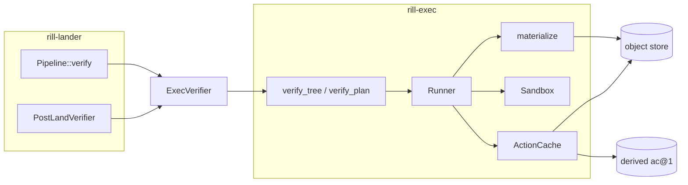
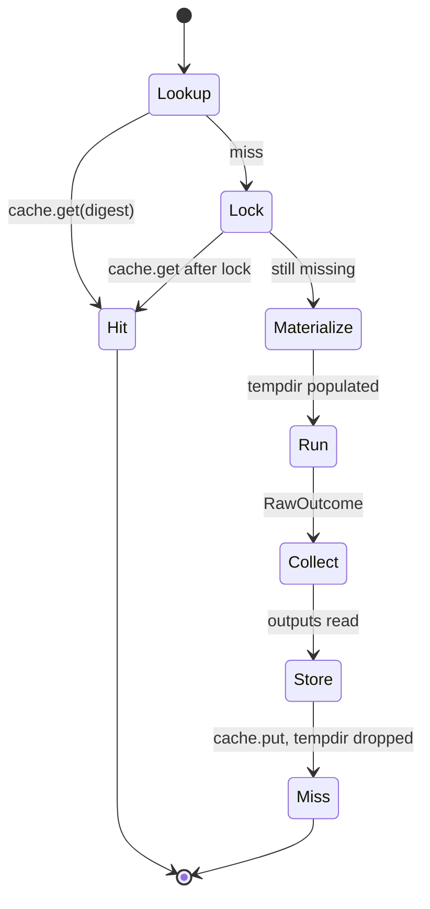

# Exec

`rill-exec` runs verification commands against materialized trees and
caches their results by action digest. An `Action` is a pure function of
its command, environment, input tree, working directory, timeout, platform
and declared outputs; its BLAKE3 digest is the cache key, so the same action
is never executed twice by any worker sharing the repository's metadata
store. The server adapts this to the lander's `Verifier` trait for pre-land
verification.

## Boundary



| Owns | Does not own |
| --- | --- |
| `Action`, `ActionResult`, digest, cache records | When verification runs and what it means for landing (`rill-lander`) |
| Materializing a tree into a directory | Trees and content reads (`rill_core::TreeOps`, `read_content`) |
| Sandbox contract and the local backend | Sandbox selection (`VerifyConfig` in the server) |
| `.rill/verify.toml` parsing and step execution | Risk classes and `VerifyMode` |

## Action model

| `Action` field | Meaning | In digest |
| --- | --- | --- |
| `command: Vec<String>` | `command[0]` is the executable | yes |
| `env: BTreeMap` | Environment beyond what the sandbox injects | yes |
| `input_root: TreeHash` | Tree materialized as the working tree | yes |
| `working_dir: RepoPathBuf` | Start directory inside the tree | yes |
| `timeout: Duration` | Wall-clock kill limit (default 600 s via `Action::new`) | yes |
| `platform: BTreeMap` | `host_platform()`: `os`, `arch` | yes |
| `output_paths: Vec<RepoPathBuf>` | Files captured after exit | yes |

`Action` implements `Encodable` (`ObjectKind::Derived`, version 1, name
`Action`); `digest()` is the hash of its canonical encoding, independent of
map insertion order. Changing the timeout changes the key.

`ActionResult` holds `exit_code` (`TIMEOUT_EXIT_CODE` = 124 on timeout, -1
when killed by a signal), `stdout` and `stderr` as `ContentRef`s in the
object store, `duration_ms`, `output_files` (path to `ContentRef` for
declared outputs that existed), `worker`, `started_at`, `timed_out`.
`succeeded()` is `exit_code == 0 && !timed_out`.

## Action cache

`ActionCache` stores results under derived kind `ac@1` keyed by digest, with
`encode_record` framing; `put` replaces any previous entry. Captured bytes go
through `rill_core::store_content`, so logs are ordinary blobs. Every
worker sharing the metadata store shares the cache.

## Runner



`Runner::execute` returns `(ActionResult, CacheStatus)`. Concurrent misses
for one digest serialize on a per-digest `tokio::sync::Mutex` in
`in_flight`; the second caller re-checks the cache under the lock and gets a
`Hit`. `run_uncached` creates a `tempfile::tempdir`, materializes
`input_root` into it with the default (full) `MaterializeOptions`, calls
`Sandbox::run`, reads declared outputs (`NotFound` is not an error; other
I/O errors are `Error::Io`), stores stdout, stderr and outputs, and writes
the cache record before dropping the directory on a blocking thread. A
failing command is cached like a passing one: the result is the exit code,
not an error.

## Materialize

`materialize(trees, root, dest, options)` walks `root` under
`options.sparse`, reads each blob on the async side and writes batches of
256 files on `spawn_blocking`. Directories are created as needed; any
existing file, symlink or directory at a target path is removed first so a
stale symlink is never followed. `Regular` and `Executable` files get mode
0644 or 0755 on Unix; `Symlink` content is the target. `local_path` refuses
any component that is not `Component::Normal` with `Error::PathEscape`, a
second guard behind `RepoPath` validation. On non-Unix hosts a symlink is
written as a file containing its target and modes are ignored.

## Sandboxes

`Sandbox::run(dir, action) -> RawOutcome` is the whole contract; the runner
owns materialization, caching and output capture. `worker_name()` is
recorded on results.

| Backend | Status | Isolation |
| --- | --- | --- |
| `LocalSandbox` | Working | `tokio::process::Command` with `env_clear()`, the action's `env`, `PATH` and `HOME` passed through from the host unless the action sets them, `stdin` null, a private tempdir as cwd, own process group on Unix. No filesystem, user, resource or network isolation; `network` is recorded, not enforced. |
| `FirecrackerSandbox` | Stub | Holds `network`, `kernel`, `rootfs`, `vcpus`, `memory_mib`; `run` always returns `Error::NotSupported { backend: "firecracker" }`. Nothing boots a VM. |

`LocalSandbox` timeout handling: `tokio::time::timeout(action.timeout,
child.wait())`; on expiry it `killpg`s the process group with `SIGKILL`,
kills the child, reports `TIMEOUT_EXIT_CODE` with `timed_out = true`, and
waits at most `DRAIN_GRACE` (2 s) for the output pipes to close before
returning whatever was captured. stdout and stderr are drained concurrently
with the wait so a chatty process cannot deadlock on a full pipe. An empty
command is `Error::InvalidAction`; a spawn failure is `Error::Spawn`.

`worker_name` is `local@$HOSTNAME` when `HOSTNAME` is set, else `local`.

## Verify plans

A tree declares its own verification in `.rill/verify.toml` (`PLAN_PATH`),
so the plan is versioned with the code. A tree without the file is green
with zero steps.

```toml
[[step]]
name = "unit"                    # optional; defaults to "step-<index>"
command = ["cargo", "test"]      # required, non-empty
timeout_secs = 900               # optional; default 600
working_dir = "crates/core"      # optional; default root
env = { RUST_BACKTRACE = "1" }   # optional
outputs = ["target/report.xml"]  # optional; captured into output_files
```

`VerificationPlan::parse(text, root)` binds every step to `root` and the
host platform, producing `PlanStep { name, action }`. Errors are
`Error::Config { path: ".rill/verify.toml", reason }` for bad TOML, an empty
command or non-UTF-8 content; invalid paths are `Error::Types`.
`verify_plan` executes steps in order through the runner and stops at the
first step whose result is not `succeeded()`; `VerificationOutcome { green,
steps }` records each `StepResult { name, result, cached }`.
`first_failure()` is the first non-succeeding step.

## Server verifier and lander modes

```mermaid
sequenceDiagram
  participant P as lander Pipeline
  participant V as ExecVerifier
  participant E as verify_tree
  participant R as Runner
  participant S as LocalSandbox
  P->>P: mode = verify_override or policy.verify_mode(risk)
  alt mode == None
    P-->>P: skip verification
  else Affected or Full
    P->>P: status Verifying; root = derive RootTree(rebased)
    P->>V: verify(root, version) under policy.max_wait
    V->>E: verify_tree(runner, root)
    E->>E: load_plan: lookup .rill/verify.toml
    loop each step
      E->>R: execute(action)
      alt cache hit
        R-->>E: (result, Hit)
      else miss
        R->>R: materialize root into tempdir
        R->>S: run(dir, action)
        S-->>R: RawOutcome
        R->>R: store outputs, cache.put
        R-->>E: (result, Miss)
      end
      E->>E: break on first failure
    end
    E-->>V: VerificationOutcome
    V-->>P: green(details) or red(details)
    P->>P: red -> fail "verification failed: ..."; timeout -> fail "verification exceeded ..."
  end
```

`ExecVerifier` (`workers/verifier.rs`) implements `rill_lander::Verifier`:
it calls `verify_tree`, maps any `rill_exec::Error` to
`rill_lander::Error::Verifier(String)`, and returns
`VerificationOutcome::green` or `::red` with a one-line detail (`step
"unit" failed with exit code 1 (2 step(s) ran)` or `N step(s) passed`).
The version hash is logged only; results are keyed by action digest, which
already includes the root tree.

`RepoContext` builds a `Runner` with `LocalSandbox::new(verify.network)`
only when `verify.enabled`; otherwise the lander gets `AlwaysGreen`. The
same `Verifier` serves the post-land worker (`PostLandVerifier` calls
`lander.verifier()`), so post-land verification of a version whose tree was
already verified pre-land is a cache hit per step.

Lander modes (`rill_lander::VerifyMode`, chosen per `RiskClass` by
`LandPolicy::modes`, overridable per request): `None` skips pre-land
verification entirely; `Affected` and `Full` both call the same verifier
with the same arguments. The `Affected` hint is not passed to `rill-exec`.
Defaults: trivial `None`, low and normal `Affected`, sensitive and critical
`Full`. `LandPolicy::max_wait` (30 min) bounds the whole plan; expiry fails
the land request without cancelling the running step.

## Configuration

| Key | Default | Effect |
| --- | --- | --- |
| `[verify] enabled` / `RILL_VERIFY_ENABLED` | `false` | Build a `Runner` and `ExecVerifier`; otherwise every landing verifies green |
| `[verify] sandbox` | `local` | Only `SandboxKind::Local` exists; the server never constructs `FirecrackerSandbox` |
| `[verify] network` | `false` | Stored on `LocalSandbox::network`; advisory |
| `[lander] modes.*` | see above | `VerifyMode` per risk class |
| `[lander] max_wait` | 30 min | Timeout around `Verifier::verify` |
| `DEFAULT_STEP_TIMEOUT` | 600 s | Per-step default when `timeout_secs` is absent |

## Limitations

* The local sandbox provides no isolation beyond a cleared environment and
  a private working directory: commands run as the server's user with the
  server's network and filesystem access. It is for trusted single-tenant
  deployments.
* `FirecrackerSandbox` is a configuration struct and an error; no VM backend
  is implemented, and `SandboxKind` has no variant to select it.
* The cache key includes `platform` only as `os` and `arch`; toolchain
  versions are not part of it, so a toolchain upgrade does not invalidate
  cached results.
* Materialization is always full (`MaterializeOptions::default()`); the
  runner does not use sparse profiles or reuse a checkout across steps, so
  each step re-materializes the whole tree.
* Results are cached regardless of exit code; a flaky failure stays cached
  until the action digest changes, and `ActionCache::put` is the only
  eviction.
* `VerifyMode::Affected` is not distinguishable from `Full` at execution.
* A `max_wait` expiry in the lander abandons the verifier future; the
  sandboxed process keeps running until its own `timeout`, held only by
  `kill_on_drop` once the future is dropped.
* `output_paths` are read from the host-side directory; a `Symlink` output
  is read through, and a directory output is an `Error::Io`.

## Code

* [lib.rs](../../crates/rill-exec/src/lib.rs), [error.rs](../../crates/rill-exec/src/error.rs)
* [action.rs](../../crates/rill-exec/src/action.rs), [cache.rs](../../crates/rill-exec/src/cache.rs)
* [materialize.rs](../../crates/rill-exec/src/materialize.rs), [runner.rs](../../crates/rill-exec/src/runner.rs)
* [sandbox/mod.rs](../../crates/rill-exec/src/sandbox/mod.rs), [sandbox/local.rs](../../crates/rill-exec/src/sandbox/local.rs), [sandbox/firecracker.rs](../../crates/rill-exec/src/sandbox/firecracker.rs)
* [verify.rs](../../crates/rill-exec/src/verify.rs)
* Server: [workers/verifier.rs](../../crates/rill-server/src/workers/verifier.rs), [state/registry.rs](../../crates/rill-server/src/state/registry.rs), [config.rs](../../crates/rill-server/src/config.rs)
* Lander: [config.rs](../../crates/rill-lander/src/config.rs), [land/pipeline.rs](../../crates/rill-lander/src/land/pipeline.rs), [traits.rs](../../crates/rill-lander/src/traits.rs)

## See

* [landing](../workflow/landing.md) for the pipeline that calls the verifier
* [search](search.md), [git-import](git-import.md)
* [storage](../data/storage.md) for the derived keyspace
