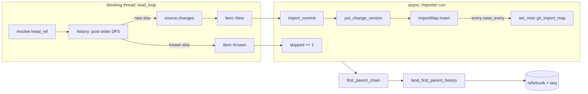
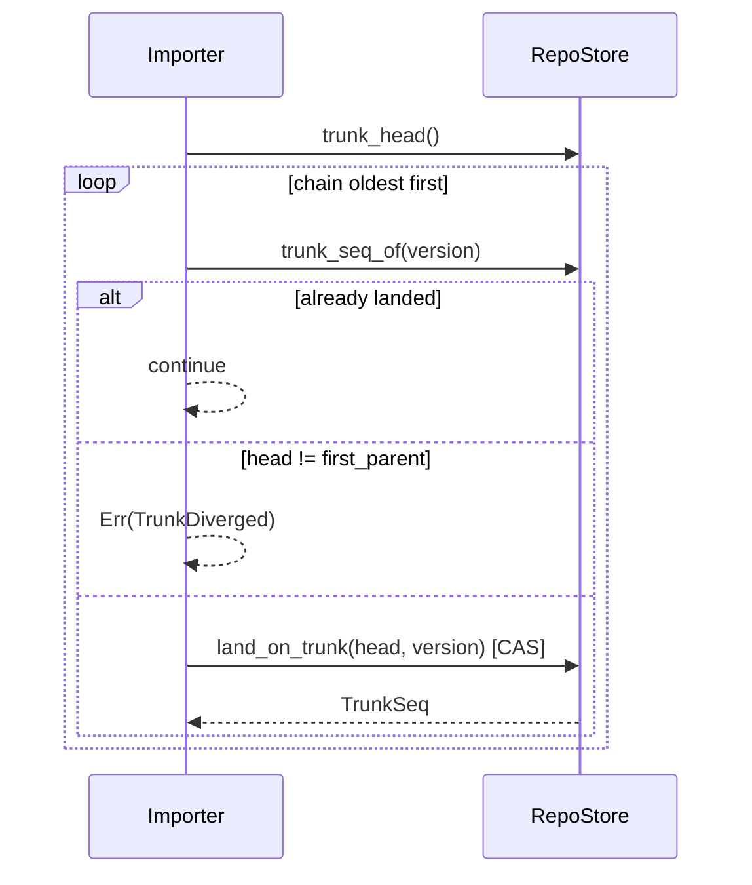

# Git import

`rill-git-import` converts a git history into change versions, one per
commit, and lands the head's first-parent ancestry on trunk in order. It is
one-way and incremental: the sha-to-version map is persisted in the
repository, so a second import converts only commits the map does not know.
There is no reverse direction and no other git compatibility.

## Flow

The reader and writer are joined by an `mpsc` channel of `read_ahead`
items. `GitSource` implementations are synchronous and `Send + 'static`;
the importer drives them from `spawn_blocking`. A reader error is sent down
the channel and surfaces as the import result; a writer that drops the
receiver silently stops the reader.

## Reader

| Type | Role |
| --- | --- |
| `GitSource` | `resolve(ref_or_hex) -> GitSha`, `commit(sha) -> GitCommit`, `changes(sha) -> CommitChanges` |
| `GixSource` | On-disk repository through `gix::ThreadSafeRepository` (worktree or bare); reads only the object database and refs, no network |
| `MemorySource` | Hand-built history for tests: `add_commit`, `add_full`, `set_ref` |
| `GitSha` | Lowercase hex (SHA-1 or SHA-256); `to_bytes` decodes hex |
| `GitCommit` | `sha`, `parents` in git order, `author_name`, `author_email`, `committed_at` (committer time), `message` |
| `GitChange` | `Set { path, content, kind }` or `Delete { path }`; renames are a delete plus a set |

`GixSource::resolve` tries `find_reference` and peels it, then falls back
to a full hex object id that must name a commit; anything else is
`Error::UnknownRef`. `changes` diffs the commit's tree against its first
parent's tree (or the empty tree) with `gix::diff::tree` and a path-tracking
`Recorder`; tree-level records are dropped, blob records become `Set` with
`FileKind` from the entry mode (`is_link` → `Symlink`, `is_executable` →
`Executable`, else `Regular`). Submodule entries (`is_commit`) are skipped
with a warning in `CommitChanges::warnings`.

`history(source, head)` is an iterative post-order DFS: every commit
reachable from `head`, parents before children, with a merge's first-parent
ancestry emitted before any other parent. It is non-recursive so histories
of hundreds of thousands of commits do not overflow the stack; it holds the
`GitCommit` metadata of the entire reachable graph in memory until emitted.

## Mapping commits to changes

`Importer::import_commit` builds one `ChangeVersion` per commit with
`rill_core::ChangeBuilder`:

| Git | Change version |
| --- | --- |
| sha | `change_id = ChangeId::derived("git", sha_hex)`; `extra["git_sha"]` = raw sha bytes |
| parents (all, git order) | `parents` as the mapped version hashes; `parents[0]` is the first parent |
| author name, email | `Principal::human(name or email)` with `identity = Some(email)` |
| committer timestamp | `created_at` |
| message | `message` |
| diff vs first parent | `file_changes` via `file_kind(path, content, kind)` / `delete(path)` |
| (none) | `provenance.tool = "rill-git-import"`; other provenance fields default |

A merge commit therefore becomes a version with several parents and file
changes relative to the first parent, matching the data model's rule that
`file_changes` are relative to `parents[0]`. Blob content goes to the object
store through the builder; the version is written with
`put_change_version`, and its hash is content-derived, so re-writing the
same commit is idempotent. A parent that is not in the map is
`Error::MissingParent`; a path `RepoPathBuf` rejects is
`Error::InvalidPath(path, cause)`.

## First parent to trunk

After every commit is converted, `first_parent_chain` walks `parents[0]`
from the head back to a root commit and reverses it into `(version,
first_parent_version)` pairs, oldest first. `land_first_parent_history`
then, for each pair, skips versions that already have a `trunk_seq_of`, and
otherwise requires the current trunk head to equal the pair's first parent
before calling `RepoStore::land_on_trunk(expected, version)`. The CAS
transaction sets `refs/trunk`, the gap-free `trunk/<seq>` row and the
`trunk_by_hash` row atomically.

Any other trunk head is `Error::TrunkDiverged { trunk, next }`: trunk
already holds a history the git mainline is not a continuation of, and
landing on top would make sequence numbers lie. The conversion is kept and
the map saved; only landing is refused.

Landing writes trunk rows only. It does not write a `Landing` record
(`land@1`), does not emit a `LandEvent`, and does not run verification;
imported versions are absent from `ListLandings` and the search indexer
learns about them only through on-demand indexing.

## Options and report

| `ImportOptions` | Default | Effect |
| --- | --- | --- |
| `land_first_parent_history` | `true` | Land the mainline after conversion |
| `save_every` | 256 | Commits between `ImportMap::save` calls |
| `read_ahead` | 8 | Channel capacity between reader and writer |

`ImportReport`: `imported`, `skipped` (already in the map), `head` (version
of the requested ref), `trunk_head` and `seq` (when landing ran), `landed`
(this run), `warnings`.

## Persistence and idempotency

| Record | Key | Value |
| --- | --- | --- |
| Import map | misc row `git_import_map` | `ImportMap { entries: BTreeMap<GitSha, ChangeVersionHash> }`, `encode_record` framed |
| Change versions | `cv/<hash>` via `put_change_version` | One per commit |
| Trunk | `refs/trunk`, `trunk/<seq>`, `trunk_by_hash/<hash>` | Via `land_on_trunk` |

The map is one record rewritten whole: O(imported commits) per save, hence
batching. `Importer::import` saves the map after `run` returns, on success
or failure, so a retry resumes; an interrupted import redoes at most
`save_every` commits, and redoing is harmless because version hashes are
content-derived. Re-importing an unchanged ref reports every commit as
`skipped`, lands nothing, and still reports the current `seq`. Importing a
longer history later converts only new commits and extends trunk from the
old head, provided the old head is on the new mainline.

## CLI

`rill import git <path> --repo <name> [--ref HEAD] --storage-dir <dir>
[--no-land]` opens `LocalStores` at `--storage-dir` (or `RILL_STORAGE_DIR`,
the same layout as `rill-server --storage local:<dir>`), creates the Rill
repository by name if missing, opens a `GixSource`, and runs the importer.
It is refused with a usage error when `--endpoint` is set: import writes
objects and the sha map directly, which the client API does not expose.
Run it while the server is stopped or before starting the server on that
directory. Output is a line per outcome, or JSON with `repo`, `repo_id`,
`imported`, `skipped`, `landed`, `head`, `trunk_head`, `seq`, `warnings`.

## Not imported

| Git concept | Handling |
| --- | --- |
| Branches other than `--ref` | Only commits reachable from the one ref; no Rill refs are created for git branches |
| Tags | Usable as `--ref` targets (peeled); not recorded |
| Notes, reflogs, stashes | Ignored |
| Submodules (gitlinks) | Skipped per entry with a warning |
| Committer identity, GPG signatures, author date | Dropped; `created_at` is committer time, author is the git author |
| Renames | Delete plus set; no rename metadata |
| Octopus/merge metadata beyond parents | Only the parent list survives |
| File modes other than regular/executable/symlink | Mapped to `Regular` |

## Limitations

* `history` loads every reachable commit's metadata before emitting the
  first one; memory is O(reachable commits).
* Blob content for each new commit is copied into memory by `changes`
  before it reaches the writer; very large files are held whole.
* The importer bypasses the lander: no review, policy, verification or
  landing record applies to imported versions, and a server running on the
  same storage during import does not observe the trunk moves.
* An import whose `--ref` mainline is not a continuation of trunk converts
  everything and then fails with `TrunkDiverged`; `--no-land` is the only
  way to keep those versions off trunk intentionally.
* Only local repositories are readable; there is no clone or fetch.

## Code

* [lib.rs](../../crates/rill-git-import/src/lib.rs), [error.rs](../../crates/rill-git-import/src/error.rs)
* [reader/source.rs](../../crates/rill-git-import/src/reader/source.rs), [reader/gix_source.rs](../../crates/rill-git-import/src/reader/gix_source.rs), [reader/history.rs](../../crates/rill-git-import/src/reader/history.rs), [reader/memory.rs](../../crates/rill-git-import/src/reader/memory.rs)
* [import/importer.rs](../../crates/rill-git-import/src/import/importer.rs), [import/land.rs](../../crates/rill-git-import/src/import/land.rs), [import/map.rs](../../crates/rill-git-import/src/import/map.rs), [import/options.rs](../../crates/rill-git-import/src/import/options.rs)
* CLI: [commands/import.rs](../../crates/rill-cli/src/commands/import.rs)
* Store: [repo.rs](../../crates/rill-store/src/repo.rs) (`land_on_trunk`, `get_misc`)

## See

* [landing](../workflow/landing.md) for how native landings differ
* [storage](../data/storage.md) for trunk and misc keys
* [search](search.md) for on-demand indexing of imported roots
* [ARCHITECTURE.md](../system.md)
