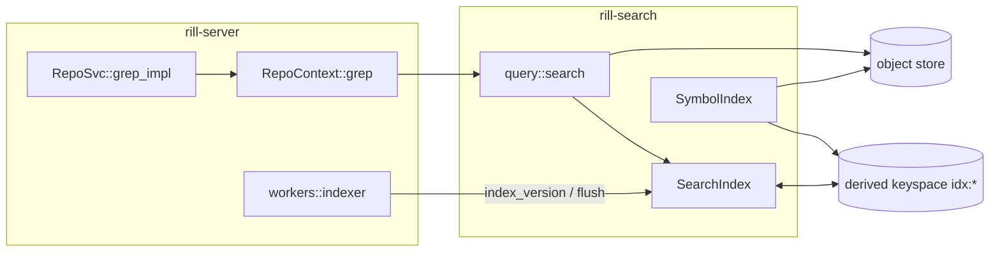
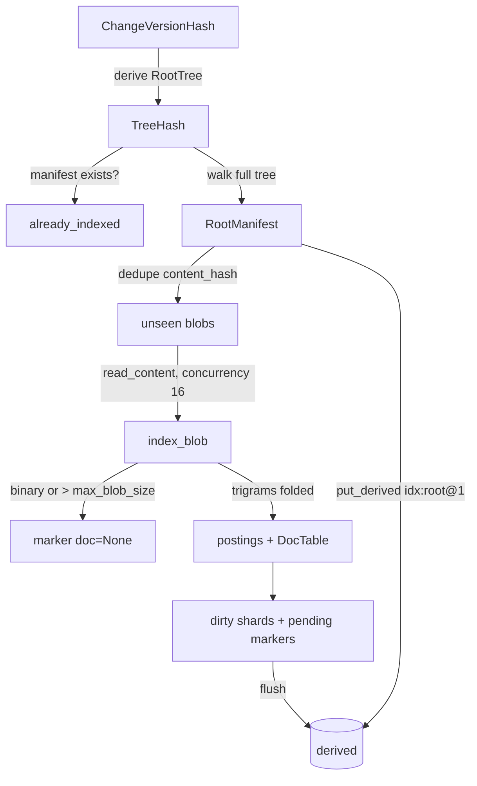

# Search

`rill-search` is a trigram text index over blob content plus a per-root
manifest of paths, with regex-based symbol extraction on top. The index is
keyed by blob hash, not by path or version: a blob is tokenized once no
matter how many roots contain it, and indexing a root whose manifest exists
is a no-op. The server serves `Grep` from it and keeps it current from
`LandEvent::Landed`.

## Boundary



| Owns | Does not own |
| --- | --- |
| Trigram postings per blob, document ids, root manifests | Tree walking (`rill_core::TreeOps`), root-tree derivation (`DeriveManager`) |
| Regex-to-trigram planning, candidate pruning, line mapping | Path permissions: the caller passes a `PathFilter` |
| Symbol tables per root | gRPC request shape, result caps, auth |

## Index build



`SearchIndex::index_root` walks the tree with a full `SparseProfile`, builds
the `RootManifest` (entries sorted by path, each with its `ContentRef` and
`FileKind`), and tokenizes only content hashes that `known()` has not seen in
memory or as a persisted `BlobMarker`. `index_version` derives the
`RootTree` of a version first. `index_blob` is the only tokenizer entry
point; it skips blobs over `max_blob_size` or that `rill_core::is_binary`
flags, assigns the next dense `DocId` from the `DocTable`, and inserts the
id into every trigram's `PostingList`.

Trigram facts:

* `trigrams()` packs three consecutive bytes into a `u32`; inputs under three
  bytes have none (they still get a document id).
* Postings are always ASCII-case-folded (`fold_byte`). One folded index
  serves case-sensitive and case-insensitive queries; a case-sensitive query
  folds its literals too, so pruning is a superset the regex then filters.
* `PostingList` is a sorted, duplicate-free `Vec<DocId>`; `encode` writes
  varint deltas, `decode` rejects overflow and truncated varints with
  `Error::Codec`.

## Query planning

`required_trigrams_for_regex` parses the pattern with `regex_syntax` into
HIR and folds it into a `TrigramQuery`: literal runs become `And` of their
trigrams, `Alternation` becomes `Or`, captures and zero-width `Look`
assertions are transparent, and anything unconstrained (classes wider than
one byte, `min == 0` repetitions) becomes `All`. The result is sound (a
matching document always satisfies it) and not complete; the regex always
runs over candidates. `TrigramQuery::or` collapses to `All` when any branch
is `All`; `and` drops `All` terms and dedups. `evaluate` intersects and
unions sorted posting lists into `Candidates::Docs` or `Candidates::All`.

Known imprecision: under case-insensitivity only ASCII fold members are
considered, so a document matching solely through a non-ASCII fold variant
(the Kelvin sign for `k`) can be pruned.

## Query execution

```mermaid
sequenceDiagram
  participant H as grep_impl
  participant C as RepoContext::grep
  participant S as query::search
  participant I as SearchIndex
  participant O as object store
  H->>H: read_filter(), resolve_root, build SearchQuery (max+1)
  H->>C: grep(root, query, PathFilter)
  C->>I: manifest(root)
  alt RootNotIndexed
    C->>I: index_root(root)
  end
  C->>S: search(index, root, query, allow)
  S->>S: compile regex, trigram_query().evaluate(postings_of)
  S->>I: manifest entries filtered by glob, allow, doc_of ∈ candidates
  loop buffered(16), path order
    S->>O: read_content(entry.content)
    S->>S: scan_blob on spawn_blocking
  end
  S-->>C: Vec<SearchHit> cut at max_results
  C-->>H: hits
  H-->>H: truncated = hits.len() > max; truncate
```

`SearchQuery` fields: `pattern` (Rust `regex` syntax, matched on bytes,
multi-line), `case_insensitive`, `path_glob` (`globset`, gitignore-style),
`max_results` (`DEFAULT_MAX_RESULTS` = 100), `context_lines`. `compile`
errors map to `Error::InvalidPattern`, bad globs to `Error::InvalidGlob`.

A `SearchHit` is one line of one file: `path`, 1-based `line_no`, the
lossily decoded `line`, `before`/`after` context, and `byte_range` of the
first match on that line within the whole file. `scan_blob` emits at most
one hit per line and stops at `limit`; `LineIndex` maps offsets to lines in
logarithmic time, strips `\n` and `\r`, and drops the phantom line a trailing
newline would create. Hits come back in manifest (path) order, then line
order.

Blobs whose `doc_of` is `None` (skipped at index time) are never searched,
even under `Candidates::All`. The search never reads a blob whose path the
`PathFilter` or glob rejects.

## Server surface

`RepoSvc::grep_impl` (`services/repo/grep.rs`) validates a non-empty
pattern, takes the caller's `Permit::read_filter()` (`PathFilter::allow_all`
in dev mode or bootstrap, otherwise `Authorizer::allowed_paths_for(...,
Relation::Reader)`; a failed relation load denies all), resolves the root
(trunk head by default), and asks for `max + 1` hits so `truncated` is
exact. `RepoContext::grep` indexes the root on demand when
`SearchIndex::manifest` fails, so a search against a ref or tree the indexer
has not reached still works at the cost of a full walk.

| Request field | Limit |
| --- | --- |
| `max_results` | 0 means 200 (`DEFAULT_RESULTS`); capped at 5 000 (`MAX_RESULTS`) |
| `context_lines` | capped at 20 (`MAX_CONTEXT`) |
| `path_globs` | empty means no filter; invalid glob is `InvalidArgument` |

gRPC status mapping (`rill-server/src/error.rs`): `InvalidPattern` and
`InvalidGlob` are `InvalidArgument`, `RootNotIndexed` is `Unavailable`,
`Codec` and `Join` are `Internal`.

## Indexer worker

`workers::indexer::run` subscribes to the lander's broadcast channel,
indexes the current trunk head at startup, then calls `index_version` and
`flush` for every `LandEvent::Landed`. A `RecvError::Lagged` re-indexes the
head (content addressing makes that cheap); `Closed` or the shutdown token
ends the loop, which flushes once more. Indexing failures are logged, not
retried. The worker reacts only to lander events: versions imported by
[git-import](git-import.md) or other roots are indexed on demand by
`RepoContext::grep`.

## Persistence

All records use `rill_store::repo::encode_record` framing under the
repository's derived keyspace.

| Kind | Key | Value |
| --- | --- | --- |
| `idx:blob@1` | content hash | `BlobMarker { doc: Option<DocId> }`; `None` means skipped |
| `idx:root@1` | root `TreeHash` | `RootManifest` |
| `idx:docs@1` | `ObjectHash::ZERO` | `DocTableRecord { hashes }`; id = position |
| `idx:post@1` | `shard_key(trigram >> 16)` (256 shards) | `ShardRecord { lists: (trigram, encoded postings) }` |
| `idx:sym@1` | root `TreeHash` | `SymbolsRecord { by_path }` |

`flush` writes dirty shards whole, then the document table (when any shard
is dirty or any marker carries a doc id), then pending markers, in that
order: a crash between them never leaves a blob marked indexed without
postings. `known()` additionally treats a marker whose doc id does not map
back to the same hash in the loaded table as unknown, so the blob is
re-indexed. `load` replaces all in-memory state with persisted state and
discards unflushed work; `open` is `new` + `load`.

## Symbols

`SymbolIndex::for_root` returns a `RootSymbols` table, loading `idx:sym@1`
or building it by walking the root and running `extract_for` over files
with a known language and `ContentRef::size()` up to 1 MiB. Extraction is
cached per `(content hash, Language)` in memory. Lookups: `find_definition`
(exact name, path order) and `list_symbols` (one path, line order).

Extraction is line-anchored regex, not parsing: for each line with an ASCII
letter, the first matching `Pattern` yields one `Symbol { name, kind, line }`.

| Language (`Language::from_path`) | Extensions | Detected |
| --- | --- | --- |
| Rust | `rs` | `fn struct enum trait mod const static type union` with visibility and `async/const/unsafe/default/extern` prefixes; `impl ... for Type` as `Impl` naming the type |
| Python | `py pyi` | `def`, `async def`, `class` |
| TypeScript / JavaScript | `ts tsx mts cts` / `js jsx mjs cjs` | `function[*] class interface type enum namespace module` with `export/default/declare/abstract/async`; `const/let/var name = (async) function` or arrow functions as `Function` |
| Go | `go` | `func` (methods included, receiver skipped), `type` |

`SymbolKind` covers `Function Class Struct Enum Trait Impl Interface Module
Const Static Type Other`. Binary content and unknown extensions yield
nothing. Nothing in `rill-server` constructs a `SymbolIndex`: symbol lookup
is library-only and has no RPC.

## Configuration

| Field | Default | Effect |
| --- | --- | --- |
| `IndexConfig::max_blob_size` | 1 MiB | Larger blobs are marked skipped and never searched |
| `IndexConfig::concurrency` | 16 | Concurrent blob reads in `index_root` |
| `DEFAULT_MAX_RESULTS` | 100 | Library default for `SearchQuery` |
| `MAX_SYMBOL_FILE` | 1 MiB | Largest file the symbol extractor reads |

The server always uses `IndexConfig::default()` (`state/registry.rs`); no
server config key or `RILL_*` variable tunes the index.

## Limitations

* Pruning is by trigram only; a pattern with no mandatory three-byte
  literal scans every indexed blob of the root.
* Shards are rewritten whole on every flush: O(shard) writes, and the whole
  index lives in memory.
* `Candidates::All` is evaluated per manifest entry with a `doc_of` lookup,
  so unpruned searches over large roots pay a read-lock per file.
* Blob markers are written only at flush; a crash before flush re-tokenizes
  blobs the next time their root is indexed.
* The indexer is not wired to the ref-move events of other refs or to
  imports; those roots are indexed lazily on first `Grep`.
* `RepoContext::grep` carries a stale comment claiming `rill.v1` has no
  `Grep` RPC; `repo.proto` defines one and `RepoSvc::grep` serves it.
* Symbol extraction is regex per line: multi-line signatures, nested
  definitions and macros are missed or misattributed.

## Code

* [lib.rs](../../crates/rill-search/src/lib.rs), [error.rs](../../crates/rill-search/src/error.rs)
* [trigram/extract.rs](../../crates/rill-search/src/trigram/extract.rs), [trigram/literals.rs](../../crates/rill-search/src/trigram/literals.rs), [trigram/query.rs](../../crates/rill-search/src/trigram/query.rs), [trigram/postings.rs](../../crates/rill-search/src/trigram/postings.rs)
* [index/search_index.rs](../../crates/rill-search/src/index/search_index.rs), [index/persist.rs](../../crates/rill-search/src/index/persist.rs), [index/docs.rs](../../crates/rill-search/src/index/docs.rs), [index/manifest.rs](../../crates/rill-search/src/index/manifest.rs), [index/config.rs](../../crates/rill-search/src/index/config.rs)
* [query/search.rs](../../crates/rill-search/src/query/search.rs), [query/request.rs](../../crates/rill-search/src/query/request.rs), [query/lines.rs](../../crates/rill-search/src/query/lines.rs), [query/hit.rs](../../crates/rill-search/src/query/hit.rs)
* [symbols/extract.rs](../../crates/rill-search/src/symbols/extract.rs), [symbols/lang.rs](../../crates/rill-search/src/symbols/lang.rs), [symbols/index.rs](../../crates/rill-search/src/symbols/index.rs)
* Server: [workers/indexer.rs](../../crates/rill-server/src/workers/indexer.rs), [services/repo/grep.rs](../../crates/rill-server/src/services/repo/grep.rs), [state/registry.rs](../../crates/rill-server/src/state/registry.rs)
* Proto: [repo.proto](../../crates/rill-proto/proto/rill/v1/repo.proto) (`GrepRequest`, `GrepHit`)

## See

* [exec](exec.md), [git-import](git-import.md)
* [landing](../workflow/landing.md) for `LandEvent::Landed`
* [storage](../data/storage.md) for the derived keyspace
* [ARCHITECTURE.md](../system.md)
