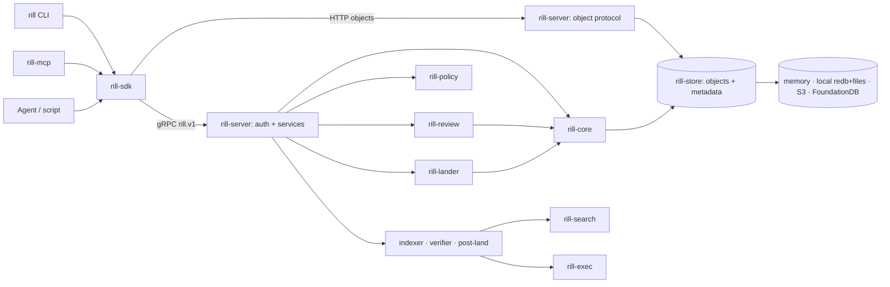
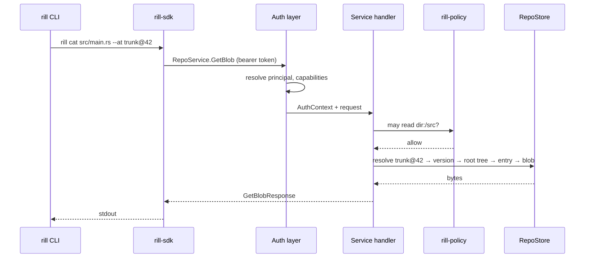

# System model

Rill is a server-authoritative source control platform for codebases written
by humans and AI agents together. One server process owns a repository; clients
hold bounded caches and never a full copy. Every operation a client can do is an
RPC that needs no checkout. The server is not git-compatible: a one-way importer
exists for migrating a history, nothing else.

Three records carry the whole workflow. A **workspace** is a principal's private
in-progress state on the server. A **change** is a unit of work with a stable
`ChangeId` and one or more content-addressed versions. **Trunk** is the single
landed line, a ref plus a gap-free sequence number per landed version, moved only
by the lander after review policy passes.

## Boundaries

| Crate | Owns | Does not own |
| --- | --- | --- |
| `rill-types` | Object model, ids, hashing, canonical encoding, `Merge<T>` | I/O, policy decisions |
| `rill-store` | `ObjectStore`/`MetaStore` traits, keyspace, four backends, typed `RepoStore` | Diff, merge, authorization |
| `rill-core` | Diff, three-way merge, trees, rebase, ancestry graph, derived data, blob chunking | Storage layout, RPC |
| `rill-policy` | Risk classification, Cedar submit rules, ReBAC, Biscuit capability tokens, signing | Enforcement points (the server owns those) |
| `rill-review` | Labels, votes, threads, interdiff, stacks, submit evaluation, review agents | Landing |
| `rill-lander` | Queue, rebase-onto-trunk, CAS land, sequence numbers, post-land verification, bisect, revert | Review state (adapted through `ReviewHooks`) |
| `rill-search` | Trigram index, symbol extraction, query execution | Permission filtering (applied by the server) |
| `rill-exec` | Action cache, sandbox materialization, verify plans | Scheduling policy |
| `rill-proto` | `rill.v1` protobufs, tonic services, domain↔wire conversion | Handlers |
| `rill-server` | Authentication, `RepoContext`, gRPC handlers, object HTTP protocol, event bus, workers, config | Client-side state |
| `rill-sdk` | Typed client, blob upload, local checkout (`.rill/`), status, sync | User interface |
| `rill-cli` | `rill` and `rill-server` binaries, output formats, exit codes | Business rules |
| `rill-mcp` | stdio JSON-RPC tool surface over the SDK for agents | Anything the SDK cannot do |
| `rill-git-import` | One-way git history import | Export, mirroring |

Layering is strict: `types ← store ← core ← {policy, review, lander, search,
exec} ← server ← sdk ← {cli, mcp}`. No crate below `rill-proto` depends on
tonic; only `rill-server` depends on axum.

## Principles

1. The server is the repository. Clients hold bounded caches.
2. Immutable, content-addressed data everywhere (BLAKE3). Mutable state is a
   small set of refs plus append-only logs.
3. Cost scales with the change, not the repository. Every metadata write is
   O(size of change); the root tree of a version is derived, not stored in it.
4. Stable identity (`ChangeId`), mutable content (`ChangeVersion` hash).
5. Conflicts are data (`Merge<T>` terms inside a `FileChange`), never errors.
   A rebase never fails; it may produce a conflicted version.
6. Intent and provenance are first-class and signed into every change.
7. Landing is optimistic; verification is continuous: post-land batches,
   bisect, auto-revert.
8. Agents are principals with their own identity, narrow-only capability
   tokens and signed provenance.
9. Build, test and search share the object store.
10. Nothing is possible in a UI that is not possible through the API.

## Authority

A request carries a principal (`human`, `agent` or `service`) resolved by the
server's authenticator from a static token, a Biscuit capability token, or the
fixed `dev` principal in dev mode. Authorization has three layers, all of
which must allow:

- **Capabilities** on the token: repo, verbs, path prefixes, expiry. A token can
  be attenuated offline to something narrower, never wider.
- **Relationships** (ReBAC): `owner ⊃ writer ⊃ reader` on `repo` and `dir:/path`
  objects, inherited down the tree. A principal that cannot read a directory
  never sees its names in listings, diffs, blame or search.
- **Submit policy** (Cedar): evaluated at `EvaluateSubmit` and before landing,
  over facts about the change (risk class, votes by label and principal kind,
  unresolved threads, intent). The policy text is per repo and hot-swapped by
  `SetPolicy`.

See [identity and authentication](policy/identity-and-authentication.md),
[permissions](policy/permissions.md) and [submit policy](policy/submit-policy.md).

## Durable work

Objects (blobs, trees, change versions) are written to the object store first
and verified against their hash on every put; metadata (refs, sequence, review
and workspace records) is written after and references objects by hash. Trunk
moves by compare-and-swap on the trunk ref; the landing record and sequence
number are written by the lander under a process-local lock, which is why one
lander per repository is the v1 deployment assumption.

The event bus is in-process. Workers (search indexer, verifier, post-land
verification) subscribe to `Landed` and related events and are idempotent over
replays, but a missed event is recovered only by on-demand work (a query that
finds no index builds one), not by a durable outbox. See
[server](runtime/server.md) and [landing](workflow/landing.md).

## Request lifecycle

Every handler builds a `RepoContext` (store handles, policy snapshot, derived
data manager, event sender) per request; nothing request-scoped outlives it.

## API surface

Six gRPC services under `rill.v1`, one HTTP object protocol:

| Service | Covers |
| --- | --- |
| `RepoService` | Repos, trees, blobs, change versions, log/history/blame/grep, diff, merge-base, create version, apply edits, rebase/merge/resolve, refs, trunk, watch streams, derived data |
| `WorkspaceService` | Create/get/list, sparse profile, snapshot, new change, update base, handoff, undo, operations, diff |
| `ReviewService` | Get/list, submit, vote, comment/reply/resolve threads, stacks, evaluate, abandon, request land, land status, watch |
| `LanderService` | Trunk status, landings, verification records, report verification, revert, bisect |
| `IntentService` | Create/get/update/list, link change, find similar |
| `AdminService` | WhoAmI, issue token, relations, policy get/set, health |
| HTTP `/objects` | Batch has/get/put of content-addressed objects with hash verification |

See [protocol](runtime/protocol.md).

## Source map

- [Server composition](../crates/rill-server/src/lib.rs)
- [Services](../crates/rill-server/src/services)
- [Object model](../crates/rill-types/src/objects)
- [Store traits and keyspace](../crates/rill-store/src)
- [Core algorithms](../crates/rill-core/src)
- [Protocol](../crates/rill-proto/proto/rill/v1)
