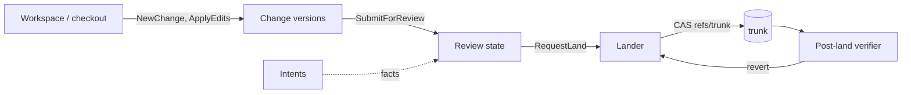

# Workflow

The workflow layer is everything between an editor and trunk: a workspace
holds in-progress state, a change carries it through review, the lander
puts it on trunk, and the post-land worker verifies what landed. One
invariant runs through every page: the server is the authority, every
client-visible step is an RPC that mutates a small record (workspace,
`ReviewState`, trunk ref) and publishes an event, and nothing below
`rill-server` knows about any other crate's state machine except through
a trait.

| Page | Owns |
| --- | --- |
| [workspaces](workspaces.md) | Server-side workspace record and op log; the client checkout in `.rill/`; sync and undo. |
| [changes](changes.md) | `ChangeId` vs `ChangeVersion`, new/amend/describe/rebase, predecessors, stacks. |
| [review](review.md) | Labels, votes, threads, interdiff vote carry-over, status machine, submit evaluation, review agents. |
| [landing](landing.md) | Queue, conflict graph, rebase onto trunk, CAS on `refs/trunk`, sequence numbers, land records. |
| [post-land](post-land.md) | Post-land verification sweeps, bisection, auto-revert, `ReviewHooks`. |
| [intents](intents.md) | Intent records, linking, similarity, their role in policy facts. |

Related: [merge and rebase](../core/merge-and-rebase.md), the
[object model](../data/objects.md), and [policy](../policy/README.md).
