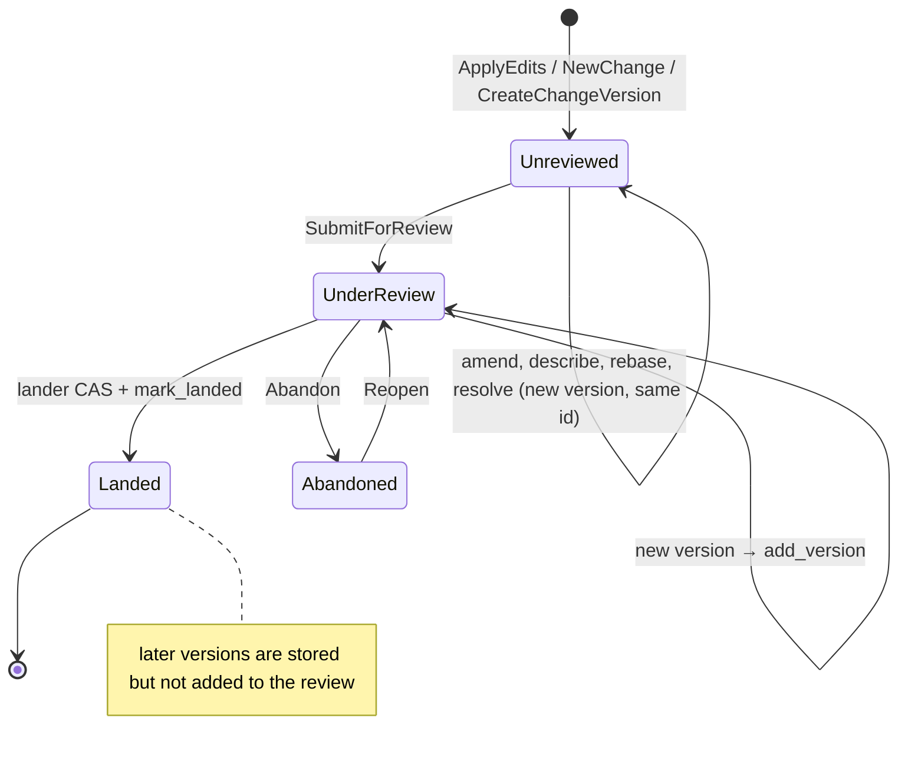

# Changes

A change is a stable identity (`ChangeId`, random 128-bit) that a sequence
of immutable `ChangeVersion` objects belongs to. Every edit, amend, rebase
or resolution writes a new version; nothing is ever rewritten. The
invariant: the version hash names content and parents exactly once, the
`change_id` survives every rewrite, and `predecessor` links each version to
the one it replaced so a change's evolution is a walkable chain.

```mermaid
flowchart LR
    subgraph change["change_id = ch_…"]
        V1["v1<br/>parents=[trunk@7]"] -->|predecessor| V2["v2 (amend)<br/>parents=[trunk@7]"]
        V2 -->|predecessor| V3["v3 (rebase)<br/>parents=[trunk@9]"]
    end
    T7[trunk@7] --- V1
    T9[trunk@9] --- V3
    V3 -->|land| T10[trunk@10]
```

## Identity

| Identity | Changes when | Survives |
| --- | --- | --- |
| `change_id` | Never; assigned by `ChangeBuilder`/`NewChange`/`ChangeId::new()` for a new change. | amend, describe, rebase, resolve, landing, revert (a revert is a new change). |
| Version hash | Any field of the `ChangeVersion` differs: parents, file changes, message, author, provenance, intent, `created_at`. | Nothing; a version is one hash. |
| `predecessor` | Set on every amend/rebase/resolve to the version replaced. | Chains back to the first version. |
| Review state | Keyed by `change_id`; `versions` grows. | Every new version; see [review](review.md) for which votes carry over. |
| Trunk position | Assigned once to the landed hash (`trunk_by_hash`). | A rebased landing records the requested hash separately in the `Landing` record. |

`RepoStore::put_change_version` is idempotent on the hash: it stores the
object, a `ChangeInfo` row, an entry in the repo log and an entry in
`change_versions/<change_id>` (creation order). `change_versions(id).last()`
is the current version everywhere the server needs one: `edit_base`,
`NewChange`'s predecessor, `ReviewService::submit`.

## Producing versions

| Operation | Entry point | Parents | Predecessor | `change_id` |
| --- | --- | --- | --- | --- |
| New change from a checkout | `rill new` → `ApplyEdits(EditBase::Root, change_id=None)` | `[resolved root]` | `None` | fresh |
| Amend / describe | `rill amend`, `rill describe` → `ApplyEdits(EditBase::Root, change_id=working)` | `[resolved root]` | current version of `working` | kept |
| Amend by change | `ApplyEdits(EditBase::ChangeId(id))` | current version's parents | current version | `id` (or explicit `change_id` to amend onto that id) |
| Workspace `NewChange` | `WorkspaceSvc::new_change` | `[ws.base]` or none when base is `ZERO` | last version of `ws.working_change` | `ws.working_change` |
| Rebase | `RepoSvc.Rebase`, `UpdateBase`, the lander, `rill stack sync` | `[new_parent] + old parents[1..]` | the rebased version | kept |
| Merge | `RepoSvc.Merge` → `merge_changes` | `[left, right]` | `None` | fresh |
| Resolve | `RepoSvc.Resolve` | unchanged | the conflicted version | kept |
| Revert | `rill_lander::build_revert` | `[landed version]` | `None` | fresh |
| Raw | `CreateChangeVersion` | as given | as given | as given |

`ApplyEdits` edits are `SetContent` (a `ContentRef` that must already exist
in the object store, else `FailedPrecondition`), `Delete`, or `Patch` (a
unified diff applied server-side against the base file). A version with no
file changes is accepted when the caller holds `write(root)`.

`commit_version` ([write.rs](../../crates/rill-server/src/services/repo/write.rs))
is the single path every RPC takes: it checks that parents and predecessor
exist, that every `Set` content exists, stores the version, materializes
the root tree immediately (a bad version fails the request, not a later
read), calls `ReviewService::add_version` (ignoring `ReviewNotFound` and
`InvalidStatus`, so a version of a landed or abandoned change is stored but
not reviewed) and publishes `RepoEvent::VersionCreated`.

### Rebase

`rill_core::rebase` ([rebase.rs](../../crates/rill-core/src/rebase.rs))
computes the version's effect (tree diff from old first parent to the
version, plus recorded conflict paths), three-way merges each path with
base = old parent, left = new parent, right = the version, drops paths
whose result equals the new parent, and writes `FileChange::Conflict` for
the rest. Conflicts are data: the rebase RPC never fails on them; the CLI
prints `conflicts in: …` and exits 3 only for `rill stack sync`.

## Stacks

A stack is a bottom-to-top list of change ids stored on every member's
`ReviewState.stack`. There are two notions:

* **Structural**: `rill stack show|sync|submit|land` walk first parents
  from the top change until a landed version
  (`stack::collect`, bounded at 10 000 hops). Nothing is stored; the stack is
  whatever chain of unlanded first-parents exists.
* **Declared**: `ReviewService::set_stack` ([stacks.rs](../../crates/rill-review/src/stacks.rs))
  validates that every member is under review, no id repeats, and each
  member's current version has the previous member's current version as
  first parent (`InvalidStack` otherwise). It then writes `stack` on every
  member, recomputes risk with `stack_depth` = position in the stack, and
  emits `StackChanged`. `rill stack submit` submits each change and then
  declares the stack.

`stack_of` returns `[change_id]` for an undeclared change.
`restack_after_land(landed, version)` returns the members above the landed
one with `base = landed version`; the lander calls the equivalent
`ReviewHooks::dependents_of` and publishes `DependentsReady`. No code
performs the restack automatically: `rill stack land` lands bottom-up,
waiting for each ticket, and relies on the lander rebasing each next
change onto the new trunk head. `rill stack sync` rebases bottom-up on the
client, each change onto the previous result, and reports conflicts per
change.

A declared stack is not re-validated after members gain versions; the
`stack` field stays as declared until `set_stack` is called again.

## State



The review-side statuses inside `UnderReview` are in [review](review.md).

## Persistence

| Key | Value |
| --- | --- |
| object store, kind `cv` | canonical `ChangeVersion` |
| `ci/<repo>/<hash>` (`keys::change_info`) | `ChangeInfo` summary (`trunk_seq` filled at read time from `trunkh`) |
| `chv/<repo>/<change_id>/<seq>` (`keys::change_versions_prefix`) | version hashes in creation order |
| `log/<repo>/<seq>` (`keys::log_prefix`) | every version hash ever written |
| derived `RootTree` keyed by version | materialized root tree |

## Limitations

* `change_versions` is creation order, not a DAG: amending an older
  version makes the amendment "current" regardless of its predecessor.
* `rill describe` re-uploads all edits; message-only amends are not an RPC.
* Declared stacks are validated once; a later amend of a lower member does
  not invalidate the stack record.
* `restack_after_land` is only consulted to publish an event; dependents
  are rebased by the next land request, not proactively.

## Code

* [rill-types/src/objects/change.rs](../../crates/rill-types/src/objects/change.rs)
* [rill-core/src/rebase.rs](../../crates/rill-core/src/rebase.rs)
* [rill-server/src/services/repo/write.rs](../../crates/rill-server/src/services/repo/write.rs)
* [rill-server/src/services/workspace.rs](../../crates/rill-server/src/services/workspace.rs) (`new_change`, `update_base`)
* [rill-review/src/stacks.rs](../../crates/rill-review/src/stacks.rs)
* [rill-sdk/src/stack.rs](../../crates/rill-sdk/src/stack.rs)
* [rill-cli/src/commands/change.rs](../../crates/rill-cli/src/commands/change.rs), [stack.rs](../../crates/rill-cli/src/commands/stack.rs)

## See

* [workspaces](workspaces.md) for how a checkout turns edits into `ApplyEdits`.
* [review](review.md) for `add_version` and vote carry-over.
* [landing](landing.md) for the rebase the lander performs.
* [merge and rebase](../core/merge-and-rebase.md).
