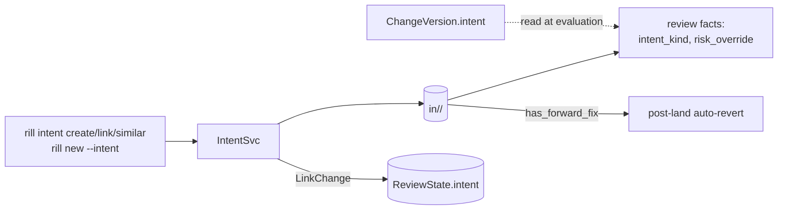

# Intents

An intent is the "why" behind changes: a task, bug, spec or plan stored as
a mutable record (`Intent`, id `in_…`) that change versions point at and
that policy reads for its kind and risk override. The invariant: the link
is recorded on both sides independently, `ChangeVersion.intent` is
immutable per version and set by whoever creates the version, while
`Intent.changes` and `ReviewState.intent` are mutable records updated only
by `LinkChange`.

## Record

`Intent` ([intent.rs](../../crates/rill-types/src/objects/intent.rs)):

| Field | Values / notes |
| --- | --- |
| `id` | `IntentId::new()` at creation. |
| `title`, `body` | Free text; `title` must be non-blank on create. |
| `kind` | `Feature` (default), `Bug`, `Refactor`, `Chore`, `Experiment`, `System`. |
| `status` | `Open` → `InProgress` (first link) → `Done` / `Abandoned`; only `UpdateIntent` moves it otherwise. `is_closed()` is `Done | Abandoned`. |
| `owner` | The creating principal. |
| `parent` | Optional `IntentId`; must exist on create; cannot be itself on update. |
| `risk_override` | Optional `RiskClass` an owner sets; replaces the computed class. |
| `changes` | `ChangeId`s linked through `LinkChange`, in link order, deduplicated. |
| `created_at`, `updated_at` | Timestamps. |

## RPCs

`IntentSvc` ([intent.rs](../../crates/rill-server/src/services/intent.rs)):

| RPC | Permit | Effect | Errors |
| --- | --- | --- | --- |
| `CreateIntent` | `write(root)` | New record from `title`, `body`, `kind`, `parent`, `risk_override`. | blank title → `InvalidArgument`; missing parent → `NotFound` |
| `GetIntent` | `read(root)` | The record. | `NotFound` |
| `UpdateIntent` | `write(root)` + owner or admin | Field-wise update: `title`, `body`, `status`, `parent` or `clear_parent`, `risk_override` or `clear_risk_override`; bumps `updated_at`. | self-parent → `InvalidArgument` |
| `ListIntents` | `read(root)` | Filter by `status[]`, `kind[]`, `owner`, `parent`; newest `updated_at` first; `limit` default 100, max 10 000; no paging token. | |
| `LinkChange` | `write(root)` | Adds the change to `intent.changes` (if absent) and moves `Open → InProgress`; if the change has a review, sets `ReviewState.intent` with a CAS `put_review`. | change with no versions → `NotFound`; review CAS conflict → `Aborted` |
| `FindSimilarIntents` | `read(root)` | Scores every intent against `title + body`. | |

Writes to the intent record itself are unconditional `put_intent`: two
concurrent `UpdateIntent` or `LinkChange` calls can lose one side's fields.

### Similarity

`find_similar_intents` tokenizes `"<title> <body>"` of the query and of
every intent: split on non-alphanumeric characters, keep words of at
least three characters, lower-case, into a `BTreeSet`. The score is
Jaccard similarity `|A ∩ B| / |A ∪ B|`; intents with a score of 0 are
dropped, the rest are sorted descending and truncated to `limit` (default
10, max 100). An empty query returns nothing. The comparison is a full
scan of `list_intents`; there is no index, no stemming and no embedding.
`rill intent similar <text> [--body]` renders the scores.

## Relation to changes

| Carrier | Written by | Read by |
| --- | --- | --- |
| `ChangeVersion.intent` | `ApplyEdits`/`NewChange`/`Merge` request field, `rill new --intent`, copied by `rebase` and `build_revert` | `ReviewService::submit` and `add_version` (into `ReviewState.intent`), `version_facts`, `review_context`, `has_forward_fix` |
| `ReviewState.intent` | `submit`, `add_version` (from the version), `LinkChange` | `ListReviews --intent` filter |
| `Intent.changes` | `LinkChange` only | `GetIntent`, CLI display |

`rill new --intent <id>` sets the id on the version and then calls
`LinkChange`, because the version's field does not update the intent's
change list. A version created by any other route with `intent` set
leaves `Intent.changes` stale until someone links it. `add_version`
overwrites `ReviewState.intent` with the new version's field, so a
`LinkChange` made on the review record is undone by the next amend unless
that amend also carries the intent.

## Policy facts

`ReviewService::version_facts` reads the version's intent (when the record
still exists) and calls `ChangeFacts::with_intent(kind, risk_override)`.
In `rill_policy::classify`, `risk_override` replaces the computed class
outright at the end; `intent_kind` is carried in `ChangeFacts` but no
risk rule reads it today. There is no Cedar entity for intents: the submit policy sees only the
resulting `risk` string. An intent's `status` has no effect on review or
landing.

## Persistence

| Key | Value |
| --- | --- |
| `in/<repo>/<id>` (`keys::intent`) | postcard `Intent` |

No index exists on `status`, `owner` or `parent`; every list and
similarity query scans the prefix.

## Limitations

* No optimistic concurrency on intent records.
* `ListIntents` returns at most `limit` rows with no continuation.
* Similarity is token overlap over the whole repository's intents.
* The three carriers of the change↔intent link are not reconciled;
  `LinkChange` is the only RPC that updates `Intent.changes`.
* `IntentKind::System` ("automatically created, e.g. for a quarantined
  flaky test") has no producer in the codebase.

## Code

* [rill-types/src/objects/intent.rs](../../crates/rill-types/src/objects/intent.rs)
* [rill-server/src/services/intent.rs](../../crates/rill-server/src/services/intent.rs)
* [rill-review/src/facts.rs](../../crates/rill-review/src/facts.rs) (`version_facts`)
* [rill-lander/src/revert.rs](../../crates/rill-lander/src/revert.rs) (`has_forward_fix`)
* [rill-sdk/src/intent.rs](../../crates/rill-sdk/src/intent.rs)
* [rill-cli/src/commands/intent.rs](../../crates/rill-cli/src/commands/intent.rs), [change.rs](../../crates/rill-cli/src/commands/change.rs) (`snapshot_new`)

## See

* [review](review.md) for how facts become a submit decision.
* [changes](changes.md) for where `ChangeVersion.intent` is set.
* [post-land](post-land.md) for the forward-fix check.
* [policy](../policy/README.md) for risk classification.
