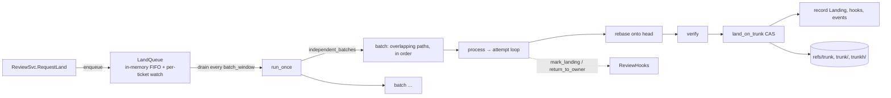
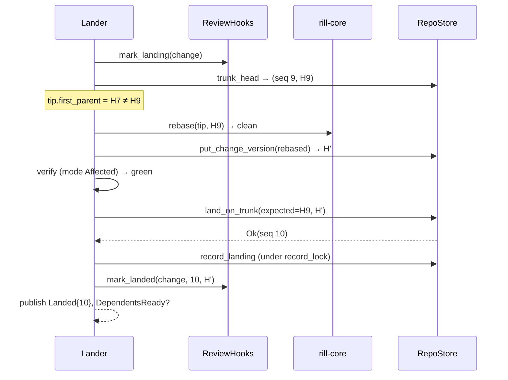

# Landing

The lander takes a requested version, rebases it onto the current trunk
head when it is not already based there, optionally verifies the rebased
tree, and advances trunk with a compare-and-swap that assigns the next
sequence number. Landing is optimistic: nothing is locked while a request
is rebased or verified; the CAS on `refs/trunk` decides, and a loser
rebases again. The invariant: trunk is a single ref plus a gap-free
sequence `trunk/<seq>` where every position was written by exactly one
successful `land_on_trunk` transaction.



## Queue and tickets

`LandQueue` ([queue.rs](../../crates/rill-lander/src/queue.rs)) is
process memory: a `VecDeque<QueuedRequest>` of pending requests and a
`DashMap<LandTicket, watch::Sender<LandStatus>>`. `enqueue` assigns
`LandTicket(n)` from an `AtomicU64` starting at 1 and publishes
`LandEvent::Queued`. The lander's `run_forever` sweeps every
`batch_window`, calls `run_once` (drain everything, partition, process)
and then `forget_terminal`, which drops terminal tickets from the map.
`land_now` (used by reverts and tests) enqueues, runs one sweep inline and
waits on the ticket's watch channel.

The server keeps its own `RepoContext.tickets: DashMap<u64, TicketInfo>`
so `GetLandStatus` can answer after the queue forgot a ticket: it falls
back to the review state (`landed_seq` ⇒ `Landed`, otherwise `Returned {
"ticket expired …" }`). Both maps are per process; a restart loses every
ticket and every queued request. The durable record of what landed is the
trunk log and the `Landing` records.

| `LandStatus` (lander) | wire `LandStatus` | `GetLandStatus.error` |
| --- | --- | --- |
| `Queued` | `Queued` | — |
| `Verifying`, `Landing` | `Rebasing` | — |
| `Landed { seq }` | `Landed` | — (`seq`, `landed_hash` set) |
| `Failed { reason }` | `Failed` | reason |
| `Conflict { paths }` | `Failed` | `rebase onto trunk conflicts at: <paths>` |
| `Returned { reason }` | `Cancelled` | reason |

## Conflict graph

`run_once` partitions the drained requests with
[conflict_graph.rs](../../crates/rill-lander/src/conflict_graph.rs).
`touched_paths(version)` is the tree diff of the version against its
first parent plus its conflicted paths and `subtree_changes` keys.
`partition` is a union-find over requests in arrival order: two requests
join one group when a path is equal or one is a prefix directory of the
other. Each group is spawned as its own task and processed in arrival
order, so a later request in a group is rebased onto the earlier one's
result; groups run concurrently and race on the CAS. A request whose
touched paths cannot be computed (missing version) fails on the spot.

## Pipeline

`process` ([pipeline.rs](../../crates/rill-lander/src/land/pipeline.rs))
never returns an error; every outcome becomes a ticket status. Steps, per
attempt, with `tip` starting at the requested version:

1. `hooks.mark_landing(change_id)` once before the loop (error logged).
2. Read `trunk_head`. If `trunk_seq_of(tip)` is set: `Failed("already
   landed at …")`.
3. If `tip.first_parent() != head`: if `tip` is an ancestor of head,
   `Failed("version is already an ancestor of trunk")`; otherwise
   `rill_core::rebase(tip, head)`. A rebase with conflicts sets `Conflict {
   paths }`, calls `return_to_owner`, publishes `LandEvent::Conflict` and
   stops. A clean rebase is stored with `put_change_version` (a new version
   of the same change, `predecessor = tip`) and becomes the candidate.
4. Unless the mode is `VerifyMode::None`: status `Verifying`, materialize
   the root tree, `verifier.verify(root, hash)` under `max_wait`. A timeout
   or red outcome is `Failed("verification …")`.
5. Status `Landing`; `repo.land_on_trunk(expected = head hash, hash)`.
   Success ⇒ `finalize`. A store `Conflict` ("trunk moved") ⇒ retry with
   `tip = candidate` (the rebased version is rebased again onto the new
   head). Any other store error ⇒ `Failed`.
6. After `max_retries + 1` attempts: `Failed("trunk moved N times while
   landing; giving up")`.

`verify_override` on the request (set to `None` by reverts) replaces the
policy's per-risk mode. Both `Affected` and `Full` call the same verifier;
the distinction is not passed through today.

### CAS and sequence numbers

`RepoStore::land_on_trunk` ([repo.rs](../../crates/rill-store/src/repo.rs))
reads the head, returns `Conflict` when `head_hash != expected`, and
submits one transaction: `expect(ref/trunk == expected)`,
`expect_absent(trunk/<seq>)`, `set(ref/trunk)`, `set(trunk/<seq>)`,
`set(trunkh/<hash> = seq)` with `seq = head_seq + 1`. Two landers racing
for the same slot see exactly one winner; the loser's next attempt reads
the new head. The sequence is gap-free because the next number is always
derived from the current head inside the same transaction that writes it.

### Finalize

`finalize` writes the `Landing` record under the `record_lock` (a
process-local `tokio::Mutex`; the recent-landings ring is a
read-modify-write of one `misc` row, and the lock keeps concurrent
batches from dropping entries), sets `Landed { seq }`, calls
`hooks.mark_landed`, publishes `LandEvent::Landed`, and when
`hooks.dependents_of` returns stacked changes publishes
`DependentsReady`. Hook errors are logged, never fatal: the trunk ref has
already moved.



```mermaid
sequenceDiagram
    participant L as Lander
    participant H as ReviewHooks
    participant C as rill-core
    participant Q as LandQueue
    L->>H: mark_landing(change)
    L->>C: rebase(tip, head) → Conflict at src/a.rs
    L->>Q: set_status(Conflict{paths})
    L->>H: return_to_owner(change, "rebase onto trunk conflicts at 1 path(s)")
    Note over H: landing_failed → refresh status;<br/>post change-level comment to owner
    L-->>L: publish LandEvent::Conflict
```

## Land record

`Landing { seq, change_id, version, requested_version, requester, risk,
landed_at }` ([record.rs](../../crates/rill-lander/src/land/record.rs)) is
stored twice: derived kind `land@1` keyed by the landed version (point
lookup, `landing_of`) and appended to the `landings` misc row, a ring of
the last `LANDINGS_RING = 1000` entries (`list_landings`). A version that
reached trunk without the lander (the git importer calls `land_on_trunk`
directly) has no record, and `common::land_event` then reports the
version's author and `created_at` as who landed it and when.

## Events

| `LandEvent` | When |
| --- | --- |
| `Queued { ticket, change_id }` | `enqueue` |
| `Landed { seq, change_id, version }` | after CAS; forwarded to the bus as `RefMoved(trunk)` then `Land` |
| `Conflict { change_id, paths }` | rebase conflicted |
| `Failed { change_id, reason }` | any other terminal failure |
| `DependentsReady { landed, dependents }` | stack members above a landed change |
| `Verification`, `Culprit`, `Reverted` | post-land worker, see [post-land](post-land.md) |

## Configuration

`LandPolicy` ([config.rs](../../crates/rill-lander/src/config.rs)), set
as `[lander]` in the server config:

| Field | Default | Effect |
| --- | --- | --- |
| `modes.trivial` | `none` | pre-land verification per risk class |
| `modes.low`, `modes.normal` | `affected` | |
| `modes.sensitive`, `modes.critical` | `full` | |
| `max_wait` | 30 min | timeout for one pre-land verification |
| `batch_window` | 2 s | sleep between queue sweeps |
| `auto_revert` | `false` | revert a bisected culprit automatically |
| `revert_grace` | 15 min | wait for a forward fix before an auto-revert |
| `max_retries` | 8 | CAS retries after trunk moved |

The verifier is `ExecVerifier` (runs `.rill/verify.toml` through
`rill-exec`) when `[verify].enabled`, else `AlwaysGreen`, which reports
green with "no verification configured".

## What a client sees

`rill land` calls `RequestLand` and prints the ticket. With `--wait` it
polls `GetLandStatus` through `StackClient::await_land` with backoff
(250 ms × 1.6 up to 5 s) until `Landed` (prints `trunk@N`), `Failed` or
`Cancelled` (`Error::LandFailed` → exit 3 with the server's error text),
or the timeout (`--timeout`, default 300 s; `Error::Timeout` → exit 1).
A policy refusal is a `FailedPrecondition` from `RequestLand` itself →
exit 3. `rill stack land` lands members bottom-up, awaiting each.

## Limitations

* Queue, ticket status and `record_lock` are process-local; the
  deployment assumption is one lander per repository. Two processes could
  both pass `land_on_trunk` for different slots, but their landing rings
  would race and lose entries.
* A request is processed with the risk class it was enqueued with; a
  later re-classification is not seen.
* `VerifyMode::Affected` and `Full` behave identically.
* A pending request is lost on restart; the client must re-request.
* `return_to_owner` is advisory: a failed landing leaves the rebased
  version stored but the review's current version unchanged.

## Code

* [rill-lander/src/land/lander.rs](../../crates/rill-lander/src/land/lander.rs), [pipeline.rs](../../crates/rill-lander/src/land/pipeline.rs), [record.rs](../../crates/rill-lander/src/land/record.rs)
* [rill-lander/src/queue.rs](../../crates/rill-lander/src/queue.rs), [conflict_graph.rs](../../crates/rill-lander/src/conflict_graph.rs), [events.rs](../../crates/rill-lander/src/events.rs), [config.rs](../../crates/rill-lander/src/config.rs), [traits.rs](../../crates/rill-lander/src/traits.rs), [error.rs](../../crates/rill-lander/src/error.rs)
* [rill-store/src/repo.rs](../../crates/rill-store/src/repo.rs) (`land_on_trunk`, `trunk_head`, `trunk_seq_of`)
* [rill-server/src/services/review.rs](../../crates/rill-server/src/services/review.rs) (`request_land`, `get_land_status`), [common.rs](../../crates/rill-server/src/services/common.rs) (`ticket_status`, `land_status_proto`), [lander.rs](../../crates/rill-server/src/services/lander.rs)
* [rill-server/src/state/registry.rs](../../crates/rill-server/src/state/registry.rs), [workers/mod.rs](../../crates/rill-server/src/workers/mod.rs)
* [rill-sdk/src/stack.rs](../../crates/rill-sdk/src/stack.rs) (`await_land`), [rill-cli/src/commands/land.rs](../../crates/rill-cli/src/commands/land.rs)

## See

* [review](review.md) for `RequestLand` and `mark_landing`.
* [post-land](post-land.md) for verification after trunk moves.
* [changes](changes.md) for the rebase the lander stores.
