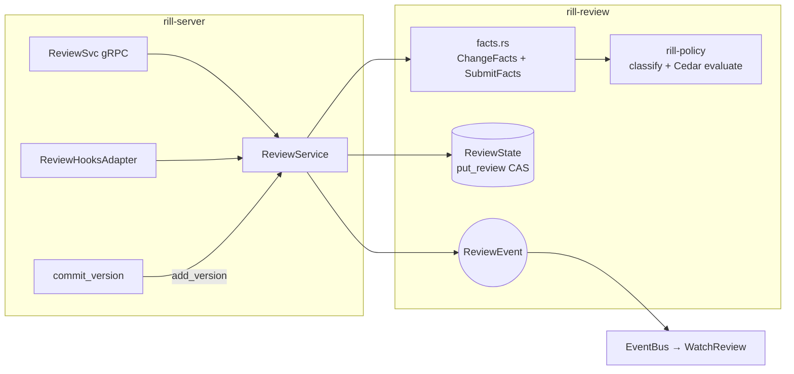
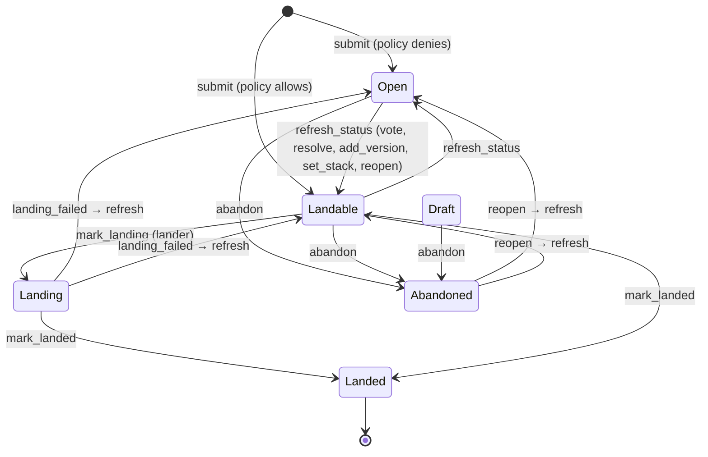

# Review

Review is a state machine over one record per change, `ReviewState`, keyed
by `ChangeId`. `rill_review::ReviewService` owns no state: every operation
reads the record, mutates a copy and writes it back with an optimistic
compare of the whole previous record, retrying up to `MAX_WRITE_ATTEMPTS`
(8) before failing with `Contended`. The invariant that decides landing:
a change is `Landable` exactly when the Cedar submit policy permits its
owner to land the current version given the votes on that version, the
unresolved threads and the risk class.



## Record

| Field | Set by |
| --- | --- |
| `versions` | `submit` (all stored versions), `add_version` (append). Last is current. |
| `status` | `submit`, `refresh_status`, `abandon`, `reopen`, `mark_landing`, `mark_landed`, `landing_failed`. |
| `owner` | The principal that called `submit`; the `Owner` label vote the policy looks for. |
| `intent` | From the current version's `intent`; `LinkChange` overwrites it. |
| `votes` | `vote`, `copy_votes`. Each `LabelVote` is bound to a version. |
| `threads` | `comment`, `reply`, `resolve`, `unresolve`, `reanchor`. |
| `risk`, `risk_reasons` | `apply_risk` on submit, every new version and `set_stack`. |
| `stack` | `set_stack`. |
| `landed_seq` | `mark_landed`. |

## Labels and votes

`LabelSet` ([labels.rs](../../crates/rill-review/src/votes/labels.rs)) is
the repository's label configuration, taken from `ServerConfig.labels` and
shared by every repository the server hosts. The default:

| Label | Range | `copy_on_trivial_rebase` | `max_requires_human` |
| --- | --- | --- | --- |
| `Review` | -2..=2 | yes | no |
| `Verified` | -1..=1 | no | no |
| `Owner` | -1..=1 | yes | yes |

`validate_vote` ([cast.rs](../../crates/rill-review/src/votes/cast.rs))
rejects an unconfigured label (`UnknownLabel` → `InvalidArgument`), a value
outside the range (`VoteOutOfRange` → `InvalidArgument`) and the maximum
value from a non-human on a `max_requires_human` label (`MaxRequiresHuman`
→ `PermissionDenied`). A bot may vote `Owner -1` but not `Owner +1`.

`vote` requires status `Open` or `Landable` (`InvalidStatus` →
`FailedPrecondition`), replaces any earlier vote by the same principal on
the same label and version, pushes the new `LabelVote { version: current }`,
runs `refresh_status` inside the same write and emits `Voted` then
`StatusChanged` if the status flipped. The gRPC `Vote` additionally accepts
an optional `version` and fails with `FailedPrecondition` when it is not
current, so a client can refuse to approve a version it has not seen. The
permit is `review()` (the ReBAC reviewer relation, or any caller in dev
mode).

Votes on a non-current version stay in `votes` but count for nothing:
`SubmitFacts::from_review` summarizes `current_votes()` only.

## Threads and anchors

A `Thread { id, anchor, comments, resolved, to }` has an anchor of
`Change`, `File { version, path }` or `Lines { version, path, start, end,
context_hash }`. `comment` opens a thread (id = 16 random bytes hex); when
a `Lines` anchor arrives with an empty `context_hash` the service computes
it: BLAKE3 over the lines `start-1 ..= end+1` (`CONTEXT_LINES = 1`,
clipped to the file, terminators stripped) with the `rill:anchor:` domain
prefix ([anchor.rs](../../crates/rill-review/src/threads/anchor.rs)).

On every new version `reanchor` moves `Lines` anchors by searching the
file in the new root for a window of the same length whose context hashes
equal, trying start positions in order of distance from the original
(`find_context`); `File` anchors move when the path still exists. An
anchor whose context is gone keeps pointing at the old version. Threads
are never re-anchored on the version they were made on.

`resolve` fails on an already-resolved thread (`ThreadAlreadyResolved` →
`FailedPrecondition`); `resolve` and `unresolve` refresh status because
unresolved threads with a `Bug` or `Security` comment are
`unresolved_blocking_threads` in the submit facts, which the default
policy forbids on.

## Versions and interdiff

`add_version` ([versions.rs](../../crates/rill-review/src/lifecycle/versions.rs))
is called by `commit_version` for every stored version of a change under
review. It verifies the version belongs to the change (`WrongChange`),
returns the state unchanged when the version is already recorded, and
rejects (`InvalidStatus`) unless the status is `Open` or `Landable`; the
server swallows that error, so a version of a `Landing`, `Landed` or
`Abandoned` change is stored but not added. Otherwise, in one optimistic
write: append the version, take `intent` from it, copy votes, re-anchor
threads, recompute risk, refresh status, emit `VersionAdded {
votes_copied }`.

`relate_versions` ([interdiff.rs](../../crates/rill-review/src/lifecycle/interdiff.rs))
classifies the new version against the previous current one:

| `VersionRelation` | Test | Votes copied |
| --- | --- | --- |
| `SameContent` | Same root tree (message, metadata or parent changed without affecting content). | For labels with `copy_on_trivial_rebase`. |
| `TrivialRebase` | Different roots, neither version has conflicts, and the per-path `(before, after)` content identities of each version's diff against its own first parent are equal (`FileKind` included, so an executable-bit flip is a change). | For labels with `copy_on_trivial_rebase`. |
| `Changed` | Anything else, including any version that records a conflict. | None; the change must be re-approved. |

Copying means a new `LabelVote` with `version = new` for each vote on the
old version whose label allows it; `Verified` never carries over. Old
votes are kept for history.

## Status



`Draft` is a legal status in the enum and an accepted source for `abandon`,
but no code sets it: `submit` always starts at `Open` (then refreshes).
`refresh_status` only moves between `Open` and `Landable`; every other
status is left alone. `mark_landing` accepts only `Landable`, which is the
lander's guard against landing a change whose approvals were withdrawn
between request and processing. `mark_landed` accepts `Landing` or
`Landable`. `abandon` is allowed for the owner or an admin on the gRPC
side and posts an `Abandoned: <reason>` change-level comment when a reason
is given. All transition errors are `InvalidStatus` → `FailedPrecondition`.

## Submit, evaluate, request land

`submit` ([submit.rs](../../crates/rill-review/src/lifecycle/submit.rs))
reads all stored versions (`NoVersions` → `NotFound` when none),
rejects a second submit (`AlreadySubmitted` → `AlreadyExists`), builds the
record with `owner = caller`, classifies risk, refreshes status and writes
with `expected = None`. Permit: `write(root)`.

`evaluate_for(state, principal)` ([evaluate.rs](../../crates/rill-review/src/evaluate.rs))
builds `ChangeFacts` and `SubmitFacts` and calls
`SubmitPolicy::evaluate`, returning `SubmitDecision { allowed, reasons,
matched_policies }`. `refresh_status` evaluates as the owner;
`EvaluateSubmit` and `RequestLand` evaluate as the caller. The
`ReviewService` is rebuilt and hot-swapped by `RepoContext::reload_policy`
when `SetPolicy` changes the Cedar text; `ReviewHooksAdapter` loads the
current handle on every call.

`RequestLand` ([review.rs](../../crates/rill-server/src/services/review.rs))
needs the `land()` permit, refuses `Landed`, `Landing` and `Abandoned`
(`FailedPrecondition`), evaluates for the caller and refuses when
`!allowed` with the policy's reasons, then enqueues `LandRequest {
change_id, version: current, requester, risk }` and remembers the ticket
in `RepoContext.tickets`. It does not change the review status; the lander
does when it processes the request.

```mermaid
sequenceDiagram
    participant A as author
    participant R as reviewer (human)
    participant S as ReviewSvc
    participant RV as ReviewService
    participant P as rill-policy
    participant L as Lander
    A->>S: SubmitForReview(change)
    S->>RV: submit(change, author)
    RV->>P: classify(facts) → risk
    RV->>P: evaluate(owner, facts, submit_facts) → denied
    RV-->>S: ReviewState{Open}
    R->>S: Vote(change, Review, +2)
    S->>RV: vote(...)
    RV->>RV: validate_vote; replace vote on current version
    RV->>P: evaluate → allowed
    RV-->>S: ReviewState{Landable}; events Voted, StatusChanged
    A->>S: RequestLand(change)
    S->>RV: evaluate_for(state, author) → allowed
    S->>L: enqueue(LandRequest)
    S-->>A: ticket land#N (Queued)
```

### Facts

`change_facts` ([facts.rs](../../crates/rill-review/src/facts.rs)) produces
`ChangeFacts { author, provenance, paths, total_files, total_lines,
intent_kind, risk_override, stack_depth }`. Per-path facts (added /
modified / deleted, lines added and removed, `cosmetic_only`, `conflict`)
come from a tree diff of the version against its first parent; files over
`MAX_DIFF_BYTES` (1 MiB) or binary carry no line counts. A conflicted path
whose first term equals the parent leaves no tree difference and is added
as `PathFacts::conflicted`. The path facts are cached as derived data under
`review-paths@1` keyed by version. `intent_kind` and `risk_override` are
read from the linked intent at evaluation time. `SubmitFacts::from_review`
contributes `risk`, per-label `VoteSummary` (max, min, human_max,
agent_max, counts of distinct human and agent voters and approvers;
service principals count only toward max/min), `unresolved_threads`,
`unresolved_blocking_threads` and `touches_sensitive`. The default Cedar
rules are in [default_policy.rs](../../crates/rill-policy/src/submit/default_policy.rs):
a `Review` min of -2 or any unresolved blocking thread forbids; trivial and
low risk land on `Verified >= 1`; normal needs a human `Review +2`, or two
agent approvals plus a human `Owner +1`; sensitive and critical need both a
human owner and a human `Review +2`.

## Review agents

[agents/](../../crates/rill-review/src/agents/mod.rs) defines the agent
model; none of it is wired into the server, which never constructs a
`ReviewerPool`. It is exercised by `tests/review_flow.rs` only.

| Piece | What it does today |
| --- | --- |
| `Reviewer` trait ([reviewer.rs](../../crates/rill-review/src/agents/reviewer.rs)) | `name()` and `review(Arc<ReviewContext>) -> Vec<Finding>`. A finding is change-level, whole-file or a line range with a `CommentCategory` and confidence 0-100. |
| `review_context` ([context.rs](../../crates/rill-review/src/agents/context.rs)) | Builds `ReviewContext`: per-file diffs with hunks (text under 1 MiB only), blame of the parent-side lines the change removes (best effort), the linked intent, the stack, and `truncated` after dropping the largest diffs' content until the estimate (bytes/4) fits `Budget.max_input_tokens` (default 100 000; timeout 120 s). |
| `HeuristicReviewer` ([heuristic.rs](../../crates/rill-review/src/agents/heuristic.rs)) | Regex checks on added lines: `TODO/FIXME/XXX` (Suggestion 55), debug prints in source files (Style 65), credential-shaped strings and private keys (Security 85), new files over 500 lines (Suggestion 50), and a change-level `TestGap` (50) when source files change without any test path. Votes as `agent:heuristics`. |
| `ReviewerPool` ([pool.rs](../../crates/rill-review/src/agents/pool.rs)) | Runs all registered reviewers concurrently under per-reviewer and total timeouts (default 300 s). Posts findings at or above `min_confidence_to_post` (30) as threads anchored at the version reviewed, then votes `Review -1` when any finding is in `block_categories` (`Bug`, `Security`) with confidence ≥ 70, else `+1`. No vote is cast when the change's current version moved during the run. A reviewer error or timeout becomes `ReviewerOutcome.error`, not a pool failure. |
| `Resolver` trait ([resolver.rs](../../crates/rill-review/src/agents/resolver.rs)) | Shape only: `resolve(&ConflictTerms) -> Option<Resolution>`. There is no implementation and no caller; the lander does not invoke resolvers. |

## Persistence

| Key | Value | Concurrency |
| --- | --- | --- |
| `ch/<repo>/<change_id>` (`keys::change`) | postcard `ReviewState` | `put_review(next, Some(prev))` expects the stored bytes to equal `prev`; conflict → retry via `update`, up to 8 times, then `Contended` → `Aborted`. |
| derived `review-paths@1/<version>` | cached `Vec<PathFacts>` | immutable per version |

Events (`ReviewEvent`): `Submitted`, `VersionAdded`, `Voted`, `Commented`,
`ThreadResolved`, `StackChanged`, `StatusChanged`, `Landed`, `Abandoned`.
They go to a per-repo broadcast channel shared across policy reloads and
are forwarded onto the `EventBus` as `RepoEvent::Review`; `WatchReview`
maps them to wire events (`StackChanged` and `Landed` are dropped there;
`Landed` is observable through the lander's `LandUpdate`).

## Limitations

* Labels are server-global (`ServerConfig.labels`); there is no per-repo
  label configuration.
* `vote` and `resolve` compute `ChangeFacts` once before the retry loop; a
  version added concurrently is evaluated with stale facts for that write.
* `submit` writes with no expected value and relies on the preceding
  `get_review` check, so two simultaneous submits can both succeed with the
  last writer winning.
* Thread re-anchoring is line-exact: a renamed file loses its anchors.
* The agent pool, heuristic reviewer and resolver interface are library
  code without a server entry point or RPC.
* `ReviewStatus::Draft` is unreachable.

## Code

* [rill-review/src/service.rs](../../crates/rill-review/src/service.rs), [error.rs](../../crates/rill-review/src/error.rs)
* [rill-review/src/lifecycle/](../../crates/rill-review/src/lifecycle/mod.rs): `submit.rs`, `versions.rs`, `interdiff.rs`, `status.rs`, `retry.rs`
* [rill-review/src/votes/](../../crates/rill-review/src/votes/mod.rs): `labels.rs`, `cast.rs`
* [rill-review/src/threads/](../../crates/rill-review/src/threads/mod.rs): `anchor.rs`, `comment.rs`
* [rill-review/src/facts.rs](../../crates/rill-review/src/facts.rs), [evaluate.rs](../../crates/rill-review/src/evaluate.rs)
* [rill-review/src/agents/](../../crates/rill-review/src/agents/mod.rs)
* [rill-policy/src/submit/facts.rs](../../crates/rill-policy/src/submit/facts.rs), [default_policy.rs](../../crates/rill-policy/src/submit/default_policy.rs)
* [rill-server/src/services/review.rs](../../crates/rill-server/src/services/review.rs)
* [rill-types/src/objects/review.rs](../../crates/rill-types/src/objects/review.rs)

## See

* [changes](changes.md) for versions and stacks.
* [landing](landing.md) for what happens after `RequestLand`.
* [post-land](post-land.md) for `ReviewHooksAdapter`.
* [intents](intents.md) for `intent_kind` and `risk_override`.
* [policy](../policy/README.md) for risk classification and Cedar.
