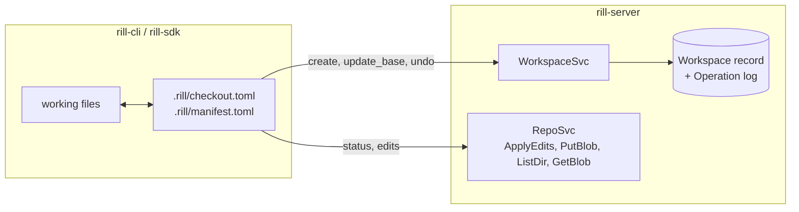
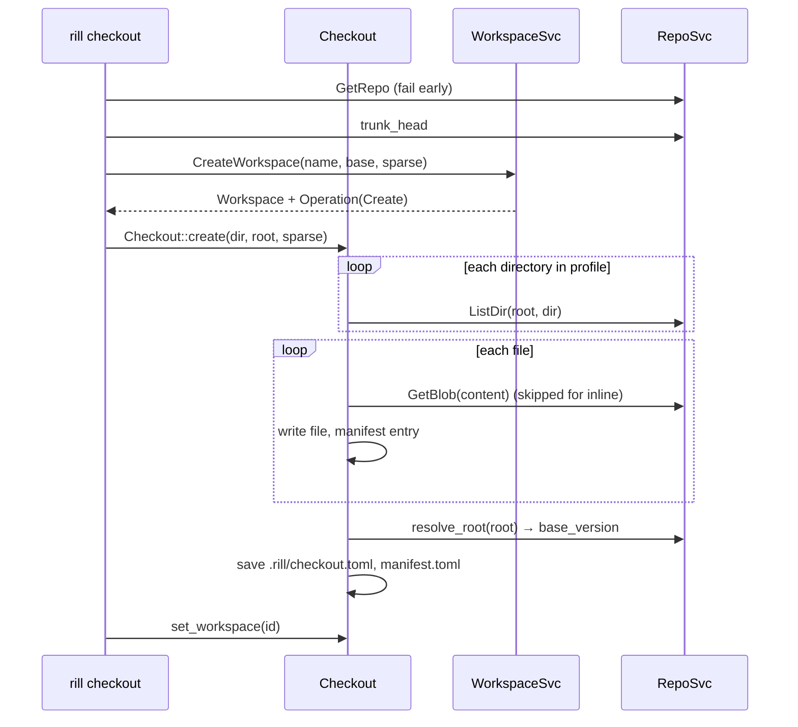

# Workspaces and checkouts

A workspace is a server-side record of one principal's in-progress state on
a repository: a base version, a working change id, an optional snapshot
tree and a sparse profile. A checkout is a client directory materialized
from a root and tracked in `.rill/`; it may be attached to a workspace but
works without one. The invariant: every mutation of a workspace is an
`Operation` appended to its log, and each operation records the resulting
`base` and `snapshot`, so undo is a pointer move rather than an inverse
computation.



## Authority

| Owns | Does not own |
| --- | --- |
| `WorkspaceSvc`: the `Workspace` record, its `Operation` log, `base`/`snapshot`/`sparse`/`owner`, `Undo`. | File content: snapshots reference trees already uploaded through the object RPCs. |
| `Checkout` (SDK): the working directory, `.rill/` metadata, local status, three-way merge on update. | Versions: `Checkout::snapshot` is a `RepoSvc.ApplyEdits` call; the server builds and stores the `ChangeVersion`. |

The CLI treats the server workspace as advisory. `rill sync` calls
`UpdateBase` first and logs (does not fail on) an error, then updates the
local checkout; `rill checkout --no-workspace` skips the record entirely.

## Server-side record

`Workspace` ([workspace.rs](../../crates/rill-types/src/objects/workspace.rs)):

| Field | Meaning |
| --- | --- |
| `id`, `repo`, `owner`, `name` | Identity; `owner` is the creator until `Handoff`. |
| `base` | `ChangeVersionHash` the working copy is based on. `ObjectHash::ZERO` while the repository has no history. |
| `working_change` | Stable `ChangeId` the next `NewChange` produces a version of. Reallocated after every `NewChange`. |
| `snapshot` | Latest `TreeHash` recorded by `Snapshot`; `None` until one is uploaded. |
| `sparse` | `SparseProfile { include, exclude }` of directory prefixes; empty `include` means the whole repo. |
| `head_op` | Id of the latest `Operation`. |

Every mutating RPC calls `WorkspaceSvc::record`, which appends an
`Operation { id, workspace, parent: ws.head_op, actor, kind, resulting_base,
resulting_snapshot, at }` and persists the workspace in one
`append_operation` transaction (`expect_absent(operation_index)`,
`append_log(operations/<ws>)`, `set(workspace)`). A reused `operation_id`
fails that transaction and surfaces as `AlreadyExists`
("operation … was already applied"), which is the idempotency key every
`*_with_op` SDK method exposes. The `operation_index` row is written in a
second, non-transactional `set` after the transaction commits.

### Workspace operations

| RPC | `OperationKind` | Effect | Preconditions / errors |
| --- | --- | --- | --- |
| `CreateWorkspace` | `Create` | New record; `base` from `RootSpec` (trunk head when absent, `ZERO` when the repo is empty), fresh `working_change`. | `write(root)` permit. |
| `Snapshot` | `Snapshot { tree }` | Sets `snapshot`. | Tree must already exist in the store, else `FailedPrecondition` "snapshot tree … has not been uploaded". |
| `NewChange` | `NewChange { change, base }` | Diffs `base` root against `snapshot`, builds a `ChangeVersion` of `working_change` (parent = base, predecessor = latest version of `working_change`), commits it through `commit_version`, then `base := new hash`, `working_change := ChangeId::new()`. | `snapshot` required; empty diff is `FailedPrecondition`; `write(path)` permit for every touched path. |
| `UpdateBase` | `Rebase { from, to }` | `base := new`; when `working_change` has a version and the base moved, `rill_core::rebase` it onto `new`, commit the rebased version and set `snapshot` to its root. | New base must resolve; empty repo is `FailedPrecondition`. |
| `SetSparseProfile` | `SetSparse { profile }` | Replaces `sparse`. | Owner or admin. |
| `Handoff` | `Handoff { to }` | `owner := to`. | Owner or admin; `to` required. |
| `Undo` | `Undo { undone }` | Finds `target` (default `head_op`) and its parent in the log; `base`/`snapshot` := parent's `resulting_*`. | First operation cannot be undone (`FailedPrecondition`); parent beyond the 1000-op retained window is `NotFound`. |
| `ListOperations` | — | Up to `limit` (default 50, max 1000) operations, optionally before an id. | Read permit. |
| `DeleteWorkspace` | — | Removes the record. Not logged. | Owner or admin. |
| `WorkspaceDiff` | — | File diffs of `snapshot` against `base` root. | Read filter applied. |

`Describe` and `Resolve` exist in `OperationKind` but no RPC records them;
`Other` is likewise unused by the server.

`Undo` restores `base` and `snapshot` only. `owner`, `sparse` and
`working_change` keep their current values, so undoing a `NewChange` leaves
the fresh `working_change` id in place while moving `base` back.

## Checkout on the client

`Checkout` ([checkout.rs](../../crates/rill-sdk/src/local/checkout.rs)) keeps
two TOML files under `.rill/` ([meta.rs](../../crates/rill-sdk/src/local/meta.rs)),
both written atomically via rename:

| File | Contents |
| --- | --- |
| `checkout.toml` | `endpoint`, `repo`, `workspace` (optional id), `base` (a `Root` string), `base_version` (the hash `base` resolved to, when it had one), `working_change`, `sparse.include/exclude`. |
| `manifest.toml` | Per path: `content_hash` (server `ContentRef::content_hash`), `local_hash` (BLAKE3 of bytes written), `size`, `mtime_ms`, `kind`, `conflict`. |

`Checkout::create` lists the root one `ListDir` RPC per directory
([remote.rs](../../crates/rill-sdk/src/local/remote.rs)), never entering a
directory the sparse profile excludes or that cannot contain an include,
fetches each file with `GetBlob` (inline content needs no round-trip),
writes it and records a manifest entry. `rill checkout` registers the
workspace first when the repository is empty, because the empty tree the
checkout is based on is stored by `CreateWorkspace`.

### Status

`compute_status` ([status.rs](../../crates/rill-sdk/src/local/status.rs))
runs under `spawn_blocking`. For each manifest entry: `conflict` flag ⇒
`Conflict`; missing on disk ⇒ `Deleted`; same symlink-ness, `size` and
`mtime_ms` ⇒ unchanged without reading; otherwise read, and `Modified` only
when the kind or BLAKE3 differs from `local_hash`. Every file on disk not
in the manifest (ignoring `.rill/` and `.rillignore` rules in
[walk.rs](../../crates/rill-sdk/src/local/walk.rs)) is `Added`. A merged
file is stored with `mtime_ms = -1` so it is always re-hashed against the
upstream bytes it was merged with.

### `rill new`, `amend`, `describe`

`Checkout::snapshot` turns status into edits (`Set` with bytes and kind for
added/modified, `Delete` for deleted; any `Conflict` is an error) and calls
`RepoSvc.ApplyEdits` with `EditBase::Root(base)` and `change_id =
working_change` ([write.rs](../../crates/rill-sdk/src/repo/write.rs)). Before
the RPC the SDK converts each `Set`: bytes at or under `INLINE_THRESHOLD`
travel inline in the request; larger ones are uploaded first with the
streamed gRPC `PutBlob` RPC in 256 KiB messages
([blobs.rs](../../crates/rill-sdk/src/repo/blobs.rs)) and referenced by
`ContentRef`. The SDK does not use the HTTP object protocol
(`PUT /o/{repo}/{kind}/{hash}`, [objects/mod.rs](../../crates/rill-server/src/objects/mod.rs));
that surface exists for caches and other clients. The server's
`apply_edits_impl` resolves the base, applies `Patch` edits with
`apply_unified` ([patch.rs](../../crates/rill-server/src/services/patch.rs),
exact context or within a 50-line window, otherwise `InvalidArgument`),
builds the version with `ChangeBuilder` and stores it through
`commit_version`, which also feeds the new version to review when the
change is under review. The response hash becomes `working_change` in
`checkout.toml`.

`rill new` with an existing unlanded `working_change` first calls
`Checkout::update(Root::Version(current))` so the previous change becomes
the base, clears `working_change`, and only then snapshots: the new change
is parented on the previous one (a stack). If the previous working change
landed, `working_change` is cleared and the new change starts on the
current base. `rill amend` and `rill describe` are the same snapshot with
`change_id` set, so each produces a new version whose `predecessor` is the
current one; `describe` re-uploads unchanged edits because the SDK has no
message-only amend.

A checkout attached to a workspace never calls the workspace `Snapshot` or
`NewChange` RPCs; those are for clients that upload trees directly. The
workspace `base` is kept in step only by `rill sync` and `rill undo`.

### Checkout sequence



### Sync with a conflict

`Checkout::update` ([update.rs](../../crates/rill-sdk/src/local/update.rs))
classifies each path by what changed upstream (old manifest `content_hash`
vs new listing) and locally (status), then: one side changed ⇒ take it;
both changed ⇒ `merge_file(base, local, upstream)` with base read from the
pinned `base_version`; a clean merge is written as a local modification, a
conflict as `Merge::three_way` rendered with markers and `conflict = true`.
Local delete vs upstream edit, and local edit vs upstream delete, are
always conflicts. A path still flagged `Conflict` from an earlier update is
left untouched.

```mermaid
sequenceDiagram
    participant CLI as rill sync
    participant W as WorkspaceSvc
    participant SDK as Checkout
    participant R as RepoSvc
    CLI->>W: UpdateBase(ws, onto)
    Note over W: rebase working change if any;<br/>failure only logged by CLI
    CLI->>SDK: update(onto)
    SDK->>R: ListDir × dirs (new root)
    SDK->>SDK: status()
    SDK->>R: ReadFile(base_version, path) + GetBlob(upstream)
    SDK->>SDK: merge_file → Conflicted
    SDK->>SDK: write markers, manifest conflict=true, mtime=-1
    SDK->>R: resolve_root(onto) → base_version
    SDK-->>CLI: UpdateReport{conflicts:[path]}
    CLI-->>CLI: exit 3 "edit them, then rill resolve"
```

`rill resolve <paths>` clears the manifest flag after the user edits the
markers; nothing checks that markers are gone. `rill undo` calls the
workspace `Undo`, then `update(Root::Version(op.workspace.base))`.

## Persistence

| Key (meta store) | Value | Written by |
| --- | --- | --- |
| `ws/<repo>/<ws>` (`keys::workspace`) | `Workspace` record | every workspace RPC (`append_operation`) |
| `op/<repo>/<ws>/<seq>` (`keys::operation_prefix`) | `Operation`, append-only log | `append_operation` |
| `opi/<repo>/<op_id>` (`keys::operation_index`) | log seq, for idempotency | `append_operation` (after the transaction) |
| `.rill/checkout.toml`, `.rill/manifest.toml` | client metadata | `Checkout::save` |

## Limitations

* `Undo` reads at most 1000 operations; older targets are `NotFound`.
* `Undo` does not restore `owner`, `sparse` or `working_change`.
* The checkout keeps no local history: `rill undo` without a workspace is
  a usage error.
* `rill sync` ignores a failed `UpdateBase`; the server workspace may drift
  from the checkout.
* `Snapshot` validates that the tree exists but not that it respects the
  sparse profile or that its blobs are present.
* Sparse profiles filter what the checkout materializes; the server never
  prunes a snapshot or a `NewChange` diff by profile.

## Code

* [rill-types/src/objects/workspace.rs](../../crates/rill-types/src/objects/workspace.rs)
* [rill-server/src/services/workspace.rs](../../crates/rill-server/src/services/workspace.rs)
* [rill-server/src/services/repo/write.rs](../../crates/rill-server/src/services/repo/write.rs) (`apply_edits_impl`, `commit_version`, `version_from_diff`)
* [rill-server/src/services/patch.rs](../../crates/rill-server/src/services/patch.rs)
* [rill-server/src/objects/mod.rs](../../crates/rill-server/src/objects/mod.rs)
* [rill-sdk/src/workspace.rs](../../crates/rill-sdk/src/workspace.rs)
* [rill-sdk/src/local/](../../crates/rill-sdk/src/local/mod.rs): `checkout.rs`, `meta.rs`, `status.rs`, `update.rs`, `remote.rs`, `walk.rs`, `fs.rs`
* [rill-cli/src/commands/checkout.rs](../../crates/rill-cli/src/commands/checkout.rs), [status.rs](../../crates/rill-cli/src/commands/status.rs), [change.rs](../../crates/rill-cli/src/commands/change.rs), [ws.rs](../../crates/rill-cli/src/commands/ws.rs)

## See

* [changes](changes.md) for what `NewChange` and `ApplyEdits` produce.
* [merge and rebase](../core/merge-and-rebase.md) for `merge_file` and `rebase`.
* [object model](../data/objects.md) for `ContentRef`, trees and the inline threshold.
