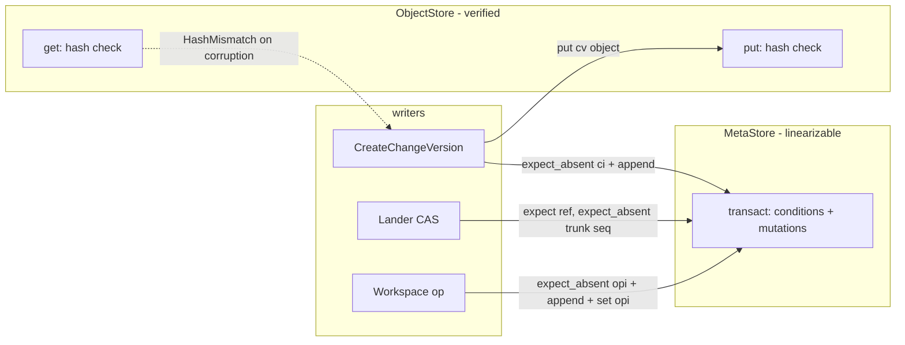

# Storage durability

Rill's data lives in two stores with different contracts: an immutable,
content-addressed `ObjectStore` and an ordered, conditionally-transactional
`MetaStore`. Every invariant the higher crates rely on (gap-free trunk
sequence numbers, CAS on refs, idempotent change-version writes) is only as
strong as the backend pair underneath. The invariant that matters most: the
`MetaStore` a deployment runs on must be linearizable for the keys that
`land_on_trunk` conditions on, and nothing in the codebase currently
verifies that any non-memory backend provides it.

## Current state

### Trait contracts

`ObjectStore` ([object.rs](../../crates/rill-store/src/object.rs)) keys
objects by `(ObjectKind, ObjectHash)`, verifies the BLAKE3 digest on every
`put` via `verify`, and treats a repeated `put` as a no-op. `get` does not
re-verify: a corrupted file or object returns whatever bytes are stored.

`MetaStore` ([meta.rs](../../crates/rill-store/src/meta.rs)) offers `get`,
`get_many`, `scan` over a `KeyRange` and `transact(Transaction)`. A
`Transaction` carries `Condition`s (`Equals`, `Absent`, `Present`) and
`Mutation`s (`Set`, `Delete`, `AppendLog`). `AppendLog` assigns the next
sequence by a reverse scan of one key under the prefix (`next_seq` in
[memory.rs](../../crates/rill-store/src/memory.rs)); the conformance test
pins the semantics that deleting the tail key reuses its number.

### Backends

| Backend | Objects | Metadata | Durability on commit | Tested against |
| --- | --- | --- | --- | --- |
| `memory` | `HashMap` under `RwLock` | `BTreeMap` under `RwLock` | none (process memory) | reference for conformance |
| `local` (default) | zstd-framed files, `<root>/<kind>/<hh>/<hex>` | redb 4, one `kv` table | file: temp + `sync_all` + rename + directory `sync_all`; redb: `Database::create` defaults | `tests/conformance.rs`, unit tests |
| `s3` | `object_store` 0.14 with `PutMode::Create` | redb (server pairs S3 objects with a local redb) | depends on the service; `AlreadyExists` treated as success | `object_store::memory::InMemory` and `file://` only |
| `fdb` | none (objects must come from another backend) | FoundationDB via `Database::run` | FDB's commit | no test at all; feature is not in the conformance fixtures |

Specific facts from the source:

* [local/objects.rs](../../crates/rill-store/src/local/objects.rs):
  `write` checks `path.try_exists()` first, writes to
  `.tmp-<pid>-<counter>-<short>`, calls `sync_all` on the file, re-checks
  existence, renames, then opens the parent directory and calls `sync_all`.
  A leftover `.tmp-*` after a crash is never cleaned up.
* [local/meta.rs](../../crates/rill-store/src/local/meta.rs): one redb
  write transaction per `transact`; conditions are read inside the write
  transaction, so the check and the mutations see one snapshot. redb
  serialises writers process-wide, and `Database::create` takes an
  exclusive file lock, so a second process cannot open the same file.
  Durability is whatever redb 4's default `Durability` is; the code never
  calls `set_durability`.
* [s3.rs](../../crates/rill-store/src/s3.rs): `put` compresses off the
  reactor, then `put_opts` with `PutMode::Create`. Credentials and region
  come from the environment through `object_store::parse_url`. There is no
  retry policy, no timeout and no request size configuration beyond what
  `object_store` defaults to. `has_many`/`get_many` fan out with
  `BATCH_CONCURRENCY = 16`.
* [fdb.rs](../../crates/rill-store/src/fdb.rs): conditions become reads in
  the transaction's conflict set; `AppendLog` adds a reverse range read of
  the whole prefix tail to the conflict range, so concurrent appenders
  serialise. The module doc notes `foundationdb::boot` must run once per
  process; nothing in `rill-server` calls it, and
  [config.rs](../../crates/rill-server/src/config.rs) `StorageConfig` has
  no FDB variant. The FDB backend is unreachable from the binary.
* [repo.rs](../../crates/rill-store/src/repo.rs) `land_on_trunk` reads
  `trunk_head` (a scan), then commits one transaction that expects
  `ref/<repo>/trunk == expected`, expects `trunk/<repo>/<seq>` absent, and
  sets the ref, the trunk entry and `trunkh/<repo>/<hash>`. The sequence
  is derived from the scan, not from the ref; correctness rests on the
  `Absent` condition.
* `put_change_version` performs an unconditional `get` of `ci/`, an object
  `put`, then a transaction with two `AppendLog`s and no condition. Two
  concurrent callers storing the same version both pass the pre-check and
  both append, producing duplicate `log/` and `chv/` rows.
* `append_operation` runs two transactions: the log append plus workspace
  set, then an unconditional `set` of `opi/`. The `expect_absent(opi)`
  guard in the first transaction only sees an index the second transaction
  already wrote.
* Record encoding ([repo.rs](../../crates/rill-store/src/repo.rs)
  `encode_record`) prefixes a single version byte `1`; the object frame
  ([codec.rs](../../crates/rill-store/src/codec.rs)) carries `RILZ`, a
  version byte and a method byte.
* [keys.rs](../../crates/rill-store/src/keys.rs) declares
  `table::CHANGE_VERSION` (`cv/<repo>/<hash>`) and a `change_version` key
  builder, but no code writes that table. Change versions exist only as
  `ObjectKind::ChangeVersion` objects in the `ObjectStore`; the metadata
  side holds the `ci/` projection. A metadata backup therefore does not
  contain history, and an object-store loss is unrecoverable from
  metadata alone.
* `KeyRange::prefix` ([meta.rs](../../crates/rill-store/src/meta.rs))
  returns an `Unbounded` end when `prefix_end` finds the prefix all
  `0xFF`. The memory and redb scans then run to the end of the keyspace;
  only [fdb.rs](../../crates/rill-store/src/fdb.rs) clamps that case to
  the end of its own prefix. No Rill key starts with `0xFF` (every table
  tag is ASCII), so this is latent, but the conformance scenario
  `prefix_end_scenario` passes only because nothing larger than the
  test's own keys exists in the store.
* Nothing deletes `dd/` rows or `ObjectKind::Derived` objects. Derived
  data (root trees, blame, history, search shards, action-cache results,
  landing and post-land records) accumulates for the life of the store;
  see [03](03-backup-restore-and-migration.md) for GC.

### Server wiring

[state/app.rs](../../crates/rill-server/src/state/app.rs) `open_stores`
builds `Memory`, `Local { dir }` or `S3 { url, prefix, meta_dir }`. The S3
variant always pairs the bucket with a redb file under `meta_dir`, so the
only multi-node-capable `MetaStore` in the tree is never constructed. The
search index ([rill-search persist.rs](../../crates/rill-search/src/index/persist.rs))
holds postings in process memory and rewrites whole shards into the `dd/`
keyspace on flush; two processes sharing one `MetaStore` would overwrite
each other's shards.

## Why it blocks production

1. **Unverified cloud backends.** The S3 path has never been exercised
   against AWS S3, MinIO, R2 or Ceph. `PutMode::Create` maps to
   `If-None-Match: *`, which AWS added in 2024 and which several
   S3-compatible services reject with `NotImplemented`. On such a service
   every `put` fails and the server cannot store a single blob.
2. **Silent corruption on read.** A bit-flip on disk or a truncated S3
   object is served to clients and materialised into checkouts because
   `get` never re-hashes. The one-year `Cache-Control: immutable` header on
   `/o/` then pins the bad bytes in every edge cache.
3. **Unknown fsync semantics for metadata.** If redb 4's default durability
   is not `Immediate`, a power loss after `land_on_trunk` returns can
   un-land a change the client was told landed. No test asserts the
   setting, and no operator doc states it.
4. **Duplicate log rows.** Two SDK clients retrying `CreateChangeVersion`
   for the same version (a common agent pattern) can double-append the
   write-ahead log; `WatchLog` and `log_after` then deliver the same version
   twice, and `change_versions` lists it twice.
5. **No multi-node story.** The only shared-object backend (S3) is tied to a
   single-process redb file, the FDB backend is dead code, the lander holds
   a process-local `record_lock`, and the search index assumes it owns its
   shards. Running two replicas against one bucket produces two
   independent, diverging repositories.
6. **No local-disk full or ENOSPC handling.** `write_temp` fails, the error
   bubbles up as `Unavailable`, but a half-written redb commit on a full
   disk is redb's problem to recover and there is no startup check.

## Requirements

Testable statements of done:

* R1. A conformance run exists for every backend that ships in a release
  build, including S3 against a real S3-compatible endpoint (MinIO in CI)
  and FoundationDB against a single-node cluster in CI. The run is the
  existing `conformance.rs` scenarios plus the concurrency scenarios below.
* R2. `land_on_trunk` is linearizable: a test with N tasks racing to land
  on the same head sees exactly one winner per sequence number and no gaps,
  on memory, redb and FDB.
* R3. `put_change_version` is idempotent under concurrency: N concurrent
  calls with the same version produce exactly one `log/` row and one `chv/`
  row.
* R4. `append_operation` is atomic: the operation index and the log entry
  are written in one transaction, and a replayed `operation_id` returns
  `AlreadyExists` without a second log row.
* R5. Every `get` from a persistent object backend verifies the hash before
  returning, or the backend documents why it is exempt (memory). A
  corrupted on-disk frame surfaces as `Error::HashMismatch`, never as data.
* R6. The redb durability mode is set explicitly and documented; a test
  kills the process (`SIGKILL`) after a committed `transact` and asserts the
  key is present on reopen.
* R7. `StorageConfig` can express every supported pair, including
  `objects = s3`, `meta = fdb`, and the server refuses combinations that
  cannot support more than one replica unless `single_node = true` is set.
* R8. The server declares what each backend guarantees in one table in the
  operator docs: atomicity, durability on return, linearizability, and
  whether multiple replicas may share it.

## Design direction

### Recommended: make the `MetaStore` the arbiter and tighten every write path

Keep the two-trait split. Fix the write paths so they rely only on
conditions the trait already offers, then make every backend prove those
conditions under contention.

Concrete changes:

1. `put_change_version`: add `expect_absent(keys::change_info)` to the
   transaction and map `Conflict` to `Ok(hash)`. Drop the pre-read or keep
   it as a fast path only.
2. `append_operation`: move the `opi` `Set` into the first transaction; the
   index value is the sequence, which `AppendLog` does not expose inside
   the transaction. Either extend `Mutation::AppendLog` with an optional
   `index_key` the backend fills with `be64(seq)`, or store `opi` as the
   operation's encoded `Operation` record and resolve the sequence by scan.
   The first is smaller and keeps `opi` semantics.
3. `land_on_trunk`: unchanged in shape; add a concurrency test.
4. Object reads: verify in `LocalObjectStore::read` and
   `ObjectStoreBackend::fetch` after decompression, with the same
   `>= 1 MiB` parallel-hash threshold `verify` already uses. Memory stays
   exempt.
5. redb: call `Builder::new().set_durability(Durability::Immediate)` (or
   whatever redb 4 names it) explicitly, and surface it in the operator
   table. Consider `Durability::Eventual` plus an explicit `sync` after
   trunk and ref transactions only if write latency becomes a problem;
   that is a measured optimisation, not a default.
6. S3: detect conditional-put support at startup with one probe object
   under `<prefix>/.rill-probe`; refuse to start on `NotImplemented` unless
   the operator sets `allow_unconditional_put = true`, in which case fall
   back to HEAD-then-PUT (content-addressed, so a race writes identical
   bytes).
7. FDB: add `StorageConfig::Fdb { cluster_file, prefix }` for metadata,
   composable with `S3` for objects; call `foundationdb::boot` in
   `open_stores`; add it to the conformance fixtures behind an env var
   (`RILL_TEST_FDB_CLUSTER`). Keep the dense `u64` sequence scheme; the
   read-conflict range on the log tail is the intended serialisation.
8. Multi-node readiness gate: `AppState::new` checks the pair and sets a
   `topology` field (`SingleNode` / `MultiNode`); workers and the search
   index consult it (see [02](02-crash-recovery-and-consistency.md) for
   the lander lease).

### Alternatives considered

* **Single backend for both stores (FDB record layer style).** Store
  objects as FDB values. Rejected: FDB caps values at 100 kB and
  transactions at 10 MB; blobs and chunks would need their own splitting
  layer, and the object protocol's CDN story depends on an HTTP-addressable
  object store.
* **Versionstamped keys for the logs.** Conflict-free appends in FDB.
  Rejected for now; trunk sequence numbers must stay dense and small, and
  the lander already serialises per repository.
* **Litestream-style redb replication for multi-node.** Streams the redb
  file to S3 for recovery, not for concurrent writers. Useful for
  [03](03-backup-restore-and-migration.md), not for linearizability.
* **Dropping redb for SQLite.** No gain: both are single-writer embedded
  stores; redb's typed B-tree and ACID commit match the key-value trait
  more directly.

### Trade-offs

Verifying on read costs one BLAKE3 pass per object fetch; at ~1-3 GB/s
per core that is below the decompression cost for zstd and acceptable.
`Durability::Immediate` costs one fsync per `transact`; the lander,
review and workspace paths issue a handful of transactions per user action,
so this is tens of milliseconds on cloud disks and the right default.

## Work breakdown

1. **S** Add `expect_absent(ci)` to `put_change_version`; add a concurrent
   idempotency test in `conformance.rs`.
2. **M** Extend `Mutation::AppendLog` with an optional index key (or
   equivalent) and make `append_operation` one transaction; update memory,
   redb and FDB implementations; conformance test.
3. **S** Concurrent `land_on_trunk` race test (32 tasks, one head) on every
   fixture.
4. **S** Hash verification on `get` in local and object_store backends;
   corruption test that flips a byte on disk.
5. **S** Explicit redb durability setting; crash test using a child
   process and `SIGKILL`.
6. **M** MinIO-backed conformance job in CI; conditional-put probe at
   startup; fallback mode.
7. **M** `StorageConfig::Fdb`, `foundationdb::boot`, FDB conformance job
   (docker `foundationdb/foundationdb` single node).
8. **M** Topology detection in `AppState` and the operator table of
   guarantees in `docs/`.
9. **L** Multi-node search index: either per-node indexes with node-scoped
   shard keys and a merge on read, or a single indexer elected through the
   lander lease from [02](02-crash-recovery-and-consistency.md).

## Risks and open questions

* redb 4's exact default durability and whether `InMemoryBackend` in
  `RedbMetaStore::temporary` diverges from the file backend in any
  condition-check path. The conformance test
  `redb_temporary_matches_memory` covers semantics, not fsync.
* FDB transaction limits (5 s, 10 MB): `put_review` writes the whole
  `ReviewState` including threads; a review with thousands of comments
  could exceed a value size limit (100 kB) long before 10 MB. Needs a size
  bound or a split of threads into their own keys.
* Whether `cv/` should be populated (making metadata self-contained for
  history, at the cost of duplicating every change version) or removed
  from `keys.rs` so the key layout documents what is real.
* `AppendLog` sequence reuse after tail deletion is a documented property;
  GC ([03](03-backup-restore-and-migration.md)) must never delete the tail
  of `log/` or `trunk/`.
* S3 eventual consistency is no longer a concern on AWS (strong since
  2020) but still is on some compatible stores; `has` immediately after
  `put` may return false there. The probe should check this too.
* The object protocol accepts `PUT` of any kind, including `cv` and `tree`
  objects whose referents may not exist. That is an integrity question for
  [03](03-backup-restore-and-migration.md) (GC) rather than durability.

## References

Source:

* [crates/rill-store/src/object.rs](../../crates/rill-store/src/object.rs)
* [crates/rill-store/src/meta.rs](../../crates/rill-store/src/meta.rs)
* [crates/rill-store/src/memory.rs](../../crates/rill-store/src/memory.rs)
* [crates/rill-store/src/local/objects.rs](../../crates/rill-store/src/local/objects.rs)
* [crates/rill-store/src/local/meta.rs](../../crates/rill-store/src/local/meta.rs)
* [crates/rill-store/src/s3.rs](../../crates/rill-store/src/s3.rs)
* [crates/rill-store/src/fdb.rs](../../crates/rill-store/src/fdb.rs)
* [crates/rill-store/src/repo.rs](../../crates/rill-store/src/repo.rs)
* [crates/rill-store/src/codec.rs](../../crates/rill-store/src/codec.rs)
* [crates/rill-store/tests/conformance.rs](../../crates/rill-store/tests/conformance.rs)
* [crates/rill-server/src/config.rs](../../crates/rill-server/src/config.rs)
* [crates/rill-server/src/state/app.rs](../../crates/rill-server/src/state/app.rs)
* [crates/rill-search/src/index/persist.rs](../../crates/rill-search/src/index/persist.rs)

Prior art:

* FoundationDB Record Layer: metadata and indexes over FDB with explicit
  size limits and versionstamps.
* Sapling/Mononoke: blobstore with multiplexed writes and a separate
  "bonsai" metadata store; `blobstore healer` for cross-store consistency.
* Piper/CitC: single global sequence number per commit; the linearizable
  allocator is the system of record.
* Bazel remote cache (REAPI): content-addressed storage with digest
  verification on both read and write.
* Litestream: streaming replication of an embedded database file for
  recovery.
* AWS S3 conditional writes (`If-None-Match`) announcement, August 2024.
* redb design document (copy-on-write B-tree, two-slot commit, durability
  modes).
