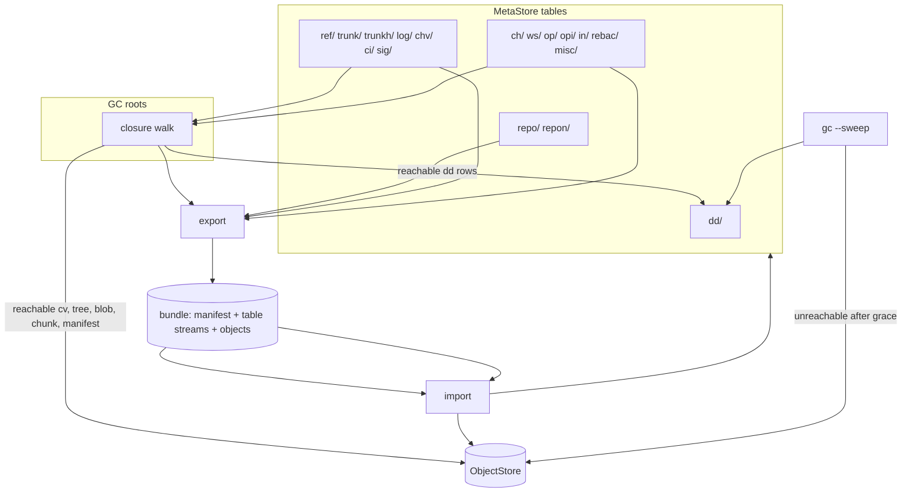

# Backup, restore and migration

A Rill deployment is one object store plus one metadata store, and the only
way to copy, move, version or shrink either today is to copy the underlying
files or bucket by hand. There is no export format, no schema version
beyond a single byte, no backend-to-backend mover and no garbage
collection. The invariant that matters most: a restore must produce a
store in which every `trunk/` entry resolves to a change version whose
whole closure (parents, root tree, blobs, chunks) is present, and
`fsck` ([02](02-crash-recovery-and-consistency.md)) must be able to say
so.

## Current state

### What is versioned

| Layer | Version marker | Where | Upgrade path |
| --- | --- | --- | --- |
| Object frame | `RILZ` magic, `VERSION = 1`, method byte | [codec.rs](../../crates/rill-store/src/codec.rs) | `parse_header` rejects any other version; no reader for a future version 2 |
| Metadata record | leading byte `RECORD_VERSION = 1` | [repo.rs](../../crates/rill-store/src/repo.rs) `encode_record` / `decode_record` | `decode_record` errors on any other byte; postcard body has no field tags, so adding, removing or reordering a field in any `Serialize` type under `rill-types` silently changes the wire shape |
| Object content | domain-separated BLAKE3 over canonical encoding | `rill-types` `Encodable` | a change to canonical encoding changes every hash |
| Derived data | kind strings with `@N` suffix: `land@1`, `postland@1`, `ac@1`, `idx:blob@1`, `idx:root@1`, `idx:docs@1`, `idx:post@1`, `RootTree` etc. via `derived_kind_key` | [record.rs](../../crates/rill-lander/src/land/record.rs), [persist.rs](../../crates/rill-search/src/index/persist.rs), [cache.rs](../../crates/rill-exec/src/cache.rs) | bump the suffix and recompute; old rows stay forever |
| Policy records | JSON `StoredPolicy` under `misc/policy:<name>` | [state/policy.rs](../../crates/rill-server/src/state/policy.rs) | JSON is tolerant; validated on load |
| Verification reports | JSON `Vec<Report>` under `misc/verify_reports:<seq>` | [services/lander.rs](../../crates/rill-server/src/services/lander.rs) | JSON |
| Store-level schema | none: no `meta/schema` key, no manifest file in the object root | | a server of any version opens any store |

The `misc/` table is a grab bag of postcard and JSON values written by
four crates; nothing enumerates its names.

### What exists for moving data

* `rill-git-import` ([importer.rs](../../crates/rill-git-import/src/import/importer.rs)):
  one-way, resumable through `ImportMap` stored in `misc/`. Not an export.
* The object protocol (`GET/PUT /o/`, `POST /o/{repo}/batch`,
  [objects/](../../crates/rill-server/src/objects/mod.rs)): can copy
  objects between servers by hash if a client knows the hashes; nothing
  walks a closure.
* `WatchLog` / `log_after`: can replay change-version hashes in write
  order, which is the start of an export, but refs, reviews, workspaces,
  intents, relations, policies and derived records have no streaming
  surface.
* Nothing deletes a repository: `keys.rs` describes "deleting a repo is a
  prefix delete per table" but no function does it, and objects are not
  partitioned by repository at all (`<root>/<kind>/<hh>/<hash>` is global),
  so a repository delete cannot free objects without a reachability walk.

### Garbage

Objects that nothing references: chunks of a blob whose manifest was never
written, trees uploaded for a `Snapshot` that was undone, change versions
of abandoned changes, `Derived` objects from superseded `@N` kinds,
action-cache stdout/stderr blobs, and anything a client `PUT` directly.
Rows that nothing reads: `dd/` entries for versions no ref or trunk entry
reaches, `postland` and `land` records (bounded rings but unbounded
`dd/` rows), `verify_reports` for every sequence, operation logs of deleted
workspaces (`delete_workspace` removes `ws/` only; `op/` and `opi/` rows
stay). None of this is counted or reclaimed.

### Point-in-time recovery

The metadata store is a single redb file (local and S3 configurations).
redb is copy-on-write with a two-slot commit, so a file copy taken while
the server runs is not guaranteed consistent; redb has no online backup
API. Objects are immutable and append-only, so an object store is always
restorable to "every object that existed at time T" by a bucket versioning
or snapshot feature, but there is no way to find the metadata state that
matches.

## Why it blocks production

1. **Any field change bricks the store.** Adding a field to `ReviewState`,
   `Workspace`, `Intent` or `RepoConfig` and shipping it produces
   `Codec("...")` errors (`DataLoss` on the wire) on every existing record.
   The single version byte gives no way to read old and new side by side.
   Likewise `LandPolicy` is postcard-serialised in a config test but TOML
   on disk; the derived kinds carry a suffix but the framework records
   (`RootTree`, `PathHistory`, `Generation`, `ChangeSummary`) depend on
   `derived_kind_key` naming.
2. **No tested restore.** An operator who loses `meta.redb` loses every
   ref, the trunk sequence, every review and workspace; the objects remain
   but nothing can name them. There is no procedure, and the `cv/` table
   that would let history be rebuilt from metadata is never written
   ([01](01-storage-durability.md)).
3. **No way off a backend.** A team that starts on `local` cannot move to
   `S3` + FDB without writing a copier; the stores have no "copy all keys"
   surface beyond `scan(Unbounded..Unbounded)`, which works but is
   undocumented and unbounded in memory.
4. **Unbounded growth.** Agents produce many abandoned versions and
   snapshots; every one is kept forever. Disk and bucket cost grow with
   activity, not with the repository. Principle 3 (cost scales with the
   change) is violated at the storage layer.
5. **No repository deletion.** A repository created by mistake, or
   containing a leaked secret in a blob, cannot be removed through the
   API. Secret removal in particular needs object deletion plus a
   verification that no ref reaches it.
6. **No point-in-time recovery.** A bad `SetPolicy`, a mass revoke, or an
   agent that abandons a hundred changes cannot be rolled back to "ten
   minutes ago".

## Requirements

* R1. A `meta/schema` key holds an integer schema version; the server
  refuses to open a store whose version is newer, and runs registered
  forward migrations (one transaction each where the backend allows, else
  resumable) for older versions. Records gain a per-type version in their
  envelope so a reader can decode `N` and `N-1` during a rolling upgrade.
* R2. `rill-server export --repo <name> --out <dir|s3 url>` writes a
  self-describing bundle: a manifest (schema version, repo config, counts,
  hashes), the metadata rows of the repository as a length-prefixed stream
  grouped by table, and every reachable object. `rill-server import`
  reads it into any backend pair and `fsck` passes afterwards. Round-trip
  on a non-trivial repository is a CI test.
* R3. `rill-server copy --from <config> --to <config>` moves a whole store
  (every repository) between backend pairs, resumable, verifying object
  hashes on write.
* R4. `rill-server backup` produces a consistent metadata snapshot without
  stopping the server (redb: a read transaction plus a key-by-key dump;
  FDB: `fdbbackup` or a snapshot read at one read version) and records the
  object-store position (last `log/` seq) in it. `restore` applies it and
  verifies closure.
* R5. GC: `rill-server gc --repo <name> [--dry-run]` marks from roots (all
  refs, every `trunk/` entry, every workspace base and snapshot, every
  review's versions, every landing and verification record's version,
  every action-cache output within a retention window) and sweeps objects
  and `dd/` rows unreachable for longer than a grace period. Objects are
  never deleted while a concurrent upload could reference them (grace ≥
  the longest upload). A report states bytes reclaimed.
* R6. `DeleteRepo` RPC (admin) marks the repository deleted, hides it from
  `ListRepos`, and GC removes its rows and newly unreachable objects after
  the grace period.
* R7. Point-in-time recovery: a documented procedure restores metadata to
  any backup point and the object store to a superset, then runs `fsck`.
  Rollback of a single repository to an earlier `trunk/` position is a
  revert, not a restore, and is already supported through `RevertSeq`.

## Design direction

### Recommended: versioned envelopes, a bundle format over the existing
key spaces, and a mark-and-sweep GC driven by the same closure walk

1. **Schema version and envelopes.** Add `meta/schema` (store-wide) and
   extend `encode_record` to `[RECORD_VERSION][type_tag][type_version]`
   followed by postcard. `decode_record::<T>` dispatches on
   `type_version` to `T::from_v(n, bytes)`, with the current version the
   default. Migrations are a `Vec<Migration>` in `rill-store` run by
   `Stores::open_with_migrations`. For postcard bodies, add fields only at
   the end of structs and never reorder; enforce with a `proptest`
   round-trip against stored fixture bytes committed in `tests/fixtures/`.
2. **Closure walk.** One function in `rill-core`:
   `reachable(repo, roots) -> (objects, derived_keys)`, walking
   `ChangeVersion` parents and predecessors, root trees via `RootTree`,
   tree entries to blobs, manifests to chunks. It is the basis of export,
   GC and `fsck`. Memory: a bitmap or Bloom filter keyed by hash for large
   repositories; the walk is O(repo) and runs in the background with a
   progress checkpoint in `misc/`.
3. **Bundle format.** Directory (or zip/tar) with `manifest.json`,
   `meta/<table>.rec` (length-prefixed `(key, value)` pairs, raw bytes as
   stored, so the bundle carries whatever record versions exist), and
   `objects/<kind>/<hh>/<hex>` frames as-is. Import writes objects first
   (verified), then metadata rows in table order with `repo/` last so a
   partial import leaves an invisible repository. Repository ids are kept;
   an `--rename` option rewrites `repon/` only.
4. **Backup.** Local/S3+redb: `backup` opens one redb read transaction and
   streams every key to the bundle's `meta/` files; redb read transactions
   are MVCC snapshots, so this is consistent without stopping writers.
   FDB: run the same dump inside one `Database::run` at a fixed read
   version, or shell out to `fdbbackup`. Record `log_head` per repository
   in the manifest. Objects are not copied by `backup`; the operator
   enables bucket versioning or a filesystem snapshot (ZFS/btrfs/LVM) and
   `restore` verifies closure against whatever object store it is pointed
   at.
5. **GC.** Mark: closure walk from the roots in R5, writing reachable
   object hashes into a temporary `gcm/<run-id>/` key space or an on-disk
   set. Sweep: list the object store (local: directory walk; S3: `list`
   with prefix) and delete anything not marked whose creation time is
   older than the grace period (local: mtime; S3: `last_modified`). `dd/`
   sweep: delete rows whose hash is an unreachable version. The `log/`
   table is never truncated (sequence reuse hazard from
   [01](01-storage-durability.md)); `chv/` rows for abandoned changes are
   kept too, since `ChangeId` identity is a product invariant. GC runs
   under the per-repo lease from [02](02-crash-recovery-and-consistency.md)
   and never concurrently with import.
6. **Delete.** `repo/` record gains `deleted_at`; `resolve` hides it;
   GC drops every `<table>/<repo>/` prefix after the grace period and then
   sweeps objects. Secret removal is `DeleteRepo` or, within a repository,
   a future `Expunge(blob)` that rewrites history; out of scope here.

### Alternatives considered

* **Rely on backend-native tools only** (`fdbbackup`, bucket versioning,
  redb file copy). Necessary but not sufficient: they give no closure
  verification, no cross-backend move and no repository-level export.
* **Protobuf for records instead of postcard.** Field tags would make
  schema evolution tolerant by default. Rejected for now: `rill-types`
  canonical encoding is hash-bearing and must stay postcard; mutable
  records could switch, but the envelope approach gets most of the benefit
  without a second codec in the hot path.
* **Reference counting objects on write.** Precise and incremental, but
  every write path must maintain counts transactionally across two stores,
  which [02](02-crash-recovery-and-consistency.md) shows is already the
  weak spot. Mark-and-sweep with a grace period is the standard answer
  (git, Mononoke, Bazel caches).
* **Git-compatible export.** Out of scope by principle: the import is
  one-way and the data model (conflicts as data, intents, provenance) does
  not fit git objects.

### Trade-offs

A full closure walk on every GC is O(objects); for large monorepos it must
be incremental (mark from the last GC's roots plus new `log/` entries). The
grace period trades reclaim latency for safety against in-flight uploads.
The envelope adds two bytes per record.

## Work breakdown

1. **S** `meta/schema` key, `Stores::open` version check, migration
   registry with a no-op v1→v1.
2. **M** Record envelope with type tag and version; fixture bytes in
   `rill-store/tests/fixtures/`; round-trip tests for every record type.
3. **M** `reachable()` closure walk in `rill-core` with checkpointing.
4. **M** `export` / `import` bundle format and CLI subcommands; round-trip
   CI test on a repository built by `grpc_smoke`'s scenario plus a git
   import.
5. **M** `backup` (redb snapshot dump, FDB read-version dump) and
   `restore` with closure verification; document object-store snapshot
   pairing.
6. **M** `copy --from --to` on top of export/import streaming without an
   intermediate bundle.
7. **L** GC mark-and-sweep with grace period, lease, dry-run, report;
   object-store `list` support in the `ObjectStore` trait (new method
   with a default `Unimplemented`).
8. **S** `DeleteRepo` RPC and `deleted_at` handling in `resolve` and
   `ListRepos`.
9. **S** Enumerate `misc/` names in one constant table in `rill-store`
   so export and migrations know them.

## Risks and open questions

* Object creation time is the only tombstone-free way to implement the
  grace period; local filesystems may not preserve mtime across copies.
  A `gc/pending/<hash>` row written at first-sight by a periodic lister
  would be more robust but is more code.
* Objects are global across repositories; GC must mark from every
  repository's roots before any sweep, or scope objects by repository
  (a layout change that breaks the object protocol's URL stability).
* Export of workspaces includes snapshot trees that may reference blobs
  uploaded by `PUT /o/` and never committed; the closure walk treats
  workspace snapshots as roots, so they are exported, which is correct but
  may surprise by size.
* Rolling upgrades with mixed record versions require the N-1 reader to
  exist before N is deployed; the envelope makes this possible but the
  process has to be followed.
* Whether `log/` should be exportable without `cv/` objects: a metadata
  export without objects is a useful "schema only" artefact for support
  cases, but it is not a backup.

## References

Source:

* [crates/rill-store/src/codec.rs](../../crates/rill-store/src/codec.rs)
* [crates/rill-store/src/repo.rs](../../crates/rill-store/src/repo.rs)
* [crates/rill-store/src/keys.rs](../../crates/rill-store/src/keys.rs)
* [crates/rill-store/src/local/objects.rs](../../crates/rill-store/src/local/objects.rs)
* [crates/rill-lander/src/land/record.rs](../../crates/rill-lander/src/land/record.rs)
* [crates/rill-lander/src/postland/record.rs](../../crates/rill-lander/src/postland/record.rs)
* [crates/rill-search/src/index/persist.rs](../../crates/rill-search/src/index/persist.rs)
* [crates/rill-exec/src/cache.rs](../../crates/rill-exec/src/cache.rs)
* [crates/rill-server/src/state/policy.rs](../../crates/rill-server/src/state/policy.rs)
* [crates/rill-server/src/services/lander.rs](../../crates/rill-server/src/services/lander.rs)
* [crates/rill-server/src/services/workspace.rs](../../crates/rill-server/src/services/workspace.rs)
* [crates/rill-git-import/src/import/importer.rs](../../crates/rill-git-import/src/import/importer.rs)
* [crates/rill-server/src/objects/mod.rs](../../crates/rill-server/src/objects/mod.rs)

Prior art:

* `git bundle`, `git fast-export`/`fast-import`, `git gc`/`git prune` with
  the two-week reflog grace period.
* Mononoke blobstore GC ("walker" mark phase over bonsai changesets) and
  Sapling's segmented changelog migration tooling.
* Gerrit `NoteDb` migration (offline and online modes) as a model for
  schema migrations with a version table.
* FoundationDB `fdbbackup`/`fdbrestore`, and the Record Layer's
  `FormatVersion` and metadata versioning.
* Bazel remote cache eviction (LRU with reachability from action
  results) and bazel-remote's GC.
* Litestream and `sqlite3 .backup` for consistent online snapshots of an
  embedded database.
* redb `Database::begin_read` MVCC semantics for consistent dumps.
