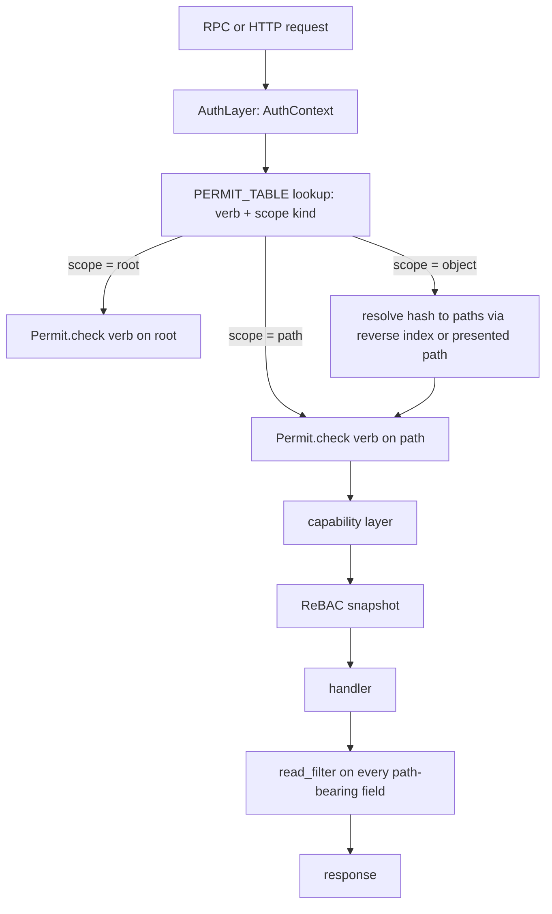

# Authorization audit

Every handler in `rill-server/src/services` is expected to call
`Permit::{read,write,review,land,admin}` before touching a repository, and
listings that could expose names of restricted directories are expected to
pass through `Permit::read_filter`. This brief enumerates every RPC and
HTTP route, states what check runs, and lists the gaps. The invariant that
matters most: the capability layer and the ReBAC layer must both run on
every path, and any response that carries paths must be filtered by the
caller's read filter.

## Current state

### The two layers

[permit.rs](../../crates/rill-server/src/auth/permit.rs) `Permit::check`:

1. `AuthContext::capability_allows(repo, path, verb)`: with no capability
   (static token, dev) always true; with a Biscuit capability, checks
   repo, verb set and path prefixes. `Capability::workspace` is ignored
   ([04](04-authentication-and-identity.md)).
2. Skipped in `dev_mode` or when the repository has zero tuples (the
   bootstrap rule): `Authorizer::check_path(principal, teams, relation,
   path)` over `dir_object(path)` and its ancestors with the rewrite table
   in [model.rs](../../crates/rill-policy/src/rebac/model.rs)
   (`owner ⊇ writer ⊇ reader`, `owner ⊇ reviewer`,
   `writer ⊇ contributor`).

`Permit::read_filter` returns `allow_all` in dev or bootstrap, else
`PathFilter::under(granted_dirs(Reader))`. `read_filter` does not consult
the capability. `Permit::review()` and `land()` always check the root.
`Relation::Contributor` is defined and rewritten but no handler asks for
it: there is no "submit without land" path.

Tuples are read through a 500 ms `SnapshotCache`
([snapshot.rs](../../crates/rill-policy/src/rebac/snapshot.rs));
`grant`/`revoke` invalidate the local process only.

Cedar ([submit/](../../crates/rill-policy/src/submit/)) is used only by
`rill-review` to decide `RequestLand` / `EvaluateSubmit`; it is not part
of the path permission check. `.rill/risk.toml` and `.rill/submit.cedar`
appear in doc comments ([risk/config.rs](../../crates/rill-policy/src/risk/config.rs))
but nothing loads policy from the tree: only `misc/policy:*` records and
`ServerConfig.risk` ([state/policy.rs](../../crates/rill-server/src/state/policy.rs)).

### Per-path table

Legend: `root R` = `permit().read(root)`; `path R` = read on the request
path; `W` likewise for write; `filter` = `read_filter` applied to output;
`owner` = `owns_or_admin`. "Leak" lists what a caller can learn beyond
their scope.

**RepoService** ([services/repo/](../../crates/rill-server/src/services/repo/mod.rs))

| RPC | Check | Output filtered | Notes / leak |
| --- | --- | --- | --- |
| GetRepo | root R | n/a | |
| ListRepos | root R per repo | by check | builds every repo's context (spawns workers) on each call |
| CreateRepo | authenticated only | n/a | any principal creates repos; becomes owner |
| GetChangeVersion | root R | no | returns full `file_changes` (paths, content refs) and stored signatures |
| GetChangeInfo | root R | no | message, author, provenance |
| GetChangeVersions | root R | no | |
| Log | root R; path R when `path` set | no | `ChangeInfo` has no paths; fine |
| PathHistory | path R | n/a | `FileChange` for that path only |
| Blame | path R | n/a | |
| Grep | **none**; `read_filter` only | yes (ReBAC) | capability verb/path never checked; a token with verbs `[Write]` or paths `[docs]` can search everything its principal's relations allow |
| GetTree | root R | no | by hash; path-scoped readers are denied entirely |
| ListDir | path R | yes | correct |
| ResolvePath | path R | n/a | |
| GetBlob | root R | no | by content ref |
| PutBlob | root W (after the whole stream is buffered in memory) | n/a | up to 64 MiB reserved; no size cap on the stream |
| HasObjects | root R | n/a | existence oracle for any hash |
| Diff | root R | yes | correct |
| MergeBase / IsAncestor | root R | n/a | |
| CreateChangeVersion | path W per `file_changes` key; root W if both maps empty | n/a | **`subtree_changes` paths are never checked**; `author` and `signatures` unverified ([04](04-authentication-and-identity.md)) |
| ApplyEdits | path W per edit; root W if no edits | n/a | `amend` of another principal's change is allowed (no owner check) |
| Rebase | root W | n/a | |
| Merge | root W | n/a | |
| Resolve | path W per resolution | n/a | the committed version keeps the other `file_changes` of the original, so a writer of `/a` can re-commit a version touching `/b`; no owner check |
| ResolveRef / ListRefs | root R | no | ref names leak |
| MoveRef | root W | n/a | trunk refused; target must exist; no per-ref ownership |
| TrunkHead / TrunkRange | root R | no | |
| WatchRefs / WatchTrunk / WatchLog | root R at subscribe | no | permission is checked once; a revoke does not end the stream |
| GetDerived / WaitDerived | root R | no | returns raw derived bytes for any kind, including `PathHistory`, search shards (`idx:post@1`) and action-cache results (`ac@1`) that embed paths and outputs |

**WorkspaceService** ([workspace.rs](../../crates/rill-server/src/services/workspace.rs))

| RPC | Check | Notes / leak |
| --- | --- | --- |
| CreateWorkspace | root W | |
| GetWorkspace | root R | any reader sees any workspace: name, owner, snapshot hash, sparse profile |
| ListWorkspaces | root R | same, for all workspaces |
| SetSparseProfile / Snapshot / UpdateBase / Handoff / Undo / DeleteWorkspace | root W + owner | `Handoff` to any principal without consent; `Snapshot` accepts any uploaded tree, so a path-scoped writer can snapshot content under paths it cannot write (checked only at `NewChange`) |
| NewChange | root W + owner; path W per diff entry | correct |
| ListOperations | root R | actors and snapshots of any workspace |
| WorkspaceDiff | root R + filter | correct |

**ReviewService** ([review.rs](../../crates/rill-server/src/services/review.rs))

| RPC | Check | Notes / leak |
| --- | --- | --- |
| GetReview / ListReviews / WatchReview | root R | threads, votes, risk reasons (which name paths), comments on any path |
| SubmitForReview | root W | any writer can submit anyone's change |
| Vote / Comment / ReplyThread / ResolveThread | review (root) | comments may anchor on any path; no path check |
| SetStack | root W | no owner check on the changes |
| EvaluateSubmit | root R | |
| Abandon | root W + owner | |
| RequestLand | land (= Writer on root) + Cedar | |
| GetLandStatus | root R | |

**IntentService** ([intent.rs](../../crates/rill-server/src/services/intent.rs))

| RPC | Check |
| --- | --- |
| CreateIntent / LinkChange | root W |
| GetIntent / ListIntents / FindSimilarIntents | root R |
| UpdateIntent | root W + owner |

**LanderService** ([lander.rs](../../crates/rill-server/src/services/lander.rs))

| RPC | Check | Notes |
| --- | --- | --- |
| GetTrunkStatus / ListLandings / GetVerification | root R | verification `details` and external report `artifact` bytes are returned to any reader |
| ReportVerification | land | any lander can file a report for any target; one per (target, reporter) |
| RevertSeq | land | no Cedar evaluation; a revert bypasses the submit policy |
| Bisect | land | runs verification jobs on demand: resource consumption by any lander |

**AdminService** ([admin.rs](../../crates/rill-server/src/services/admin.rs))

| RPC | Check | Notes |
| --- | --- | --- |
| WhoAmI | authenticated | |
| IssueToken | narrower-than parent, else admin | `for_principal` unconstrained ([04](04-authentication-and-identity.md)) |
| AddRelation / RemoveRelation | admin | an owner can remove the last owner tuple, which re-opens the repository (bootstrap rule) |
| ListRelations | root R | every reader sees every grant on the object |
| GetPolicy | root R | |
| SetPolicy | admin | |
| Health | **none** (no caller check) | exposes repository count and uptime without a token |

**HTTP object protocol** ([objects/](../../crates/rill-server/src/objects/mod.rs))

| Route | Check | Notes |
| --- | --- | --- |
| GET/HEAD `/o/{repo}/{kind}/{hash}` | root R | any object of any kind by hash, including `cv` and `derived` |
| PUT `/o/{repo}/{kind}/{hash}` | root W | any kind; `cv` and `tree` objects enter the store without `commit_version` validation |
| POST `/o/{repo}/batch` | root R | up to 10 000 objects |
| `/healthz`, `/readyz` | none | |

### Tests

`grpc_smoke.rs` has two tests: `dev_mode_end_to_end` (every check passes)
and `static_auth_denies_unrelated_principal` (one `ListDir` deny and
`ListRepos` filtering). `rebac/tests.rs` covers the snapshot logic.
Nothing exercises a path-scoped reader against listings, diffs, grep,
blame, watches or the object protocol, and nothing exercises a capability
token against any handler.

## Why it blocks production

1. **Path scoping is nominal.** A `reader` of `dir:/docs` (the only way to
   give a contractor or an agent partial access) is denied `GetTree`,
   `GetBlob`, `Diff`, `Log`, watches and the object protocol, because they
   check the root. The SDK's checkout and `rill cat` use `GetBlob` and
   `GetTree`. So in practice every user is a root reader, and the filters
   are never exercised by real traffic.
2. **Capability bypass on Grep.** An agent token restricted to `docs/`
   can search `src/` because `grep_impl` never calls `permit().read`.
3. **Subtree bypass on CreateChangeVersion.** A writer of `/a` submits a
   version whose `subtree_changes` rewrites `/b`; no path check runs.
4. **Derived-data channel.** `GetDerived` hands out search shards and
   action-cache results that embed paths and command output to any root
   reader; there is no allow-list of kinds.
5. **Streams outlive revocation.** A revoked reader keeps receiving
   `WatchLog` until the connection drops.
6. **Self-lockout and re-open.** Removing the last owner silently turns on
   the bootstrap rule; a repository with no tuples is readable and
   writable by every authenticated principal, including agents holding
   tokens for other repositories (the capability layer still checks
   `repo`, but static-token agents have no capability).
7. **No test matrix.** Any of the above can regress without a failing
   test.

## Requirements

* R1. Every handler calls `Permit::check` with the most specific path the
  request names, or `root` with a comment stating why root is required.
  A `#[deny]`-style test enumerates the proto service descriptors and
  asserts each method name appears in a `PERMIT_TABLE` constant with its
  verb and scope; a new RPC without an entry fails the build.
* R2. Path-scoped readers can use the product: `GetTree`, `GetBlob`,
  `GetChangeVersion`, `Diff`, `Log`, `WatchLog` and the object protocol
  work for a reader of `dir:/docs` and return only what is under `docs`.
* R3. The capability layer runs on every path, including `Grep`,
  `ListRepos`, `Health` (deny without a token outside dev) and HTTP.
* R4. `subtree_changes` keys are write-checked; `Resolve` checks write on
  every path in the resulting version; `ApplyEdits` with `amend` and
  `SetStack` check `owns_or_admin` on the change owner.
* R5. `GetDerived` serves an allow-list of kinds and applies the read
  filter where the kind embeds paths; search shards and action-cache rows
  are not served raw.
* R6. Watch streams re-check permission on a timer (≤ 30 s) and on
  `RefMoved`/relation events, and terminate with `PERMISSION_DENIED` on
  loss.
* R7. Removing the last `owner` tuple on `repo` is refused; the bootstrap
  rule is replaced by an explicit `open = true` repository flag that only
  `CreateRepo` sets for a repository created in dev mode.
* R8. A permission test matrix runs in CI: principals × relations × RPCs
  with expected outcomes, for static and Biscuit credentials, including
  path-scoped and workspace-pinned tokens.
* R9. Snapshot invalidation propagates across replicas within one second
  (a `rebac_version` key bumped on every grant/revoke and polled, or an
  event on the bus).

## Design direction

### Recommended: object reads resolve to paths, a declarative permit
table, and filtered derived data

1. **Permit table.** A `const PERMIT_TABLE: &[(&str, Verb, Scope)]` in
   `services/mod.rs`, where `Scope` is `Root`, `Path(field)`,
   `Object`, `Workspace(field)` or `None`. Handlers call
   `permit_for("rill.v1.RepoService/ListDir", &req)` which reads the
   scope from the table; a test walks `rill_proto::FILE_DESCRIPTOR_SET`
   and asserts coverage. This makes R1 mechanical.
2. **Object reads for path-scoped readers.** Two options; recommend both:
   (a) content-addressed reads take an optional `path` hint
   (`GetBlob{content, path}`, `GET /o/{repo}/blob/{hash}?path=`), the
   server verifies the hash is what the tree resolves at that path for the
   given root and checks read on the path; (b) for trees, `GetTree` by
   hash requires root read as today, but `ListDir` and `ResolvePath`
   already serve path-scoped listing, so the SDK's checkout walks by path.
   `Diff` and `Log` already filter; the root-read guard on them is dropped
   in favour of "caller has any reader tuple" (`granted_dirs` non-empty).
3. **Filtered views.** `GetChangeVersion` filters `file_changes` and
   `subtree_changes` through the read filter and sets a
   `filtered: true` flag so the client knows the hash will not verify.
   `GetReview` filters thread anchors and risk reasons by path. `GetDerived`
   dispatches by kind: `RootTree`, `Generation`, `ChangeSummary` pass;
   `PathHistory` is filtered; `idx:*`, `ac@1`, `land@1`, `postland@1` are
   refused (they have typed RPCs).
4. **Write-side closure.** `commit_version` is the choke point: it checks
   write on every key of `file_changes` and `subtree_changes` of the
   version it is about to store (not only the request's edits), so
   `Resolve`, `Rebase` and `Merge` inherit the rule.
5. **Revocation propagation.** `Authorizer` keeps `rebac_version` from a
   `misc/rebac_version` key, bumped in the same transaction as the tuple
   write; the snapshot is refreshed when the version changes (one `get`
   per TTL instead of a scan). Watch streams hold a `Permit` and re-run
   it when the version changes.
6. **Bootstrap replacement.** `RepoConfig.open: bool`; `CreateRepo`
   grants `owner` and sets `open = false`; `RemoveRelation` refuses to
   remove the last `owner`; a `rill-server repo open/close` admin command
   exists for recovery.
7. **Test matrix.** A table-driven test in `rill-server/tests/permissions.rs`
   builds one repository with tuples `{owner: alice, writer: team core on
   dir:/src, reader: bob on dir:/docs, reviewer: carol}` and principals
   `{alice, bob, carol, dave (none), bot (Biscuit read docs), bot2 (Biscuit
   write src pinned to ws)}`, then asserts the gRPC code of every RPC in
   the table for every principal. Expected values live next to the
   `PERMIT_TABLE`.

### Alternatives considered

* **Per-object ACLs (store the allowed dirs on each object).** Breaks
  content addressing and the immutable object protocol. Rejected.
* **Encrypt restricted subtrees with per-directory keys** (as some
  monorepo systems do for secrets directories). Strong but a large
  design; path-scoped reads through a path hint cover the common case.
* **Move all checks into Cedar.** One policy language for everything is
  attractive, but Cedar evaluation per path per request is slower than
  the tuple snapshot, and ReBAC with inheritance is what Zanzibar-style
  systems have shown scales. Keep Cedar for submit rules; consider Cedar
  for admin actions later.
* **Drop path-scoped access entirely** and make every repository
  all-or-nothing. Simplest and honest about today's behaviour, but
  agents are the primary user and least-privilege per directory is the
  stated product goal (principle 8).

### Trade-offs

Filtered `GetChangeVersion` responses no longer hash to their id; clients
that verify must know. The path hint on `GetBlob` costs one tree lookup
per blob read for scoped readers only. `rebac_version` adds one `get` per
TTL per replica.

## Work breakdown

1. **S** Add `permit().read(root)` (capability layer) to `Grep`; check
   `subtree_changes` in `CreateChangeVersion`; move all write-path checks
   into `commit_version`. Tests.
2. **S** Allow-list in `GetDerived`/`WaitDerived`; filter `PathHistory`.
3. **M** `PERMIT_TABLE` + descriptor coverage test; migrate handlers to
   `permit_for`.
4. **M** Path hint on `GetBlob` and `GET /o/`; `Diff`/`Log`/`WatchLog`
   guarded by "any reader tuple" instead of root; SDK checkout uses paths.
5. **M** Filtered `GetChangeVersion` and `GetReview`; `filtered` flag in
   proto.
6. **S** Refuse removing the last owner; `RepoConfig.open` flag and the
   recovery command.
7. **M** `rebac_version` key, cross-replica snapshot refresh, watch
   re-check and termination.
8. **M** Permission test matrix (`tests/permissions.rs`) covering every
   RPC, both credential types, path-scoped and workspace-pinned tokens.
9. **S** `Health` RPC requires authentication outside dev mode; `/readyz`
   stays open but returns no detail.
10. **S** `owns_or_admin` on `ApplyEdits` amend and `SetStack`; `Handoff`
    requires the recipient to accept (or an admin), recorded as an op.

## Risks and open questions

* Hash-addressed reads are the foundation of the CDN story; adding a path
  hint keeps URLs immutable (`?path=` is a check, not an identity) but
  edge caches must include the query string in their key or serve a
  cached object to an unauthorised path. Cache-key configuration becomes
  an operator concern.
* `ListRepos` resolves every repository's context to run the check,
  spawning workers for each; with many repositories this is a startup
  cost on first call. The check only needs tuples, not a full context.
* Whether `Contributor` should gate `SubmitForReview` (today root write
  does). The relation exists for exactly that and is unused.
* Review threads anchored on paths the voter cannot read: the current
  code lets a reviewer comment anywhere; filtering comments by path on
  read may hide a reviewer's own comment from a scoped reader.
* Cedar policy surface: `evaluate_for` gets the caller and the review
  state; whether landing rules should see `teams` and `sponsor` (they do
  not today) is an input to [04](04-authentication-and-identity.md).

## References

Source:

* [crates/rill-server/src/auth/permit.rs](../../crates/rill-server/src/auth/permit.rs)
* [crates/rill-server/src/services/common.rs](../../crates/rill-server/src/services/common.rs)
* [crates/rill-server/src/services/repo/trees.rs](../../crates/rill-server/src/services/repo/trees.rs)
* [crates/rill-server/src/services/repo/history.rs](../../crates/rill-server/src/services/repo/history.rs)
* [crates/rill-server/src/services/repo/grep.rs](../../crates/rill-server/src/services/repo/grep.rs)
* [crates/rill-server/src/services/repo/write.rs](../../crates/rill-server/src/services/repo/write.rs)
* [crates/rill-server/src/services/repo/refs.rs](../../crates/rill-server/src/services/repo/refs.rs)
* [crates/rill-server/src/services/repo/watch.rs](../../crates/rill-server/src/services/repo/watch.rs)
* [crates/rill-server/src/services/diff.rs](../../crates/rill-server/src/services/diff.rs)
* [crates/rill-server/src/services/workspace.rs](../../crates/rill-server/src/services/workspace.rs)
* [crates/rill-server/src/services/review.rs](../../crates/rill-server/src/services/review.rs)
* [crates/rill-server/src/services/intent.rs](../../crates/rill-server/src/services/intent.rs)
* [crates/rill-server/src/services/lander.rs](../../crates/rill-server/src/services/lander.rs)
* [crates/rill-server/src/services/admin.rs](../../crates/rill-server/src/services/admin.rs)
* [crates/rill-server/src/objects/handlers.rs](../../crates/rill-server/src/objects/handlers.rs)
* [crates/rill-server/src/objects/batch.rs](../../crates/rill-server/src/objects/batch.rs)
* [crates/rill-policy/src/rebac/authorizer.rs](../../crates/rill-policy/src/rebac/authorizer.rs)
* [crates/rill-policy/src/rebac/model.rs](../../crates/rill-policy/src/rebac/model.rs)
* [crates/rill-policy/src/rebac/snapshot.rs](../../crates/rill-policy/src/rebac/snapshot.rs)
* [crates/rill-server/tests/grpc_smoke.rs](../../crates/rill-server/tests/grpc_smoke.rs)

Prior art:

* Google Zanzibar (Pang et al. 2019): userset rewrites, snapshot reads
  with zookies for consistency across replicas; SpiceDB and OpenFGA as
  open implementations with `ZedToken`/consistency modes, the model for
  `rebac_version`.
* Piper/CitC path-level ACLs and Perforce protections tables for
  directory-scoped access in a monorepo.
* Gerrit `project.config` access sections with ref-level `read` and the
  "block" semantics for last-owner protection.
* Cedar policy language and its validation; AWS Verified Permissions
  for the policy/ReBAC split.
* Sapling/Mononoke "hooks" and ACL checks on `pushrebase`, including
  `allow_writes` per path prefix.
* GitHub CODEOWNERS and required reviewers as the user-facing shape of
  `Contributor`/`Reviewer`.
