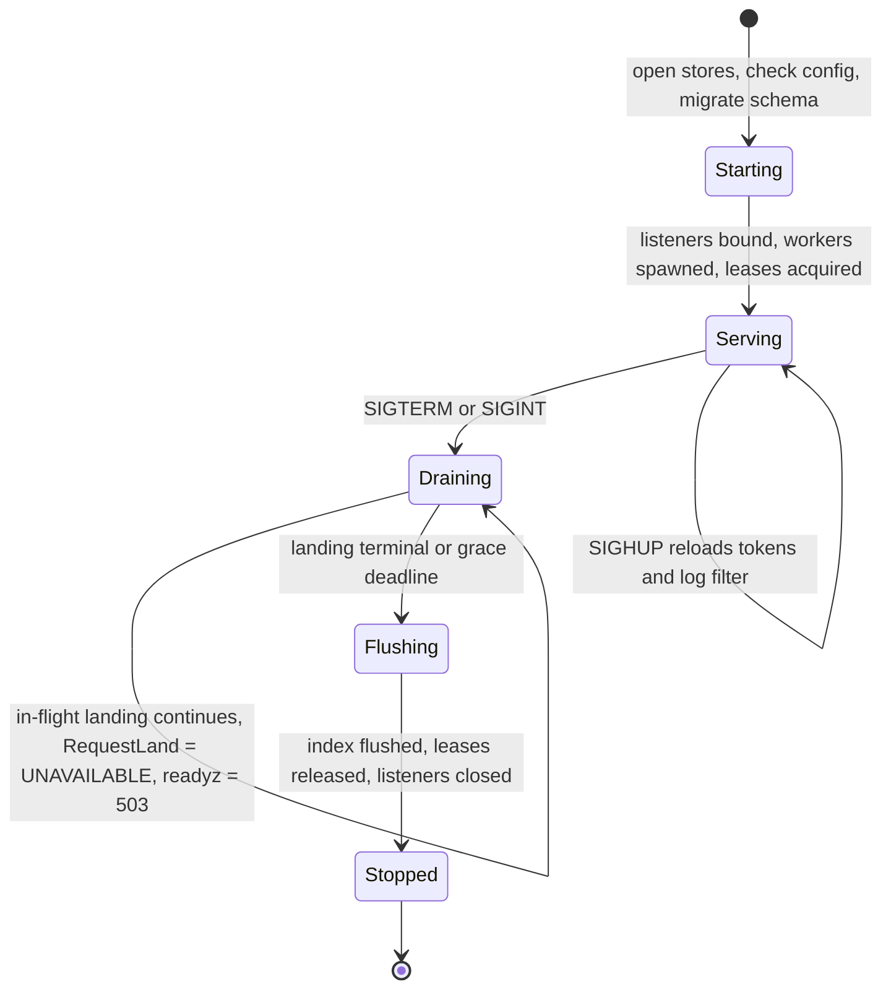

# Operations and observability

`rill-server` is one binary that opens a store, spawns per-repository
workers and serves gRPC and HTTP until Ctrl-C. It logs through
`tracing-subscriber` to stderr, exposes a gRPC health service and two HTTP
probes, and has no metrics, no trace export, no rate or concurrency
limits, no request timeouts, no SIGTERM handling, no packaging and no
runbooks. The invariant that matters most: an operator must be able to
tell, from outside the process, whether landing is progressing and
whether the stores are healthy, and must be able to stop and upgrade the
process without losing an in-flight landing.

## Current state

### Process lifecycle

[rill-cli/src/server/mod.rs](../../crates/rill-cli/src/server/mod.rs):

* `init_logging`: `tracing_subscriber::fmt()` with `EnvFilter` from
  `RUST_LOG` (default `info`), writer stderr, text format. The `json`
  feature of `tracing-subscriber` is enabled in the workspace but never
  selected.
* Shutdown: one `tokio::signal::ctrl_c()` task cancels a
  `CancellationToken`. `SIGTERM` (what `docker stop`, Kubernetes and
  systemd send) is not handled; the process dies immediately with in-
  flight landings mid-pipeline (see [02](02-crash-recovery-and-consistency.md)).
* On cancel, [serve.rs](../../crates/rill-server/src/serve.rs) calls
  tonic `serve_with_incoming_shutdown` and axum `with_graceful_shutdown`,
  which stop accepting and drain connections with no deadline. Workers
  watch the same token: `Lander::run_forever` exits at the next select,
  leaving a `process()` in progress to be dropped when the runtime drops;
  `indexer::run` flushes on exit; the post-land verifier stops between
  sweeps. There is no "stop accepting land requests, finish the current
  one, then exit" sequence.
* No PID file, no `--version` beyond clap's, no `--check-config`.

### Configuration

[config.rs](../../crates/rill-server/src/config.rs): TOML with
`RILL_*` overrides, all fields defaulted. Validation is parse-only:

* `dev_mode = true` with `listen_grpc = 0.0.0.0:7420` starts and serves
  the world as `human:dev`.
* `AuthConfig::Static { tokens: [] }` (the default) with `dev_mode =
  false` starts a server no one can authenticate to, with no warning.
* `AuthConfig::Biscuit` without `root_private_key_hex` starts with an
  ephemeral issuer ([04](04-authentication-and-identity.md)); logged at
  `info`.
* `StorageConfig::S3` is not validated until `open_stores` fails; a bad
  URL is a startup error, a wrong bucket is a runtime `Unavailable`.
* `postland.interval_secs = 0` is clamped to 1 in `postland_interval`;
  `lander.batch_window = 0` spins.
* `verify.sandbox` has one variant (`Local`) and
  [sandbox/local.rs](../../crates/rill-exec/src/sandbox/local.rs) runs
  repository-controlled commands as the server user with the server's
  network; `network = false` is advisory. The Firecracker sandbox
  ([firecracker.rs](../../crates/rill-exec/src/sandbox/firecracker.rs))
  returns `NotSupported`.
* `rill-server init-config` writes an annotated default file
  ([template.rs](../../crates/rill-cli/src/server/template.rs)).

### Health

* gRPC: `tonic_health` reports `SERVING` for every service at startup and
  never changes it.
* HTTP: `/healthz` returns `ok` unconditionally; `/readyz` runs
  `health_components` ([admin.rs](../../crates/rill-server/src/services/admin.rs)):
  `list_repos` on the meta store, `has` of the empty-blob hash on the
  object store, and uptime. Neither probe reflects lander liveness,
  worker backlog, lease state or store latency. `/readyz` and the `Health`
  RPC need no token and return repository count and error strings.

### Metrics, tracing, logs

* Metrics: none. No `prometheus`, `metrics` or `opentelemetry` crate is
  in `Cargo.lock`; nothing counts requests, landings, verification
  durations, queue depth, cache hit rates or store latency.
* Tracing: `tracing` spans and events exist throughout (`tracing::info!`
  with structured fields on landings, imports, policy reloads); no
  OpenTelemetry exporter, no trace or request id propagated from
  headers, no span per RPC. `tower-http` is a dependency but its
  `TraceLayer` is not applied.
* Logs: stderr text only; no JSON option, no file rotation, no
  sampling. Secrets: static tokens are never logged; the
  `RILL_STATIC_TOKENS` value would appear in `ps` output and in any
  environment dump.

### Limits

| Surface | Limit | Source |
| --- | --- | --- |
| gRPC message size | tonic default 4 MiB decode, unlimited encode | not configured |
| `PutBlob` stream | none; buffered entirely in memory (`reserve` capped at 64 MiB, growth unbounded) | [trees.rs](../../crates/rill-server/src/services/repo/trees.rs) |
| HTTP `PUT /o/` body | `MAX_PUT_BYTES = 256 MiB`, buffered in memory | [objects/mod.rs](../../crates/rill-server/src/objects/mod.rs) |
| `POST /o/batch` | 10 000 objects; response streamed | [batch.rs](../../crates/rill-server/src/objects/batch.rs) |
| Inline content in a change | `MAX_INLINE = 1 MiB` per file | [trees.rs](../../crates/rill-server/src/services/repo/trees.rs) |
| Diff | 4 MiB per file, 1000 files default | [diff.rs](../../crates/rill-server/src/services/diff.rs) |
| Log/history pages | 100 default, 10 000 max | [history.rs](../../crates/rill-server/src/services/repo/history.rs) |
| Grep | 200 default, 5000 max, 20 context lines | [grep.rs](../../crates/rill-server/src/services/repo/grep.rs) |
| `WaitDerived` | 60 s | [refs.rs](../../crates/rill-server/src/services/repo/refs.rs) |
| Concurrent requests | none | |
| Per-principal rate | none | |
| Request timeout | none (verification has `max_wait`, default 30 min) | [config.rs](../../crates/rill-lander/src/config.rs) |
| Watch streams | unbounded count; 256-item buffer each | [watch.rs](../../crates/rill-server/src/services/repo/watch.rs) |
| Event bus | 4096 per repo, lossy | [state/events.rs](../../crates/rill-server/src/state/events.rs) |
| Per-repo caches | derived 8192 entries, tree cache `DEFAULT_TREE_CACHE`, whole search index in memory | [registry.rs](../../crates/rill-server/src/state/registry.rs) |

`ListRepos` builds every repository's context (spawning three workers
each) on first call; `RepoRegistry::warm` does the same at startup. Memory
grows with repository count regardless of use.

### Packaging and upgrade

No `Dockerfile`, no `systemd` unit, no Helm chart, no `.github/workflows`,
no release process in the tree. The binary is `cargo build --release`.
There is no documented upgrade procedure, no schema version
([03](03-backup-restore-and-migration.md)) and no compatibility statement
between SDK and server versions (the SDK falls back when a server lacks
`Grep`, per `ARCHITECTURE.md`; nothing else is versioned).

### Runbooks

None. `docs/GETTING_STARTED.md` and `docs/USER_GUIDE.md` cover usage.

## Why it blocks production

1. **`docker stop` loses landings.** SIGTERM kills the process; a landing
   between `land_on_trunk` and `finalize` leaves the review stuck
   ([02](02-crash-recovery-and-consistency.md)). Every deploy is a
   potential incident.
2. **Nobody can see the queue.** With no metrics, a stalled lander (a
   verification hung for 30 minutes, a lease lost) is invisible until a
   user complains; `/readyz` says ready.
3. **Memory is unbounded.** One client streaming a 2 GB `PutBlob`, or
   twenty clients each `PUT`ting 256 MiB, takes the process down; no
   admission control exists. An agent in a loop calling `Bisect` runs
   unbounded verification jobs on the host.
4. **Verification runs as the server.** `verify.enabled = true` executes
   `.rill/verify.toml` commands from the repository as the server user
   with the server's network and credentials (S3 keys in the
   environment are filtered by `env_clear`, but files on disk, the
   metadata database and the Unix socket namespace are reachable). Any
   writer can run code on the server host.
5. **Misconfiguration starts silently.** Public dev mode, an
   unauthenticatable server, and an ephemeral token issuer are all
   accepted.
6. **No way to ship it.** Without a container image, a unit file and an
   upgrade procedure, the first production deployment is improvised and
   unrepeatable.

## Requirements

* R1. Signals: `SIGTERM` and `SIGINT` both start a graceful shutdown:
  stop accepting new land requests (`RequestLand` returns `UNAVAILABLE`),
  let the in-progress landing reach a terminal status or a bounded
  deadline (`shutdown.grace_secs`, default 60), flush the search index,
  release leases, then exit. `SIGHUP` reloads the static token table and
  log filter without restart.
* R2. Config validation at startup with `rill-server check-config`
  returning non-zero on: dev mode on a non-loopback address; no
  authenticator that can succeed; Biscuit without a persistent issuing
  key outside dev; S3 bucket not reachable (one `head` probe); `batch_window
  = 0`; `verify.enabled` with `sandbox = local` unless
  `verify.allow_unsandboxed = true`.
* R3. Metrics exported in Prometheus text format on the HTTP listener at
  `/metrics` (auth optional, configurable), covering at minimum: RPC
  count/latency/status by method; HTTP object protocol count/bytes/
  status; land queue depth, landings per outcome, land pipeline duration
  by stage; verification runs, duration, cache hit ratio; post-land cursor
  lag (head minus cursor); store operation latency and error count by
  backend and op; object and metadata bytes written; event bus lag
  counts; watch stream count; derived cache hit ratio; worker lease held
  (gauge); process RSS, tokio runtime metrics.
* R4. Tracing: a span per RPC and HTTP request carrying `request_id`,
  `principal`, `repo`, `method`; W3C `traceparent` accepted and
  propagated; OTLP export configurable (`telemetry.otlp_endpoint`); JSON
  log format selectable (`telemetry.log_format = json`).
* R5. Health: `/readyz` reflects lease ownership, store probe latency
  below a threshold and worker liveness (each worker touches a heartbeat
  `Instant`); gRPC health status is updated from the same signals;
  `/livez` is a plain liveness probe.
* R6. Limits: configurable `limits.max_blob_bytes` (default 256 MiB)
  enforced on `PutBlob` while streaming (reject at the first byte over);
  `PUT /o/` streams to the object store through a bounded buffer or a
  temp file instead of `Bytes` in memory; gRPC max message size set
  explicitly; `limits.max_concurrent_requests` (tower `ConcurrencyLimit`)
  and `limits.max_inflight_bytes`; per-principal token-bucket rate limit
  on writes and on `Bisect`/`RevertSeq`; request timeouts per RPC class
  (reads 30 s, writes 120 s, watches none).
* R7. Packaging: a multi-stage `Dockerfile` producing a distroless image
  running as non-root with `/var/lib/rill` as a volume; a `systemd`
  unit with `Type=notify` (or `simple` plus a readiness probe),
  `KillSignal=SIGTERM`, `TimeoutStopSec` ≥ grace; a Helm chart or
  Kubernetes manifest with probes wired to R5; CI that builds, tests
  (including the MinIO and FDB jobs from [01](01-storage-durability.md))
  and publishes the image on tags.
* R8. Upgrade procedure documented and tested: schema check at startup
  ([03](03-backup-restore-and-migration.md)), N-1 SDK compatibility
  statement, rolling upgrade order (replicas without the lease first),
  and a rollback step.
* R9. Runbooks in `docs/ops/` for: stuck landing, lease not acquired,
  store unavailable, disk full, revoke a token, rotate the root key,
  restore from backup, re-index search, run `fsck`, reclaim space with
  `gc`.

## Design direction

### Recommended: a `telemetry` module, a `limits` layer stack, and a
documented shutdown state machine

1. **Shutdown.** `AppState` gains a `phase: ArcSwap<Phase>`. The signal
   task sets `Draining`, `RequestLand` and `PutBlob` check it, `/readyz`
   returns 503, the lander finishes `process()` for the current request
   and skips the rest of the batch, then the token is cancelled. systemd
   notify via `sd_notify` (`READY=1`, `STOPPING=1`) through the `libc`
   dependency already present or the `sd-notify` crate.
2. **Telemetry module** in `rill-server/src/telemetry/`: `metrics` crate
   facade with `metrics-exporter-prometheus`; a tower layer for gRPC and
   an axum middleware for HTTP recording method, status, duration and
   bytes; store wrappers (`InstrumentedObjectStore`,
   `InstrumentedMetaStore` implementing the traits over an inner `Arc`)
   so every backend is measured identically; lander and post-land
   gauges updated from `LandQueue::len` and the cursor. OpenTelemetry via
   `tracing-opentelemetry` with OTLP, enabled by config; `tower-http`
   `TraceLayer` with a request-id maker. JSON logs via the existing
   `tracing-subscriber` `json` feature.
3. **Limits layer stack.** On the gRPC router: `ConcurrencyLimitLayer`,
   `TimeoutLayer` keyed by method class, a `RateLimit` layer keyed by
   principal (a `governor`-style keyed token bucket after auth), and
   tonic's `max_decoding_message_size`. On axum: `DefaultBodyLimit` from
   config and a streaming `PUT` that hashes incrementally and writes to
   the object store through a temp file or multipart upload. `PutBlob`
   hashes incrementally and aborts over the limit.
4. **Sandbox gate.** `verify.enabled` requires `verify.sandbox != local`
   or an explicit `allow_unsandboxed = true` with a startup warning; the
   Firecracker (or gVisor) backend from
   [firecracker.rs](../../crates/rill-exec/src/sandbox/firecracker.rs) is
   the production path and a separate brief.
5. **Health signals.** Each worker loop updates an `AtomicU64` heartbeat;
   `health_components` adds `lander`, `postland`, `indexer`, `lease`
   components with `ok` derived from heartbeat age and lease state; the
   gRPC health reporter is updated by a periodic task.
6. **Packaging.** `deploy/Dockerfile` (cargo-chef for layer caching,
   `gcr.io/distroless/cc` runtime, `USER 65532`), `deploy/systemd/
   rill-server.service`, `deploy/k8s/` manifests with a `StatefulSet` for
   the local backend and a `Deployment` for S3+FDB, `.github/workflows/
   ci.yml` (fmt, clippy, test, MinIO and FDB service containers) and
   `release.yml` (tag → image).
7. **Runbooks.** `docs/ops/<topic>.md`, each with symptoms, diagnosis
   (which metric, which log line, which `fsck` check) and the commands.

### Alternatives considered

* **OpenTelemetry metrics instead of Prometheus text.** OTel metrics are
  fine where a collector exists; Prometheus scraping is the lowest common
  denominator and the `metrics` facade can export both. Start with
  Prometheus.
* **Envoy or a service mesh for limits and timeouts.** Appropriate in
  Kubernetes, but the server must be safe on its own; keep the in-process
  limits and let a proxy add more.
* **Supervisor-style restart on any error** (restart loops instead of
  graceful shutdown). Masks the consistency issues; graceful drain plus
  `fsck` on startup is the correct pair.
* **Keeping the local sandbox as default with a warning.** The current
  state. Rejected: executing repository content on the server host is an
  RCE for any writer, and the default must be safe.

### Trade-offs

Instrumented store wrappers add an `Arc` indirection and an atomic
increment per call, negligible. Streaming `PUT` removes the single
in-memory `verify` and requires an incremental BLAKE3 hasher (supported
by the `blake3` crate) and a temp-file or multipart path per backend,
which is more code in `rill-store`. Per-principal rate limits need the
auth layer to run before the limit layer; the current layering (auth
wraps each service) must be reordered to a router-level auth layer.

## Work breakdown

1. **S** SIGTERM handling, `Phase` state, `RequestLand` refusal during
   drain, bounded grace deadline; test with a child process.
2. **S** `check-config` subcommand and startup validation rules in R2.
3. **M** Telemetry module: `metrics` facade, Prometheus exporter on
   `/metrics`, RPC and HTTP layers, instrumented store wrappers, lander
   and post-land gauges.
4. **M** Request ids, `traceparent` propagation, span per request,
   OTLP export, JSON log option.
5. **S** Health components for workers and lease; gRPC health updates;
   `/livez`.
6. **M** Limits: tonic message sizes, concurrency and timeout layers,
   keyed rate limiter after auth (router-level auth layer refactor),
   `PutBlob` streaming limit.
7. **L** Streaming `PUT /o/` and `PutBlob` with incremental hashing and a
   streaming `ObjectStore::put_stream` on local and S3 backends
   (multipart).
8. **S** Sandbox gate (`allow_unsandboxed`) and warning; the production
   sandbox is its own brief.
9. **M** `Dockerfile`, systemd unit, Kubernetes manifests, CI workflows
   with MinIO and FDB services, release workflow.
10. **M** Upgrade procedure and the runbooks in R9, each validated by
    running it once against a test deployment.

## Risks and open questions

* The runtime shuts down by dropping; a landing's `process()` future is
  cancelled at the next await, which can be between `land_on_trunk` and
  `finalize`. Draining must wait on the pipeline task, not only on the
  token; this depends on the queue persistence from
  [02](02-crash-recovery-and-consistency.md) to be fully safe.
* `metrics` cardinality: labels must exclude repository name by default
  (or cap it) for deployments with thousands of repositories.
* Rate limiting agents: an agent fleet behind one sponsor token looks
  like one principal; limits may need to key on `(principal, session)`
  from provenance, which is client-supplied.
* `env_clear` in the local sandbox drops `RILL_*` and AWS variables from
  verification commands, but a command can still read `/proc/<server
  pid>/environ` if it shares a user. The sandbox gate is the only real
  fix.
* Whether `/metrics` should require auth: default to the HTTP listener
  without auth but bindable to a separate address (`listen_metrics`), the
  common Prometheus arrangement.
* `tonic-health` and `tonic-reflection` are registered without the auth
  layer; reflection exposes the full API surface to unauthenticated
  callers, which is usually acceptable but should be a config option.

## References

Source:

* [crates/rill-cli/src/server/mod.rs](../../crates/rill-cli/src/server/mod.rs)
* [crates/rill-cli/src/server/template.rs](../../crates/rill-cli/src/server/template.rs)
* [crates/rill-server/src/serve.rs](../../crates/rill-server/src/serve.rs)
* [crates/rill-server/src/lib.rs](../../crates/rill-server/src/lib.rs)
* [crates/rill-server/src/config.rs](../../crates/rill-server/src/config.rs)
* [crates/rill-server/src/state/app.rs](../../crates/rill-server/src/state/app.rs)
* [crates/rill-server/src/state/registry.rs](../../crates/rill-server/src/state/registry.rs)
* [crates/rill-server/src/state/events.rs](../../crates/rill-server/src/state/events.rs)
* [crates/rill-server/src/workers/mod.rs](../../crates/rill-server/src/workers/mod.rs)
* [crates/rill-server/src/objects/mod.rs](../../crates/rill-server/src/objects/mod.rs)
* [crates/rill-server/src/objects/handlers.rs](../../crates/rill-server/src/objects/handlers.rs)
* [crates/rill-server/src/services/admin.rs](../../crates/rill-server/src/services/admin.rs)
* [crates/rill-server/src/services/repo/trees.rs](../../crates/rill-server/src/services/repo/trees.rs)
* [crates/rill-server/src/services/repo/watch.rs](../../crates/rill-server/src/services/repo/watch.rs)
* [crates/rill-lander/src/config.rs](../../crates/rill-lander/src/config.rs)
* [crates/rill-lander/src/land/lander.rs](../../crates/rill-lander/src/land/lander.rs)
* [crates/rill-exec/src/sandbox/local.rs](../../crates/rill-exec/src/sandbox/local.rs)
* [crates/rill-exec/src/sandbox/firecracker.rs](../../crates/rill-exec/src/sandbox/firecracker.rs)
* [Cargo.toml](../../Cargo.toml) (workspace dependencies: no metrics or
  OpenTelemetry crates)

Prior art:

* Google SRE Book: the four golden signals; "Release Engineering" and
  "Managing Incidents" chapters for runbook shape.
* Prometheus exposition format and the `metrics` /
  `metrics-exporter-prometheus` Rust crates; `tokio-metrics` for runtime
  gauges.
* OpenTelemetry tracing semantic conventions for RPC and HTTP spans; W3C
  Trace Context.
* `tower` `ConcurrencyLimit`, `Timeout`, `RateLimit`; `tower_governor`
  for keyed rate limiting; Envoy's admission control as the proxy-level
  complement.
* systemd `sd_notify` protocol and `Type=notify`; Kubernetes probe
  semantics (`startupProbe`, `readinessProbe`, `livenessProbe`).
* Gerrit's `show-queue`, `gc`, `index` SSH commands and its Prometheus
  metrics plugin as a mature VCS server's operator surface.
* Mononoke's `scuba` logging and per-repo rate limiting ("load shedding")
  configuration.
* Firecracker and gVisor for sandboxing untrusted verification steps;
  Bazel's `--spawn_strategy=sandboxed` as the build-side analogue.
* cargo-chef and distroless images for Rust service packaging.
