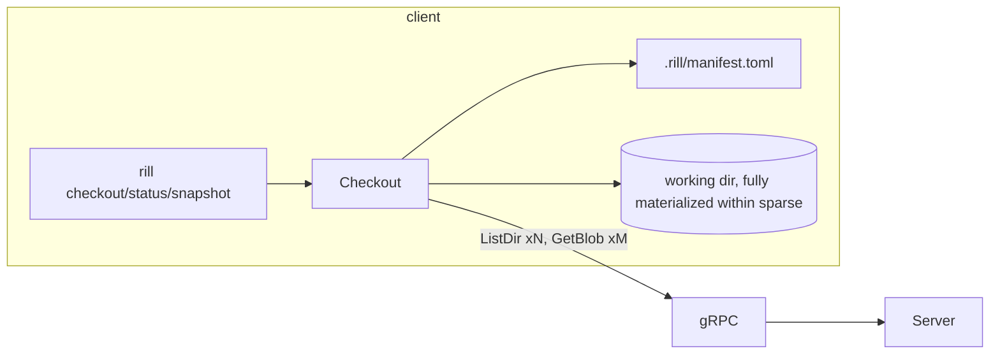
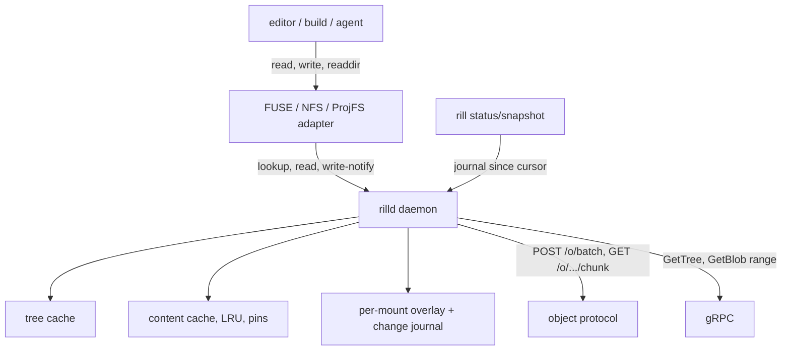

# Virtual filesystem

A Rill client holds a bounded cache, never the repository (principle 1). The
only working-copy implementation is `rill_sdk::local::Checkout`: a sparse,
eager materialization of a root into a directory, tracked by a manifest in
`.rill/`. Everything inside the sparse profile is fetched up front, status
walks the whole directory, and nothing is evicted. The invariant a virtual
filesystem must keep is that the bytes a program reads at a path equal the
content the manifest says is there, with the fetch deferred to the first read.

## Current state

| Concern | Source | Behavior now |
| --- | --- | --- |
| Create | [checkout.rs](../../crates/rill-sdk/src/local/checkout.rs) `Checkout::create` | `remote::list_tree` walks directories one `ListDir` RPC each (pruned by the `SparseProfile`), then `materialize` fetches each file with one `GetBlob` RPC and writes it. No batching, no parallelism, no use of `POST /o/{repo}/batch`. |
| Tracking | [meta.rs](../../crates/rill-sdk/src/local/meta.rs) | `.rill/checkout.toml` (endpoint, repo, workspace, base, base_version, working_change, sparse) and `.rill/manifest.toml`: per path `content_hash`, `local_hash`, `size`, `mtime_ms`, `kind`, `conflict`. TOML, rewritten whole on every save. |
| Status | [status.rs](../../crates/rill-sdk/src/local/status.rs) `compute_status` | For every manifest entry: `symlink_metadata`; if size and mtime match, unchanged, else read and hash. Then `walk_files` (the `ignore` crate, honoring `.rillignore`) over the whole tree for untracked files. O(files in checkout) per call, no caching between calls, no watcher. |
| Update | [update.rs](../../crates/rill-sdk/src/local/update.rs) | Lists the new root, classifies each path (upstream vs local change), three-way merges with `merge_file`, writes markers for conflicts. |
| Snapshot | `Checkout::snapshot` | Reads every added/modified file into memory as `Edit::Set { bytes }` and calls `ApplyEdits`; content goes through `store_content` on the SDK side (inline or `PutBlob`). |
| Sparse | [rill-types workspace.rs](../../crates/rill-types/src/objects/workspace.rs) `SparseProfile { include, exclude }` | Directory-prefix include/exclude. Server-side `WorkspaceService.SetSparseProfile` records it on the workspace; the checkout stores its own copy. |
| Blob reads | [blobs.rs](../../crates/rill-sdk/src/repo/blobs.rs), [trees.rs](../../crates/rill-server/src/services/repo/trees.rs) | `GetBlob(content, offset, length)` exists and streams `BlobChunk`s, but the server implements the range by `read_content` of the whole blob then slicing, so a range read costs a full reassembly. |
| Tree reads | `GetTree`, `ListDir`, `ResolvePath` | One directory per call; no "give me this subtree's entries" or "prefetch these N trees" RPC. The object protocol's `batch` endpoint can fetch tree objects by hash, but the SDK does not use it and would have to decode trees client-side. |
| Server tree walk | [rill-exec materialize.rs](../../crates/rill-exec/src/materialize.rs) | `TreeOps::walk` + batch writes; a server-side materializer the client does not share. |

There is no FUSE, NFS, ProjFS, or daemon code anywhere in the workspace. The
README lists "a virtual filesystem client" as not yet built.

## Why it blocks production

1. **Checkout time scales with the repository, not the change.** A 300k-file
   monorepo under an empty sparse profile means 300k `GetBlob` round-trips and
   every byte on disk before the first command runs. Principle 3 is violated
   at the client.
2. **Status is a full walk.** `compute_status` stats every tracked file and
   walks every directory. On a large tree that is seconds per `rill status`,
   and `snapshot` and `update` each call it.
3. **No eviction.** The sparse profile is the only size control. A developer
   who widens the profile to find a file keeps those bytes forever.
4. **Manifest rewrites are O(checkout).** TOML, rewritten whole; a 300k-entry
   manifest is tens of MB written on every `snapshot`, `update` and
   `mark_resolved`.
5. **Agents cannot share.** Each agent checkout materialises its own copy; ten
   agents on one host are ten copies of the same tree with no shared content
   cache.
6. **Range reads are not cheap.** `GetBlob` with `offset`/`length` reassembles
   the whole blob server-side (`read_content` then `slice`), so a VFS that
   reads 4 KiB pages of a 500 MB file costs 500 MB of server work per page.

## Requirements

* R1. Opening a checkout at any sparse profile, including the whole
  repository, completes in time proportional to the number of directories
  touched before the first read, not to file count or bytes. Test: `rill
  checkout` of a 100k-file synthetic repo returns in under 2 s with an empty
  local cache.
* R2. Reading a file fetches that file's content (and only its content) on
  first access, then serves from a local content-addressed cache; a second
  read of the same content hash by any checkout on the host hits the cache.
* R3. `status` reports changed paths in time proportional to the number of
  changed paths once a watcher is attached. Test: touch one file in a
  100k-file checkout; status completes in under 100 ms.
* R4. The local cache has a byte budget; eviction never removes content that a
  locally modified file's base needs (the three-way merge in `update` reads
  it) and never changes what a read returns.
* R5. Range reads of chunked blobs cost O(chunks covering the range) on the
  server.
* R6. Prefetch: the client can ask for a tree subtree's blobs in one request
  and the server streams them in a reasonable order; the batch object endpoint
  is the transport.
* R7. The same manifest semantics hold with or without the VFS: `snapshot`,
  `update`, `mark_resolved`, conflicts and `.rillignore` behave identically.
  The eager `Checkout` remains the fallback on platforms without a VFS.
* R8. Platform coverage is explicit: a documented matrix with a working path
  on Linux, macOS and Windows.

## Design direction

### Recommended: a per-host daemon with a content cache, a lazy "sparse-aware" checkout as the first step, FUSE/NFS/ProjFS mounts as the second

The design follows EdenFS and Sapling: one daemon per host owns a
content-addressed cache and serves many mounts; the mount is a thin layer that
asks the daemon for directory listings and file content and reports writes.

**Step 1: lazy checkout without a kernel component.** Replace eager
`materialize` with a manifest that marks entries `Pending` (no bytes on disk)
versus `Present`. Create writes directories and manifest only. The CLI gains
`rill fetch <paths>` and the working-copy code fetches on demand when a
command needs content (`update`, `snapshot`, `edits`). This delivers R1 for
CLI-driven agents (which read through the SDK anyway) and is the fallback on
every platform. It also moves the manifest from TOML to a redb file under
`.rill/` with per-entry updates, fixing the O(checkout) rewrite.

**Step 2: the daemon (`rilld`).** A long-running process per host, reached
over a Unix socket or named pipe, owning:

* a content cache on disk keyed by `ObjectHash` (blob and chunk kinds), with
  an LRU index and a byte budget;
* a tree cache of decoded `Tree` objects keyed by `TreeHash`;
* a pin set: content hashes that checkouts reference as the base of a locally
  modified file;
* a watcher per mount (`notify`/FSEvents/ReadDirectoryChangesW for the eager
  mode; the kernel layer reports writes directly in mount mode) feeding a
  per-mount change journal, which is what `status` reads (watchman's "since"
  model).

**Step 3: mounts.**

| Platform | Mechanism | Notes |
| --- | --- | --- |
| Linux | FUSE (`fuser` crate), passthrough mode for cached files on kernels with FUSE passthrough | Lowest effort, mature. |
| macOS | NFSv3 server on localhost (what EdenFS does on macOS) or macFUSE | NFS needs no kernel extension; loopback NFS is what Apple's own tooling tolerates. |
| Windows | ProjFS (Projected File System) | Different model: the provider populates placeholders on enumeration and hydrates on read; writes are tracked by ProjFS notifications. Same daemon, different mount adapter. |

Reads: the mount resolves `path` through the tree cache to a `ContentRef`,
asks the daemon for bytes (cache or fetch), and for chunked blobs maps
`(offset, len)` to chunks via the `BlobManifest` so a page read fetches one or
two chunk objects. Writes: the mount copies the file into a per-mount overlay
directory on first write (copy-up), and from then on serves it from the
overlay; the overlay is exactly what today's `compute_status` compares against
the manifest.

**Objects protocol changes.**

* `GetBlob` range: implement on the server by reading the `BlobManifest` and
  only the chunks that cover `[offset, offset+len)`; `ContentRef::Chunked`
  already carries sizes per chunk
  ([blobs.rs](../../crates/rill-core/src/blobs.rs)).
* Prefetch: `POST /o/{repo}/prefetch` taking `{ root, paths[], depth }` and
  streaming, in the existing batch frame format, the tree objects then the
  blobs/chunks under those paths, ordered by directory then size ascending so
  a build's small files arrive first. This is the "pack" EdenFS asks its
  Mononoke backend for.
* `GetTree` already returns whole tree objects; the daemon decodes them with
  `rill-types` (no RPC per directory).

**Status.** `status` becomes `journal.since(cursor)` ∪ pending-conflict
entries. The journal records `(path, kind)` for every write, create, delete
and rename seen by the mount or watcher. A cold start (no daemon, no journal)
falls back to the walk, which is kept.

**Eviction.** LRU by last access with a byte budget from client config; pins
exclude base content of modified files and anything inside a `rill fetch
--pin` request. Eviction only drops cached objects; nothing in the overlay is
ever evicted. A read after eviction re-fetches; correctness is by content
hash, so eviction cannot change what a read returns (R4).

### Alternatives considered

| Option | Trade-off |
| --- | --- |
| Git-style partial clone with a promisor (fetch missing blobs on demand inside the eager checkout) | This is step 1 and is kept as the fallback; alone it does not fix status cost or sharing. |
| Kernel-level everywhere (no daemon; FUSE process per mount) | Loses the shared content cache across mounts and makes agents each pay the fetch. EdenFS's per-host daemon exists for this reason. |
| NFS on all platforms | One adapter, but Linux NFS loopback lacks passthrough and locking semantics are weaker than FUSE's; Windows NFS clients are poor. Use NFS only on macOS. |
| Skip the VFS, rely on the server-side workspace + MCP for agents | Agents never need a VFS; humans running editors and builds do. Both paths stay. |

## Work breakdown

1. **M** Lazy checkout: `Pending`/`Present` manifest states, `rill fetch`,
   on-demand fetch inside `update`/`snapshot`; manifest moved to redb with
   per-entry writes.
2. **S** Batch content fetch in the SDK using `POST /o/{repo}/batch` (hash
   list from the manifest) instead of one `GetBlob` per file; parallel fetch
   with a concurrency bound.
3. **M** Server `GetBlob` range reads by chunk; `BlobManifest`-aware slicing;
   test that a 4 KiB read of a 1 GiB chunked blob touches at most two chunk
   objects.
4. **M** `prefetch` object endpoint and the SDK call.
5. **L** `rilld` daemon: content cache with LRU and pins, tree cache, Unix
   socket/named pipe API, watcher-backed change journal for eager checkouts;
   `status` reads the journal.
6. **XL** Linux FUSE mount with copy-up overlay and journal integration; tests
   under `cargo test --features fuse` on Linux CI.
7. **L** macOS NFS adapter sharing the daemon.
8. **XL** Windows ProjFS adapter.
9. **M** Platform matrix documentation and `rill doctor` reporting which mode
   a host uses.

## Risks and open questions

* Chunked blobs are only produced above `CHUNK_THRESHOLD` (1 MiB); files
  between 256 B and 1 MiB are single blobs, which is fine for page reads
  (fetch the whole blob once).
* `local_hash` in the manifest is `ObjectHash::digest(ObjectKind::Blob,
  bytes)`; a chunked file's `content_hash` is the manifest hash. Status
  comparison via `local_hash` therefore needs the whole file hashed on change
  detection; with the overlay the daemon can hash on close instead of on
  status.
* Case-insensitive filesystems (macOS default, Windows): two repository paths
  differing by case cannot both be projected. Needs a policy (refuse at
  `ApplyEdits`, or project one and warn).
* Symlinks across the mount boundary and executable bits on Windows: today
  `fs.rs` writes symlinks as files on non-Unix; ProjFS has its own symlink
  reparse-point story.
* Build tools that `mmap` large files over FUSE see latency on first touch;
  prefetch heuristics (fetch the directory's siblings on first read) mitigate
  but need measurement.
* Open: should the daemon be the one process that talks to the server for all
  mounts on a host, holding one token? Multiple users on one host (CI runners)
  need per-user daemons or per-mount credentials.
* Open: does the server-side workspace (`WorkspaceService`) become the source
  of truth for the mount's base and sparse profile, with `.rill/checkout.toml`
  reduced to a workspace id? That unifies agents and humans but makes offline
  operation impossible.

## References

Source:
[rill-sdk/src/local/checkout.rs](../../crates/rill-sdk/src/local/checkout.rs),
[status.rs](../../crates/rill-sdk/src/local/status.rs),
[walk.rs](../../crates/rill-sdk/src/local/walk.rs),
[fs.rs](../../crates/rill-sdk/src/local/fs.rs),
[meta.rs](../../crates/rill-sdk/src/local/meta.rs),
[remote.rs](../../crates/rill-sdk/src/local/remote.rs),
[update.rs](../../crates/rill-sdk/src/local/update.rs),
[rill-sdk/src/repo/blobs.rs](../../crates/rill-sdk/src/repo/blobs.rs),
[rill-server/src/services/repo/trees.rs](../../crates/rill-server/src/services/repo/trees.rs),
[rill-server/src/objects/batch.rs](../../crates/rill-server/src/objects/batch.rs),
[rill-core/src/blobs.rs](../../crates/rill-core/src/blobs.rs),
[rill-types/src/objects/workspace.rs](../../crates/rill-types/src/objects/workspace.rs).

Prior art: EdenFS (per-host daemon, FUSE on Linux, NFS on macOS, ProjFS on
Windows, overlay for writes, journal for status) and Mononoke's prefetch
packs; Sapling `sl status` over EdenFS; Google CitC/Piper
(server-authoritative lazy FS); Microsoft VFS for Git and its successor Scalar
(ProjFS placeholders, hydration on read); Git partial clone and promisor
remotes; watchman (`since` queries, clock cursors); Perforce `p4 sync` with
virtual streams; Jujutsu's working-copy snapshot model; FUSE passthrough
(Linux 6.9+); `notify` crate and FSEvents for watchers.
