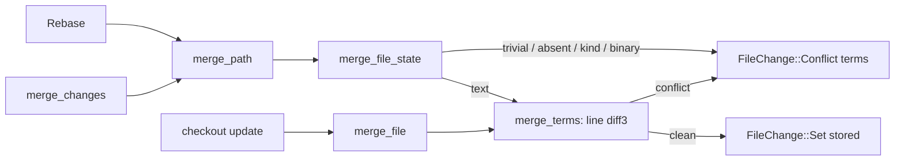
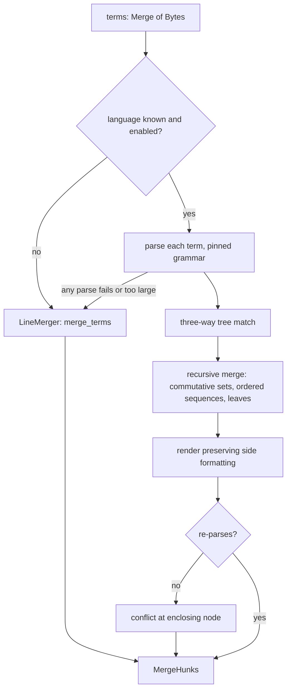

# Structural merge

Every merge in Rill (rebase onto trunk at landing, `Merge` RPC, `update` of a
checkout) resolves file content with the line-based diff3 generalisation in
`rill-core/src/merge/`. The README calls tree-sitter-based structural merge a
planned integration "with the hook in the pipeline"; what exists is a single
function, `merge_file_state`, through which every content merge passes. There
is no syntax-aware code, no grammar dependency and no trait. The invariant any
structural merge must preserve is that conflicts remain data: a
`FileChange::Conflict(Merge<FileState>)` whose terms re-materialize
losslessly.

## Current state

| Layer | Source | Behavior |
| --- | --- | --- |
| Algebra | `rill_types::Merge<T>` | N-way terms `[a0, r0, a1, ..., aN]`; `simplify`, `resolve_trivial`, `three_way`. |
| File-state merge | [merge/state.rs](../../crates/rill-core/src/merge/state.rs) `merge_file_state` | Simplify; trivial resolution; conflict if any term absent, kinds differ, any is a symlink, or any content `is_binary`; otherwise read all terms and call `merge_terms`; clean result stored via `store_content` as a `Set`, else `Conflict(terms)`. This is the only place content is merged and the only candidate "hook". |
| Text merge | [merge/file.rs](../../crates/rill-core/src/merge/file.rs) `merge_terms` | Token = line (`LineTokens`). Base = first remove. Each other term diffed against base with the Histogram `edit_script`; `align` builds regions; each region resolved trivially or emitted as a conflict after zdiff3-style `minimize`. Adjacent edits conflict, as in git. |
| Markers | [merge/materialize.rs](../../crates/rill-core/src/merge/materialize.rs), [merge/parse.rs](../../crates/rill-core/src/merge/parse.rs) | Jujutsu-style snapshot+diff markers, lossless round trip via `parse_materialized`. |
| Change merge | [merge/change.rs](../../crates/rill-core/src/merge/change.rs) `merge_changes`, `merge_path` | Per path, builds terms from tree diffs (and from a tip's recorded `Conflict` terms), calls `merge_file_state`. |
| Rebase | [rebase.rs](../../crates/rill-core/src/rebase.rs) | Three-way with base = old parent, left = new parent, right = the change; uses `merge_path`. |
| Landing | [rill-lander land/pipeline.rs](../../crates/rill-lander/src/land/pipeline.rs) | A rebase that yields any `Conflict` produces `LandStatus::Conflict { paths }` and the request is rejected; the conflict is not stored on trunk. |
| Checkout update | [rill-sdk local/update.rs](../../crates/rill-sdk/src/local/update.rs) | Calls `merge_file` (the two-sided wrapper) directly in the client and writes markers. |
| Language knowledge | [rill-search symbols/lang.rs](../../crates/rill-search/src/symbols/lang.rs) | Extension-based `Language` enum (Rust, Python, TypeScript, JavaScript, Go) with regex symbol patterns. The only language detection in the workspace, and it lives in `rill-search`, which `rill-core` cannot depend on. |

Dependencies: `rill-core/Cargo.toml` has no `tree-sitter`, `mergiraf` or
`diffsitter` crate. Nothing in the workspace parses source code into a tree.



## Why it blocks production

Line merge is adequate for human teams with low change concurrency. Rill's
premise is many agents landing small changes continuously onto one trunk,
which raises conflict rates on exactly the patterns a line merge handles
worst.

1. **Adjacent-insert conflicts.** Two agents each add an import, a match arm,
   a test function or a dependency line at the same insertion point. Lines are
   adjacent, so `merge_terms` conflicts. The lander rejects the landing
   (`LandStatus::Conflict`) and the second agent must rebase and resubmit;
   with ten agents touching `Cargo.toml`, `mod.rs` or an enum, throughput
   collapses to serial.
2. **Reformatting as conflict.** One change runs a formatter over a file,
   another edits one function. Every line differs on one side; the edit on the
   other side lands inside a changed region and conflicts, though the semantic
   change is disjoint.
3. **Moves.** A function moved within a file (or renamed) on one side and
   edited on the other is a delete+insert against a modification: a guaranteed
   conflict with a confusing marker block.
4. **False clean merges.** Line merge can combine two independently valid
   edits into syntactically invalid output (a closing brace deleted on one
   side, a statement added inside the block on the other). The result is
   stored as a clean `Set`, lands, and the first signal is red verification or
   a bisect.
5. **Conflicts are opaque to agents.** A `Conflict` term list is bytes; an
   agent resolving it gets marker text with line granularity and no indication
   which syntactic unit each side touched.

## Requirements

* R1. Two changes that insert distinct items into the same ordered syntactic
  container (import list, enum variants, match arms, struct fields, JSON/TOML
  tables, sequential statements) merge cleanly, with a deterministic order,
  for every supported language. Test corpus case per container type per
  language.
* R2. A formatting-only change on one side and a semantic change on the other
  merge to the formatted file with the semantic change applied. Test:
  `rustfmt`/`black` on one side, one-line edit on the other.
* R3. A clean structural merge always produces output that parses with the
  grammar used to merge it; if it would not, the result degrades to a conflict
  rather than a syntactically broken `Set`.
* R4. Conflict granularity is a syntactic node (statement, item, element), and
  the stored `Conflict` terms re-materialize to markers that the existing
  parser round-trips; the `Merge<FileState>` representation is unchanged.
* R5. Any file whose language is unsupported, whose grammar fails to parse any
  term, or that exceeds a size bound falls back to the current line merge with
  identical results to today.
* R6. Structural merge is deterministic across hosts: the same terms and the
  same grammar versions produce byte-identical output, so rebases are
  reproducible and action cache keys are meaningful. Grammar versions are
  pinned and recorded.
* R7. Merge latency per file stays within a bound (target: p99 under 50 ms for
  files under 10k lines) so landing throughput is not reduced.
* R8. A per-repository switch (`.rill/merge.toml` or policy) enables
  structural merge per language, with line merge the default until a language
  passes the evaluation corpus.

## Design direction

### Recommended: a `ContentMerger` trait in `rill-core` with a tree-sitter-backed implementation behind a feature, mergiraf-style three-way merge on the syntax tree, and line merge as the universal fallback

**Trait.** Introduce in `rill-core/src/merge/`:

```rust
#[async_trait]
pub trait ContentMerger: Send + Sync {
    /// Merge text terms for `path`; `None` means "not handled, fall back".
    fn merge(&self, path: &RepoPath, terms: &Merge<Bytes>) -> Option<Vec<MergeHunk>>;
}
```

`merge_file_state` gains a `&dyn ContentMerger` parameter (threaded from
`merge_path`, `merge_changes`, `rebase` and the SDK's `update`); the default
implementation is `LineMerger`, which wraps today's `merge_terms`, so behavior
is unchanged where nothing is configured. Language detection moves to
`rill-types` (or a small `rill-lang` crate below `rill-core`) so both
`rill-core` and `rill-search` use one `Language::from_path`.

**Algorithm (`TreeMerger`).** Follow mergiraf's structured merge: parse each
term with the pinned tree-sitter grammar; compute a three-way tree matching
(GumTree-style, with the base as the reference) to align nodes across terms;
merge recursively: for unordered or commutative containers (imports, struct
fields, enum variants, object keys where the grammar config says so) merge as
sets with a deterministic order; for ordered sequences (statements, list
elements) run the line algorithm on the sequence of child nodes instead of
lines, so an insert of two distinct children at the same position becomes a
non-conflict when the language config says that container is commutative, and
a node-granular conflict otherwise; for leaves, compare tokens and fall back
to text diff3 within the leaf. Whitespace and comments are attached to their
neighbouring nodes so a reformat is an identity on the tree (R2). The output
is re-rendered from the merged tree preserving the formatting of the side that
changed that region; then re-parsed, and if parsing fails the merger returns a
conflict at the smallest enclosing node (R3).

**Conflict representation.** A structural conflict is emitted as
`MergeHunk::Conflict(Merge<Bytes>)` whose terms are the byte ranges of the
conflicting nodes in each term, with the clean surrounding text as `Resolved`
hunks. That is exactly the shape `materialize` consumes, so markers,
`parse_materialized` and `FileChange::Conflict` need no change; the markers
simply cover whole nodes instead of lines (R4).

**Grammars.** Rust, Python, TypeScript/JavaScript, Go, JSON, TOML, YAML first
(the languages `rill-search` already names plus the config formats agents
touch most). Grammars are compiled into the binary behind the
`structural-merge` feature; their versions are listed in a `GrammarSet`
constant that is recorded in `ChangeVersion.extra["merge_grammars"]` on
versions produced by rebase, which gives R6 a check and future
reproducibility.

**Configuration.** `.rill/merge.toml` in the tree: `[lang.rust] structural =
true`, `[lang.toml] commutative = ["table"]`; parsed at merge time from the
base term's tree so the rule set is versioned with the code, as `verify.toml`
is.



### Alternatives considered

| Option | Trade-off |
| --- | --- |
| Shell out to `mergiraf` binary | Fastest to ship; adds a process spawn per file on the landing path (R7), a non-Rust-workspace dependency on the server image, and no control over the conflict shape. Acceptable for an experiment, not for the lander. |
| Depend on the `mergiraf` crate directly | It is a Rust crate with tree-sitter grammars and the right algorithm; the risk is API stability and its own output format (it renders markers itself). Wrapping it behind `ContentMerger` and parsing its output with `parse_materialized`-compatible markers is the pragmatic first implementation if its library API allows node-level results. |
| Semantic/AST-only merge (SemanticMerge, jsFST) that discards formatting | Produces reformatted output on every merge; violates R2's expectation that the formatted side wins and makes diffs noisy. |
| LLM-assisted resolution at landing | Non-deterministic (R6) and unverifiable without running tests; useful as an agent-side resolver tool (`Resolve` RPC) rather than inside `merge_file_state`. |
| Token-level (word) diff3 instead of line | Reduces adjacent-line conflicts somewhat, no help for R1/R2/R3, cheap. Could be a `WordMerger` fallback tier between tree and line. |

### Trade-offs

* Commutative containers reorder content; a repository that relies on import
  order (Python side effects, Go init) must disable commutativity per
  container, hence the per-repo config.
* Structural merge can accept merges that are syntactically valid and
  semantically wrong (two sides each adding a variable with the same name).
  Post-land verification is the backstop; the brief does not claim type-aware
  merge.
* Binary size grows by the grammars (several MB); the feature flag keeps
  `rill-cli` builds small when the client does not merge locally. The SDK's
  `update` would otherwise diverge from the server: the client should call a
  new `RepoService.MergeContent` RPC when built without the feature so the
  result matches what the lander would produce.

## Work breakdown

1. **S** `ContentMerger` trait, `LineMerger`, thread the parameter through
   `merge_file_state`, `merge_path`, `rebase`, `update`; no behavior change;
   tests pass unchanged.
2. **S** Move `Language::from_path` below `rill-core`; `rill-search` consumes
   it.
3. **M** Evaluation corpus: a `tests/merge-corpus/` of `(base, left, right,
   expected | conflict)` cases per language covering R1-R3 patterns, plus real
   cases harvested from git-imported histories (every merge commit's parents
   and result are a labelled sample: `rill-git-import` has them). A harness
   reporting clean/conflict/wrong rates per merger.
4. **L** `TreeMerger` with tree-sitter: parse, GumTree-style matching,
   recursive merge, render, re-parse check; Rust and TOML first.
5. **M** Marker and `parse_materialized` round-trip tests for node-granular
   conflicts; `FileDiff.conflict` unchanged.
6. **M** `.rill/merge.toml` and per-language enablement; grammar version
   recording in `extra`.
7. **M** Remaining grammars (Python, TS/JS, Go, JSON, YAML) with corpus cases.
8. **M** `MergeContent` RPC for clients built without the feature; SDK
   `update` uses it when available.
9. **S** Latency benchmarks on the lander path; size bound tuning.

## Risks and open questions

* Tree matching is the expensive and fragile part; GumTree is O(n²) worst
  case. A size bound (nodes or bytes) with fallback to line merge is
  mandatory, and the bound must be part of the deterministic behavior (same
  input, same decision).
* tree-sitter grammars are error-tolerant: a file with syntax errors still
  "parses" with `ERROR` nodes. The merger must treat any `ERROR` node in any
  term as "fall back", or merges of work-in-progress files become
  unpredictable.
* Rendering: tree-sitter has no pretty-printer; output is reassembled from
  source byte ranges. Mixed-side rendering around a merged node can produce
  odd whitespace; R3's re-parse check catches syntax but not style.
* Mergiraf's licence and crate API stability if used as a dependency.
* Open: should the lander retry a conflicted landing with structural merge
  only when line merge conflicts (cheaper, same results when clean), or always
  use structural when enabled (consistent, more CPU)? Always-on is simpler to
  reason about; the corpus decides whether the outputs ever differ on clean
  cases.
* Open: `Resolve` RPC semantics for agents once conflicts are node-granular:
  expose the node kind and byte ranges per side in `MergeTerms` so an agent
  can resolve without re-parsing.

## References

Source: [rill-core/src/merge/mod.rs](../../crates/rill-core/src/merge/mod.rs),
[merge/file.rs](../../crates/rill-core/src/merge/file.rs),
[merge/state.rs](../../crates/rill-core/src/merge/state.rs),
[merge/change.rs](../../crates/rill-core/src/merge/change.rs),
[merge/materialize.rs](../../crates/rill-core/src/merge/materialize.rs),
[merge/parse.rs](../../crates/rill-core/src/merge/parse.rs),
[rebase.rs](../../crates/rill-core/src/rebase.rs),
[diff/binary.rs](../../crates/rill-core/src/diff/binary.rs),
[rill-lander/src/land/pipeline.rs](../../crates/rill-lander/src/land/pipeline.rs),
[rill-sdk/src/local/update.rs](../../crates/rill-sdk/src/local/update.rs),
[rill-search/src/symbols/lang.rs](../../crates/rill-search/src/symbols/lang.rs),
[README.md](../../README.md) (status section).

Prior art: mergiraf (tree-sitter structured merge with line fallback,
commutative parent configuration); GumTree (fine-grained tree differencing);
difftastic (tree-sitter structural diff, Dijkstra alignment); diffsitter;
JDime and FSTMerge (semistructured merge, commutative containers);
SemanticMerge; Jujutsu's conflict materialization and `Merge<T>` algebra;
git's zdiff3 and `merge.conflictStyle`; Google's Piper merge tooling papers on
merge conflict rates at scale; the "Semistructured Merge" paper (Apel et al.,
2011).
