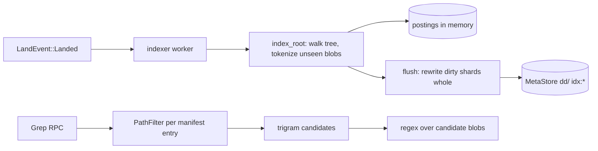

# Search

`rill-search` is a trigram index over blob content plus a path manifest per
root tree, served through `RepoService.Grep`. Blobs are indexed once by
content hash, so an unchanged file is never tokenized twice (the Blackbird
idea). The index lives in process memory and is persisted into the
repository's derived-data keyspace in whole-shard rewrites. The invariant that
matters: a query over root R returns exactly the regex matches in R's files
that the caller may read, with the trigram index only ever pruning candidates,
never producing them.

## Current state

| Piece | Source | Behavior |
| --- | --- | --- |
| Trigram extraction | [trigram/extract.rs](../../crates/rill-search/src/trigram/extract.rs) | Every 3-byte window, ASCII case-folded, packed into a `u32`; a `BTreeSet<u32>` per blob. |
| Postings | [trigram/postings.rs](../../crates/rill-search/src/trigram/postings.rs) | Sorted `Vec<DocId>` per trigram, varint delta-encoded on persist. `DocId` is a dense `u32` from `DocTable`. |
| Query planning | [trigram/query.rs](../../crates/rill-search/src/trigram/query.rs), [trigram/literals.rs](../../crates/rill-search/src/trigram/literals.rs) | Regex → required literals → `TrigramQuery` (AND/OR of trigrams) → `Candidates::Docs(set)` or `Candidates::All` when the regex has no usable literal (e.g. `.*`, `[a-z]+`). |
| Index | [index/search_index.rs](../../crates/rill-search/src/index/search_index.rs) | `postings: DashMap<u32, PostingList>`, `docs: RwLock<DocTable>`, `seen: DashMap<ObjectHash, Option<DocId>>`, `manifests: DashMap<TreeHash, Arc<RootManifest>>`. `index_root` walks the tree, tokenizes unseen blobs with bounded concurrency (16), writes the manifest. Blobs over `max_blob_size` (1 MiB) or `is_binary` are recorded as skipped. |
| Persistence | [index/persist.rs](../../crates/rill-search/src/index/persist.rs) | Derived kinds `idx:blob@1` (marker per blob), `idx:root@1` (manifest per root), `idx:docs@1` (one record, zero key), `idx:post@1` (256 shards keyed by `trigram >> 16`, each shard a whole `ShardRecord`). `flush` rewrites every dirty shard whole, then the doc table, then markers. `load` reads all 256 shards at `open`. |
| Search | [query/search.rs](../../crates/rill-search/src/query/search.rs) | Filter manifest entries by path glob and the `PathFilter`, keep those whose doc is a candidate, read each candidate blob (`read_content`) and run the regex with bounded concurrency, map byte offsets to lines, cut at `max_results`. Output order is path then line. There is no ranking. |
| Symbols | [symbols/](../../crates/rill-search/src/symbols/) | Regex-per-line definition extraction for Rust, Python, TypeScript/JavaScript, Go; `SymbolIndex::for_root` builds and persists a per-root table under `idx:sym@1`. No server service, RPC, SDK call or CLI command references `SymbolIndex`; it is reachable only as a library. |
| Server wiring | [workers/indexer.rs](../../crates/rill-server/src/workers/indexer.rs), [state/registry.rs](../../crates/rill-server/src/state/registry.rs) | One `SearchIndex` per repository, opened at `RepoContext` build (`SearchIndex::open` loads shards). The indexer indexes trunk head at start, then every `LandEvent::Landed`, flushing after each. `RepoContext::grep` indexes a root on demand if it has no manifest, so a `Grep` against an unindexed version (a review version, a workspace root) pays the full walk inline. |
| Permissions | [services/repo/grep.rs](../../crates/rill-server/src/services/repo/grep.rs), [auth/permit.rs](../../crates/rill-server/src/auth/permit.rs) `read_filter` | A `PathFilter` built from the caller's `Reader` paths is applied per manifest entry before any blob is read. Cost is one filter call per file in the root per query. |
| Limits | grep.rs | `DEFAULT_RESULTS` 200, `MAX_RESULTS` 5000, `MAX_CONTEXT` 20 lines. |

Persistence across restarts depends on the metadata backend, because derived
data is in `MetaStore`, not `ObjectStore`:

| `StorageConfig` | Metadata | Index survives restart | Notes |
| --- | --- | --- | --- |
| `Memory` | in-process | No | Rebuilt from trunk head on start. |
| `Local { dir }` | redb | Yes | One shard = one redb value; a hot shard can be tens of MB, rewritten per flush. |
| `S3 { meta_dir }` | redb | Yes | Same as local; objects on S3, so `index_root` reads of a cold repository are network bound. |
| FoundationDB (`fdb` feature) | FDB | Yes, until a shard exceeds FDB's 100 KB value limit | [fdb.rs](../../crates/rill-store/src/fdb.rs) writes each `set` as one key/value; a `ShardRecord` for a large repository exceeds 100 KB and the 10 MB transaction limit, and the write fails. Nothing in `persist.rs` splits values. |



## Why it blocks production

1. **Memory equals the index.** Every posting list of the repository is in a
   `DashMap` in the API server. A 5 GB-of-text monorepo has on the order of
   10⁸ postings; at `u32` per posting plus map overhead the server needs
   several GB per repository, and `Registry::warm` opens every repository at
   start.
2. **Startup reads everything.** `SearchIndex::open` loads all 256 shards
   before the `RepoContext` is usable; a large index delays every repository's
   first request, not only search.
3. **Flush cost is O(shard), on every landing.** A landing that touches one
   file dirties a few hundred trigram shards (typical text covers most of the
   256), and each dirty shard is re-encoded and rewritten whole. Flush time
   grows with repository size, and it runs on the indexer after every `Landed`
   event, so the indexer falls behind under a high landing rate and `Lagged`
   triggers a re-index of head.
4. **FoundationDB deployments break at scale.** The one backend meant for
   multi-node deployments is the one whose value limit the shard format
   exceeds.
5. **Index and lander share a process.** No separation: an index rebuild
   (after `Lagged`, or on a cold `Grep` of an unindexed root) competes with
   landing for the same tokio runtime and object store connections.
6. **No ranking.** Results are path order, so a query for `Config` returns
   `a/aaa/zzz.rs` before `src/config.rs` and the 200-result default cut drops
   the file the user wanted.
7. **Permission filtering is linear in files, per query.** `read_filter`
   yields a `PathFilter`; `search` calls it for every manifest entry (300k
   calls per query on a large tree) before trigram pruning, because filtering
   happens before candidate intersection.
8. **Symbols are unreachable.** `SymbolIndex` has no RPC. "Go to definition"
   for agents is a `Grep` for `fn name`.
9. **Cross-repository search does not exist.** `Grep` takes one `repo`; the
   CLI and MCP have no way to search an organisation.

## Requirements

* R1. Index memory in the API server is bounded by configuration, independent
  of repository size; postings are read from storage on demand with a cache.
  Test: index a synthetic 2 GB corpus with a 256 MB cache limit and query
  successfully.
* R2. Indexing a landed version costs O(changed blobs) in tokenization and
  O(changed postings) in storage writes, never O(shard) or O(repository).
* R3. Index persistence works on every supported metadata backend within that
  backend's value and transaction limits, or lives in the object store.
* R4. Server start does not wait for index load; a repository whose index is
  still loading answers `Grep` with `Unavailable` (code already mapped from
  `RootNotIndexed`) and everything else normally.
* R5. Results are ranked: exact-symbol and filename matches first, then by a
  path/file heuristic (shorter paths, non-test, non-vendored), with the
  ordering stable and documented. Test: corpus queries with expected top-1
  files.
* R6. Symbol search is an RPC (`FindDefinition`, `ListSymbols`) exposed in the
  SDK, CLI and MCP, with per-root results computed from the same manifests.
* R7. Permission filtering cost per query is O(candidate files), not O(files
  in root), and a principal with a deny on a prefix never sees a hit under it.
  Test: 300k-file root, caller allowed on one subtree, query latency under 100
  ms for a selective pattern.
* R8. Cross-repository search exists for the set of repositories the caller
  can read, with per-repository result caps.
* R9. Rebuilding an index from scratch for one repository is an admin
  operation that does not block landing.

## Design direction

### Recommended: immutable posting segments in the object store, a per-server posting cache, and a separate indexer role

**Storage.** Replace whole-shard rewrites with append-only segments, the
layout Zoekt and Lucene use. Each `flush` writes one *segment*: a
content-addressed object (`ObjectKind::Derived`, stored in the `ObjectStore`,
so it has no size limit and goes through the `/o/` CDN path) containing the
postings for the blobs indexed since the last flush, plus a small
`SegmentMeta`. The derived keyspace keeps only the *segment list* for the
repository (`idx:segs@2`: an ordered list of segment hashes, a few KB) and the
markers and manifests as today. A query unions postings across segments; a
background compactor merges small segments into larger ones and replaces the
list atomically. This makes R2 true (a segment is proportional to the landing)
and R3 true on FDB (the list is small; segments are objects).

**Memory.** The server holds an LRU of decoded posting lists keyed by
`(segment, trigram)` with a byte budget (`search.cache_bytes`), and reads
segment postings by trigram through an in-segment offset table so one trigram
costs one range read. Manifests stay in the derived keyspace and in a bounded
`manifests` cache (today's `DashMap` is unbounded).

**Startup.** `SearchIndex::open` reads the segment list and nothing else;
`Registry::build` no longer blocks on shards.

**Indexer role.** The indexer worker moves behind a `search.indexer = inline |
worker` switch: inline is today's loop; `worker` runs the same loop in a
separate process built from `rill-server` with only the indexer enabled,
consuming `WatchTrunk` and writing segments through the store. Landing never
shares a runtime with a rebuild.

**Ranking.** Score each hit file by: exact match of the query literal on a
symbol defined in the file (from the symbol table) > filename match > count of
matches, divided by a path penalty (depth,
`test`/`vendor`/`node_modules`/generated markers). Sort files by score, lines
within a file by position. Keep path order available as `GrepRequest.order =
PATH` for tooling that wants determinism without ranking.

**Symbols.** Expose `RepoService.FindDefinition(root, name)` and
`ListSymbols(root, path)` over `SymbolIndex`; add a per-root symbol table
build to the indexer so trunk head always has one. Coverage grows through
tree-sitter queries (the same grammar set the structural merge brief proposes)
replacing the line regexes, or by ingesting SCIP indexes produced by a
verification step (`outputs = ["index.scip"]` in `verify.toml`); SCIP gives
cross-file references, which regexes never will.

**Permission filtering.** Build the filter once per `(principal, root)` as a
set of allowed path prefixes with a short TTL; apply it after candidate
intersection, and when the allowed set is a small number of prefixes, restrict
the manifest scan to the prefix ranges by binary search on the sorted manifest
(`RootManifest.entries` is sorted by path). The deny case keeps full-filter
semantics.

**Cross-repo.** `Grep` gains `repos: []` (empty = one repo as today); the
server fans out to each repository the caller can read, applies per-repo caps,
and merges by score.

```mermaid
flowchart TD
  Landed --> W[indexer worker or inline]
  W --> Seg[write segment object: postings for new blobs]
  W --> List[idx:segs@2 list CAS append]
  W --> Sym[symbol table for root]
  Q[Grep] --> Perm[allowed prefixes, cached]
  Q --> Tri[trigram plan]
  Tri --> Cache[(posting LRU)]
  Cache -->|miss| Seg
  Tri --> Inter[intersect across segments]
  Inter --> Perm
  Perm --> Scan[regex over candidates]
  Scan --> Rank[score and sort]
```

### Alternatives considered

| Option | Trade-off |
| --- | --- |
| Embed Zoekt or Tantivy | Tantivy is a Rust full-text engine with segments and memory mapping; it would replace `trigram/` and `index/` wholesale, but it is term-based (needs a trigram tokenizer and a custom regex-to-term planner) and stores its own files outside the object store, breaking "build, test and search share the object store". Keeping Rill's own segments is less code than adapting Tantivy's query model to regex. |
| Keep whole shards but split large values | Fixes FDB (R3) only; flush stays O(shard) and memory stays O(index). |
| Index per root instead of per blob | Simpler ranking and permissions per tree, but re-tokenizes unchanged content on every landing, which the current design was built to avoid. |
| External search service (Sourcegraph/Zoekt deployment) fed by a mirror | Works today for teams that already run it, at the cost of a second copy of every repository and permissions resolved outside Rill's ReBAC. |

## Work breakdown

1. **S** Bound the `manifests` cache; make `SearchIndex::open` lazy so
   `Registry::build` does not wait on shard loads; `Grep` returns
   `Unavailable` while loading.
2. **S** Split shard values for FDB as a stopgap (chunk `ShardRecord` into ≤64
   KB pieces under sub-keys) so FDB deployments do not fail outright.
3. **L** Segment format: posting writer with trigram offset table,
   `SegmentMeta`, segment list in derived keyspace, union-at-query; migration
   that rewrites `idx:post@1` into one initial segment.
4. **M** Posting LRU with byte budget; range reads of segment objects
   (`GetBlob` range on chunked objects, shared with the VFS brief).
5. **M** Compactor: merge N small segments into one, swap list atomically,
   delete old segments after a grace period.
6. **M** Indexer as a separate role (`search.indexer = worker`), driven by
   `WatchTrunk`.
7. **M** Permission filter rewrite: cached prefix sets, post-intersection
   application, manifest range scans.
8. **M** Ranking: scoring function, `order` field in `GrepRequest`, corpus of
   expected top results.
9. **M** `FindDefinition` and `ListSymbols` RPCs; SDK, CLI and MCP surfaces;
   symbol table built by the indexer.
10. **L** Symbol coverage: tree-sitter queries or SCIP ingestion from
    verification outputs.
11. **M** Cross-repository `Grep` fan-out with per-repo caps.
12. **S** Admin `RebuildIndex(repo)` RPC and CLI command.

## Risks and open questions

* Segment union makes a query touch every segment for each trigram; without
  compaction the per-query cost grows with landings. The compactor is not
  optional.
* The markers (`idx:blob@1`, one derived key per blob) are themselves O(blobs)
  in the metadata store; on FDB that is fine (small values), on redb it is a
  large table. Consider folding markers into segment metadata (a sorted hash
  list per segment) and dropping per-blob keys.
* `Candidates::All` queries (no literal) scan every file in the root; a size
  or time budget per query is needed, and the UI/CLI should warn.
* Case folding is ASCII only; Unicode identifiers are indexed byte-wise, which
  is correct for matching but means case-insensitive search does not fold
  non-ASCII.
* Ranking by symbol tables ties search quality to symbol coverage; until step
  10, ranking is filename and path heuristics.
* Open: should segments be per repository or per server (multi-repo segments
  make cross-repo search cheaper but complicate permissions and deletion)? Per
  repository matches the storage model.
* Open: where does the compactor run in a multi-server deployment (one per
  repository, elected how)? The lander has the same "one per repo" assumption;
  whatever leader mechanism it adopts should be shared.

## References

Source: [rill-search/src/lib.rs](../../crates/rill-search/src/lib.rs),
[index/search_index.rs](../../crates/rill-search/src/index/search_index.rs),
[index/persist.rs](../../crates/rill-search/src/index/persist.rs),
[index/docs.rs](../../crates/rill-search/src/index/docs.rs),
[index/manifest.rs](../../crates/rill-search/src/index/manifest.rs),
[index/config.rs](../../crates/rill-search/src/index/config.rs),
[trigram/postings.rs](../../crates/rill-search/src/trigram/postings.rs),
[trigram/extract.rs](../../crates/rill-search/src/trigram/extract.rs),
[query/search.rs](../../crates/rill-search/src/query/search.rs),
[symbols/index.rs](../../crates/rill-search/src/symbols/index.rs),
[symbols/lang.rs](../../crates/rill-search/src/symbols/lang.rs),
[rill-server/src/workers/indexer.rs](../../crates/rill-server/src/workers/indexer.rs),
[rill-server/src/state/registry.rs](../../crates/rill-server/src/state/registry.rs),
[rill-server/src/services/repo/grep.rs](../../crates/rill-server/src/services/repo/grep.rs),
[rill-server/src/auth/permit.rs](../../crates/rill-server/src/auth/permit.rs),
[rill-store/src/fdb.rs](../../crates/rill-store/src/fdb.rs),
[rill-store/src/keys.rs](../../crates/rill-store/src/keys.rs).

Prior art: Russ Cox, "Regular Expression Matching with a Trigram Index"
(Google Code Search); Zoekt (trigram index with ngram offsets, shards as
immutable files, ranking by symbol/filename); GitHub Blackbird (content-hash
dedup, per-blob indexing, sharded by repository); Sourcegraph (Zoekt
deployment, permission filtering by repository and sub-repo); Lucene/Tantivy
segment model and merge policies; SCIP and LSIF for symbol/reference indexes;
ctags and tree-sitter tags queries for definition extraction; livegrep.
