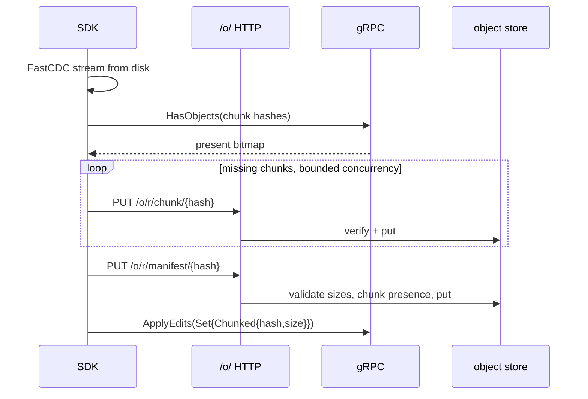

# Large files

Rill stores every file's content through one path, `store_content`: inline
under 256 bytes, a single `Blob` object under 1 MiB, and a FastCDC chunk
manifest above. There is no separate large-file system and no size limit in
the data model. The invariant to keep is that a `ContentRef` names bytes
exactly and forever; the gap is that every transport and every consumer
between a client's disk and the object store holds the whole file in memory at
once.

## Current state

| Stage | Source | Behavior for a file of size N |
| --- | --- | --- |
| Representation | [rill-types objects/blob.rs](../../crates/rill-types/src/objects/blob.rs) | `INLINE_THRESHOLD = 256`, `CHUNK_THRESHOLD = 1 MiB`. `ContentRef::{Inline, Blob{hash,size}, Chunked{hash,size}}`; `BlobManifest { total_size, chunks: Vec<ChunkRef{hash, size: u32}> }`. |
| Chunking | [rill-core blobs.rs](../../crates/rill-core/src/blobs.rs) `store_content` | FastCDC min 16 KiB, avg 64 KiB, max 256 KiB, computed on a blocking thread over the entire in-memory `Bytes`; one `objects.put` per chunk, sequential; then the manifest. A 2 GB file is ~32k chunk puts after 2 GB has been buffered. |
| Reading | `read_content` | `Chunked`: `get_many` of every chunk (S3 backend: 16 concurrent), concatenated into one `BytesMut` of `size`. Whole file in memory, always. |
| gRPC upload | [SDK blobs.rs](../../crates/rill-sdk/src/repo/blobs.rs) `put_blob`, [server trees.rs](../../crates/rill-server/src/services/repo/trees.rs) `put_blob_impl` | Client streams `PutBlobRequest::Data` in 256 KiB messages from an in-memory `Bytes`; server accumulates all data in a `BytesMut` (reserving at most 64 MiB up front), then verifies `size`/`expected_hash`, then `store_content`. No per-stream size limit; no resumability; a dropped connection restarts from zero. |
| gRPC download | `get_blob_impl` | `read_content` of the whole blob, then slice `[offset, offset+length)`, then stream in `BLOB_CHUNK` pieces. A range read costs the full reassembly. |
| HTTP objects | [objects/mod.rs](../../crates/rill-server/src/objects/mod.rs), [handlers.rs](../../crates/rill-server/src/objects/handlers.rs), [batch.rs](../../crates/rill-server/src/objects/batch.rs) | `PUT /o/{repo}/{kind}/{hash}` with `DefaultBodyLimit` `MAX_PUT_BYTES = 256 MiB`, hash verified on the whole body. A client may upload chunks (`kind = chunk`, each ≤ 256 KiB) and the manifest individually, which is resumable by construction (each object is idempotent), but no SDK code does this. `GET` returns the object bytes with `Content-Length`; no `Range` header support, though a chunk object is small enough not to need it. `batch` streams frames lazily. |
| Checkout | [SDK local/checkout.rs](../../crates/rill-sdk/src/local/checkout.rs) `materialize`, [update.rs](../../crates/rill-sdk/src/local/update.rs) | Fetch whole file via `get_blob` into memory, `write_entry`. `snapshot` reads each changed file into memory as `Edit::Set { bytes }` and calls `store_content` (inline or `put_blob`) before `ApplyEdits`. |
| Status | [local/status.rs](../../crates/rill-sdk/src/local/status.rs) | Size+mtime fast path; on mismatch reads and hashes the whole file. |
| Server materialize | [rill-exec materialize.rs](../../crates/rill-exec/src/materialize.rs) | `read_content` per file; batches of 256 files per blocking write task. |
| Search | [rill-search index/config.rs](../../crates/rill-search/src/index/config.rs) | Blobs over 1 MiB skipped. |
| Diff | [rill-core diff/binary.rs](../../crates/rill-core/src/diff/binary.rs) | `is_binary` sniff; text diff on anything else regardless of size. |
| Dedup | Object stores | Content-addressed; identical files and identical chunks across versions share storage. S3 backend writes with `PutMode::Create` so re-uploads are no-ops. |
| Tiering, GC | — | None. No storage classes, no lifecycle rules, no reachability or garbage collection code in any crate. |

## Why it blocks production

1. **A 2 GB checkout file needs 2 GB of RAM twice.** `snapshot` reads the file
   into memory; the server accumulates it again; `store_content` clones for
   the blocking chunker (`bytes.clone()` is cheap, but `chunk_boundaries`
   walks it). Two agents snapshotting large assets concurrently can OOM the
   API server, which also hosts landing.
2. **No upload limit on gRPC means an unbounded allocation per stream.** The
   HTTP path has `MAX_PUT_BYTES`; `put_blob_impl` has none. Any writer can
   send a stream until the server dies.
3. **Uploads are not resumable.** A flaky connection on a 500 MB upload
   restarts at byte zero. The chunk objects that already arrived are not
   reused because the server never stored them (it chunks only after the whole
   stream ends).
4. **Range reads are full reads.** The VFS and any viewer that reads the head
   of a large file through `GetBlob(offset, length)` pays a whole-blob
   reassembly per call.
5. **The HTTP limit forbids one-shot large objects.** A blob between 1 MiB and
   256 MiB is never a single `Blob` object (it is chunked), so `MAX_PUT_BYTES`
   only matters for the single-object path; but a client that wants to use
   `/o/` for large content has no documented way to do so, and the batch
   endpoint cannot stream a `Chunked` ref as one unit.
6. **Nothing is ever deleted.** Every chunk of every version of every large
   binary stays in the hot object store. Storage cost grows monotonically and
   there is no way to move cold chunks to cheaper storage or reclaim
   unreachable ones.
7. **Text diff on 100 MB "text".** A large CSV or generated SQL that passes
   `is_binary` goes through Histogram line diff in `Diff` and in merge; no
   size cutoff.

## Requirements

* R1. Upload of a file of any size from the SDK uses memory bounded by a
  constant (target: under 64 MiB) on the client and the server. Test: snapshot
  a 4 GiB sparse-random file under a 256 MiB cgroup on both sides.
* R2. Download to a checkout is streamed to disk with the same bound.
* R3. A server-side cap on content size per object and per change is
  configurable (`storage.max_content_bytes`, `storage.max_change_bytes`),
  enforced on gRPC and HTTP paths, with a distinct error (`ContentTooLarge`,
  gRPC `ResourceExhausted`, HTTP 413).
* R4. Interrupted uploads resume: a retry uploads only chunks the server does
  not have. Test: kill the client at 60%, retry, assert bytes transferred
  under 45% of the file.
* R5. `GetBlob(offset, length)` on a chunked blob reads only the chunks
  covering the range.
* R6. Dedup is measurable: a 1-byte append to a 1 GiB file stores O(1) new
  chunks (FastCDC guarantees this; a test asserts it end to end through the
  SDK).
* R7. Cold tiering: chunks not read within a configured window can be moved to
  a cheaper storage class without changing any `ContentRef`, and a read of a
  tiered chunk succeeds (slower) or returns a distinct
  `Unavailable{retry_after}`.
* R8. Reachability-based garbage collection exists for objects unreachable
  from any ref, workspace, review version, action result or derived record,
  with a grace period and a dry-run mode.
* R9. Diff, merge, search and blame have explicit size cutoffs above which
  content is treated as binary (reported as such in `FileDiff.binary`).

## Design direction

### Recommended: chunk-first transport, server-side manifest assembly, Xet-style dedup accounting, and lifecycle on the object store

**Client-side chunking.** The SDK chunks with the same FastCDC parameters as
the server (`rill-core` is already a client dependency through `rill-sdk`, and
`CHUNK_*` constants live there), streaming the file from disk in windows. For
each chunk it computes `ObjectHash::digest(Chunk, ...)`; it then calls
`HasObjects` for the chunk hash list (batches of ≤10k, the existing RPC) and
uploads only missing chunks via `PUT /o/{repo}/chunk/{hash}` with bounded
concurrency; finally it uploads the `BlobManifest` object and references
`ContentRef::Chunked { hash, size }` in `ApplyEdits`. Every step is
idempotent, so resumption is free (R4), memory is one window plus in-flight
chunks (R1), and the server never sees the whole file. `PutBlob` remains for
small content and for clients that do not chunk; it gains a size cap (R3) and,
when `size` in the header exceeds `CHUNK_THRESHOLD`, the server chunks
incrementally from the stream (FastCDC is streamable;
`fastcdc::v2020::StreamCDC`) instead of accumulating.

**Server validation.** A manifest `PUT` is verified structurally: every
`ChunkRef.size` ≤ `CHUNK_MAX`, `total_size` equals the sum, and
(`storage.verify_manifest_chunks = true`) every referenced chunk exists
(`has_many`). The content hash of the file is not recomputed; the manifest
hash is the identity, as today.

**Range reads.** `get_blob_impl` resolves `Chunked` by reading the manifest,
selecting the chunks whose cumulative offsets intersect the range, and
streaming them in order. `read_content` keeps its whole-file contract for
callers that need it; a new `read_content_range` and a `content_stream` (an
`impl Stream<Item = Bytes>`) serve the server, the VFS and `materialize`.

**Streaming checkout.** `materialize` in the SDK writes chunks as they arrive
through `GetBlob` streaming (already a stream; only the client-side `BytesMut`
accumulation changes) and hashes on the fly for `local_hash`.

**Limits.** `storage.max_content_bytes` (default 2 GiB) and
`storage.max_change_bytes` (sum of new content per
`ApplyEdits`/`CreateChangeVersion`, default 10 GiB) in `ServerConfig`; a Cedar
fact `content_bytes` so submit policy can require review for large additions.

**Dedup accounting and tiering.** Add a per-repo derived record of chunk
access time maintained lazily (last-read bucketed by day, written in batches
by the object HTTP handler and `read_content`). A `tiering` worker moves
chunks with no access for `cold_after` to a cold prefix/storage class using
the object-store backend's native mechanism (S3 lifecycle rule to Glacier
Instant Retrieval or Standard-IA; the `object_store` crate exposes `copy` and
attributes), and `get` on a miss in hot falls through to cold. Local backend:
a second directory on a slower disk. Memory backend: no-op.

**Garbage collection.** A mark phase walks roots: every ref, every trunk
version, every review version, every workspace snapshot, every action cache
result and every derived record that references objects; marks trees, change
versions, blobs, manifests, chunks. Sweep deletes unmarked objects older than
`gc.grace` (default 7 days, so an in-progress client upload is not swept
between chunk `PUT` and `ApplyEdits`). Runs as an admin operation
(`AdminService.CollectGarbage{dry_run}`) and as a scheduled worker; writes a
`gc:run@1` record with counts. The grace period and the single-writer
assumption (one lander per repo) make it safe without stop-the-world.

### Alternatives considered

| Option | Trade-off |
| --- | --- |
| Git LFS-style pointer files with an external store | Splits the object model: pointers in trees, bytes elsewhere, a second auth domain, and `read_content` must know about it. Rill's chunked manifests already are the "pointer"; the missing piece is transport, not representation. |
| Larger fixed-size chunks (e.g. 4 MiB) for fewer objects | Fewer puts, worse dedup across insert/delete edits. Xet's experience (64 KiB CDC, aggregated into larger "xorbs" for storage) suggests keeping small chunks for dedup and packing for storage efficiency. A pack layer (many chunks in one object, with an index) is a follow-on for the S3 backend where per-object cost dominates. |
| Multipart upload semantics (`UploadId`, parts, complete) on gRPC | Reinvents resumability that content-addressed chunk `PUT` already provides. |
| Refuse files over a threshold | Simple, and the cap in R3 exists anyway, but game assets and ML weights are a real use case for a system aimed at agents. |

## Work breakdown

1. **S** `storage.max_content_bytes` and `max_change_bytes`; cap in
   `put_blob_impl`, `put_object`, `ApplyEdits`; `ContentTooLarge` error
   mapping.
2. **M** Streaming server-side chunking in `put_blob_impl` with `StreamCDC`;
   bounded memory test.
3. **M** `read_content_range` and `content_stream` in `rill-core`;
   `get_blob_impl` uses them; test that a 4 KiB read touches ≤2 chunks.
4. **L** SDK client-side chunking: FastCDC over a file stream, `HasObjects`
   probe, concurrent chunk `PUT` over `/o/`, manifest `PUT`, resumption test;
   `snapshot` uses it above `CHUNK_THRESHOLD`.
5. **S** Server-side manifest validation on `PUT /o/{repo}/manifest/{hash}`.
6. **M** Streaming checkout writes in the SDK (`materialize`, `update`) and in
   `rill-exec materialize`.
7. **S** Size cutoffs in diff, merge, blame, `is_binary` reporting;
   `FileDiff.binary` set for oversize text.
8. **L** Garbage collection: mark roots inventory, sweep with grace,
   `gc:run@1` record, admin RPC and CLI, dry run.
9. **L** Tiering: access-time record, tiering worker, cold fall-through in the
   S3 and local backends, `Unavailable{retry_after}` for
   asynchronous-retrieval classes.
10. **M** Chunk packing for S3 (many chunks per object with an index) if
    per-object cost matters in practice.

## Risks and open questions

* Client-side chunk uploads through `/o/` require `write` on the repository
  root; the `PUT` handler checks `permit().write(root)`. Path-scoped writers
  who may `ApplyEdits` under `src/` but not root cannot upload chunks. The
  permission model for content-addressed writes needs a `Writer` on any path
  to suffice for object `PUT` (objects are not paths).
* The GC mark set includes derived data (`ac@1` results reference stdout
  blobs; `idx:root@1` manifests reference content). Every new derived kind
  that references objects must register with the GC's root walker, or it will
  be swept; a `DerivedKind::references()` hook enforces that.
* FastCDC parameters are part of dedup identity: changing `CHUNK_*` splits
  every re-uploaded file into different chunks. They should be versioned
  (`BlobManifest` gains `cdc_params`) before clients start chunking.
* Tiering on S3 with Glacier classes introduces asynchronous retrieval;
  synchronous `read_content` callers (merge, materialize) need a policy:
  either only use instant-retrieval classes, or make tiered content a distinct
  error that the lander treats as a transient failure.
* Open: should the inline threshold (256 B) rise? Tree objects embed inline
  content; larger inline values enlarge trees and thus every tree read.
* Open: per-repository quotas (bytes stored, bytes added per day) as policy
  facts, needed for multi-tenant hosting.

## References

Source:
[rill-types/src/objects/blob.rs](../../crates/rill-types/src/objects/blob.rs),
[rill-core/src/blobs.rs](../../crates/rill-core/src/blobs.rs),
[rill-sdk/src/repo/blobs.rs](../../crates/rill-sdk/src/repo/blobs.rs),
[rill-server/src/services/repo/trees.rs](../../crates/rill-server/src/services/repo/trees.rs),
[rill-server/src/objects/mod.rs](../../crates/rill-server/src/objects/mod.rs),
[objects/handlers.rs](../../crates/rill-server/src/objects/handlers.rs),
[objects/batch.rs](../../crates/rill-server/src/objects/batch.rs),
[rill-store/src/object.rs](../../crates/rill-store/src/object.rs),
[rill-store/src/s3.rs](../../crates/rill-store/src/s3.rs),
[rill-sdk/src/local/checkout.rs](../../crates/rill-sdk/src/local/checkout.rs),
[rill-exec/src/materialize.rs](../../crates/rill-exec/src/materialize.rs),
[rill-search/src/index/config.rs](../../crates/rill-search/src/index/config.rs),
[rill-core/src/diff/binary.rs](../../crates/rill-core/src/diff/binary.rs).

Prior art: FastCDC (Xia et al., 2016) and the `fastcdc` crate's `StreamCDC`;
Xet (XetHub / Hugging Face: 64 KiB CDC chunks, xorb packing, dedup-aware
upload with chunk presence queries); Git LFS (pointer files, batch API,
resumable transfer adapters); Perforce and Plastic SCM large-file handling;
restic and borg (CDC-based dedup, pack files, garbage collection with grace);
Mononoke's blobstore with multiplexing and packing; S3 lifecycle rules and
Glacier Instant Retrieval; Bazel CAS garbage collection (Buildbarn's
reference-counted and generation-based sweeps); tus resumable upload protocol
(for comparison with content-addressed resumption).
