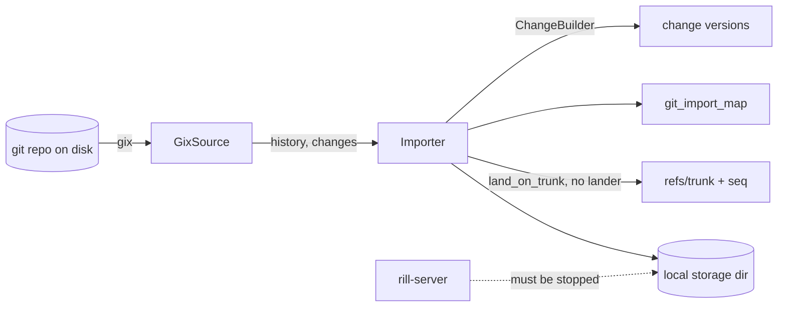
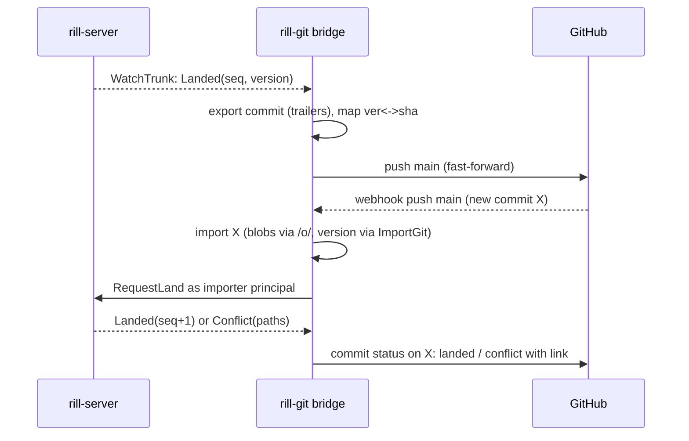

# Git interoperability

Rill is not git-compatible by design; `rill-git-import` is a one-way, offline
importer that turns a git history into change versions and lands the mainline
on trunk. There is no export, no mirror, no push/pull, and no way to run the
importer against a live server. The invariant any interop must keep is that
trunk sequence numbers stay gap-free and mean the same thing for imported and
native history; the gap is that a team cannot adopt Rill while GitHub still
holds their pull requests, CI and integrations.

## Current state

| Piece | Source | Behavior |
| --- | --- | --- |
| Reader | [reader/source.rs](../../crates/rill-git-import/src/reader/source.rs), [reader/gix_source.rs](../../crates/rill-git-import/src/reader/gix_source.rs) | `GitSource` trait: `resolve(ref)`, commit metadata (`GitCommit { sha, parents, author_name, author_email, committed_at, message }`), `changes(sha)` as the tree diff against the first parent. `GixSource` reads an on-disk repository with `gix`. Renames are delete plus set; submodules (gitlinks) are skipped with a warning; symlinks and executable bits map to `FileKind`. Author and committer identities are collapsed to the author; signatures, tags, notes and non-head refs are not read. |
| Ordering | [reader/history.rs](../../crates/rill-git-import/src/reader/history.rs) | Iterative post-order DFS, parents before children, first-parent ancestry first. |
| Conversion | [import/importer.rs](../../crates/rill-git-import/src/import/importer.rs) `import_commit` | `ChangeBuilder` with `change_id = ChangeId::derived("git", sha)`, all git parents mapped to version parents (merges keep both), `created_at = committed_at`, `Provenance { tool: "rill-git-import" }`, `extra["git_sha"] = sha bytes`. One version per commit; a git commit is never a second version of an existing change. |
| Mapping | [import/map.rs](../../crates/rill-git-import/src/import/map.rs) | `ImportMap: BTreeMap<GitSha, ChangeVersionHash>` stored as one postcard record under misc key `git_import_map`, saved every `save_every = 256` commits and at the end. Rewriting is O(imported commits). The reverse direction (version → sha) is only `extra["git_sha"]` on the version. |
| Landing | [import/land.rs](../../crates/rill-git-import/src/import/land.rs) | The first-parent chain of the head is landed oldest-first with `repo.land_on_trunk` directly, bypassing `rill-lander` (no review state, no verification, no `LandEvent`). If trunk does not end at the next version's first parent, `Error::TrunkDiverged` and the import stops. |
| CLI | [rill-cli commands/import.rs](../../crates/rill-cli/src/commands/import.rs) | `rill import git <path> --repo --ref --storage-dir [--no-land]`. Opens `LocalStores` on the storage directory; refuses `--endpoint`. Must run while the server is stopped (redb is single-process). |
| Export, mirror, hooks | — | Nothing. No `rill-git-export`, no git transport, no webhook consumer. |



## Why it blocks production

1. **Migration is one-shot and offline.** The server must be stopped for every
   import, so the only workable migration is "freeze git, import, switch
   everyone". A large team cannot freeze.
2. **There is no way back.** Once a change lands in Rill, nothing produces a
   git commit from it. Every tool that reads git (IDE integrations, deploy
   pipelines, Dependabot, docs generators, compliance archives, `go get`,
   Cargo git dependencies, `pip install git+`) stops working the day the team
   switches.
3. **Coexistence cannot be gradual.** A team that wants agents on Rill and
   humans on GitHub for a quarter needs both directions continuously; with
   import-only, every native Rill landing is invisible to GitHub and every
   GitHub merge after the import diverges trunk (`TrunkDiverged` on the next
   import).
4. **Imported history bypasses the lander.** `land_on_trunk` writes trunk
   directly: no `LandEvent::Landed`, so the search indexer and `WatchTrunk`
   subscribers see nothing until the next native landing; no post-land
   verification record exists for imported sequences, so a bisect over
   imported history has no starting state.
5. **The sha map is a single record.** 500k commits is a multi-MB postcard
   value rewritten every 256 commits; on FoundationDB it exceeds the value
   limit and the import cannot persist its progress.
6. **Identity is lossy.** Imported `Principal`s are `human(name)` with
   `identity = email`; nothing maps them to the principals that authenticate,
   so blame and provenance for imported history do not match the people now
   using the system.

## Requirements

* R1. Import runs against a live server through the API (an admin RPC or a
  privileged import stream), incrementally, with the server's lander landing
  the mainline so events, indexing and verification records are produced.
  Test: import, land a native change, import new git commits; trunk is
  gap-free, events observed for every seq.
* R2. Export: every landed version maps to exactly one git commit in a mirror
  repository; the mapping is deterministic (same version always produces the
  same sha, given the same parent mapping) and persisted both ways.
* R3. Round trip: importing the exported mirror creates no new versions (every
  exported commit maps back to its source version by `extra["git_sha"]` or the
  mapping table).
* R4. Continuous bidirectional mirror with a GitHub (or any git remote): Rill
  landings appear on the mirror's default branch within a bounded delay;
  merges to the git default branch appear on trunk; conflicts between the two
  are detected and surfaced, never silently resolved.
* R5. Review-level mapping during coexistence: a Rill change under review can
  be pushed as a git branch and PR; a PR merged on GitHub lands the
  corresponding change in Rill with the PR number recorded.
* R6. Mapping storage scales to millions of entries: O(1) lookups in both
  directions, writes per commit, works on every metadata backend.
* R7. Identity mapping: an admin-maintained table from git author email to
  Rill principal, applied at import, so blame on imported history names
  current principals.
* R8. Submodules, LFS pointers, signed commits and tags have a documented
  policy (what is preserved, what is dropped with a warning).

## Design direction

### Recommended: a `rill-git` bridge service with a two-way mapping keyspace, export as a deterministic commit builder, and GitHub as a mirror target during coexistence

**Mapping keyspace.** Replace the single `ImportMap` record with two
derived-style key families in the repository's metadata: `git:sha@1/<sha>` →
`ChangeVersionHash` and `git:ver@1/<version hash>` → `sha`, written per commit
in the same mutation batch as the version (R6). `extra["git_sha"]` stays for
versions that originated in git; exported versions get the sha only in the
keyspace (the version hash must not change when it is exported, and `extra` is
part of the hash).

**Import through the API.** `AdminService.ImportGit` becomes a
client-streaming RPC: the CLI (or the bridge) reads the git repository locally
with `GixSource`, uploads missing blobs through the object protocol, and
streams `GitCommit + changes` records; the server converts with the same
`import_commit` logic and lands the mainline through `rill-lander` with a
`LandPolicy` override `VerifyMode::None` and a bypass of review hooks for the
import principal (a `Service` principal with an `importer` relation). Landing
through the lander produces `LandEvent::Landed`, so indexing and watches work
(R1). `TrunkDiverged` becomes a real condition the bridge handles (see
mirror), not a fatal error.

**Export.** `rill_git::export::commit_for(version)` builds a git commit
deterministically: tree from the version's root tree (`RootTree` derived data;
`FileKind` → modes; inline content and chunked blobs written as git blobs),
parents from the mapped parent versions, author from the version's `Principal`
(email from `identity`, or `<name>@rill.invalid`), committer the bridge
identity, timestamp `created_at`, message = `message` + a trailer block:

```
Rill-Change: <change id>
Rill-Version: <version hash>
Rill-Intent: <intent id>
```

The trailers make the mapping recoverable from the git side alone (R3). A
conflict version (`FileChange::Conflict`) is exported as the materialized
marker file, flagged with a `Rill-Conflict: <paths>` trailer, since git has no
conflict object; such versions are never on trunk, so this only matters for
branch export of reviews.

**Mirror.** The bridge keeps, per repository, `mirror.toml`: remote URL,
credentials reference, branch mapping (`trunk` ↔ `main`, `refs/heads/*` ↔
`review/<change id>`), direction (`export`, `import`, `both`), and
poll/webhook settings. Loop:

1. `WatchTrunk(after_seq)`: for each landed version without a sha, export,
   push `main` fast-forward. If the push is rejected (non-fast-forward),
   fetch, treat the new git commits as an import (`both` mode) and continue.
2. Git side: a GitHub `push` webhook (or a poll) on `main` with new commits:
   import them; land through the lander. If trunk advanced natively since the
   git base, the imported commits are rebased by the lander like any landing;
   a rebase conflict is a `LandEvent::Conflict` and the bridge opens a Rill
   review for the conflicted import (conflicts are data) and reports the
   PR/commit on the git side with a status check.
3. Reviews: `WatchRefs(prefix = "review/")` or `ReviewEvent::Submitted` →
   export the change's latest version onto `review/<id>` and
   (`github.pull_requests = true`) open or update a PR via the GitHub API with
   the Rill review link. `pull_request.closed` with `merged = true` →
   `RequestLand` on the Rill side with the PR number in `extra`; a PR merged
   on GitHub while review state in Rill disallows landing is reported as a
   status failure and the merge commit is imported but not landed (the human
   fixes the policy or reverts on GitHub).

The mirror is single-writer per repository (same assumption as the lander) and
idempotent: every step consults the mapping before acting.



**Identity.** `git:ident@1/<email>` → `Principal`, set by
`AdminService.SetIdentityMapping`; applied at import; a periodic job can
rewrite blame caches but not versions (hashes are immutable), so provenance of
already-imported versions is corrected in a derived `author_override` rather
than in the version.

**Policy for lossy constructs (R8).** Submodules: imported as a
`.gitmodules`-style manifest file `.rill/submodules.toml` with the gitlink
shas, exported back as gitlinks when present; the content is not imported. LFS
pointers: imported as the pointer file unless `lfs.resolve = true`, in which
case the bridge fetches from the LFS server and stores real content (then
exported back as LFS pointers only if `lfs.write = true`). Signatures and
tags: dropped on import with a per-import summary; tags optionally mirrored to
`refs/tags/*` as refs on the matching versions.

### Alternatives considered

| Option | Trade-off |
| --- | --- |
| Implement the git wire protocol in `rill-server` (`git clone rill://...`) | Full compatibility is the explicit non-goal; packfile generation for a chunked, BLAKE3-addressed store means a second object model in the server. A mirror gives 90% of the value. |
| Export-only mirror (no import after cutover) | Simplest, but fails R4/R5 and forces the freeze. |
| Use Sapling/`git-filter-repo`-style one-time conversion with a hard cutover date | What exists today; it is the fallback for teams that can freeze. |
| Store git shas as a derived kind instead of a keyspace | Derived data is rebuildable by definition; the sha mapping is not (an exported sha depends on the mirror's parent shas and the bridge's committer identity). It is state, so it belongs in a keyspace with the refs. |

## Work breakdown

1. **S** Replace `ImportMap` with per-entry `git:sha@1` / `git:ver@1` keys;
   keep a migration from the misc record; `MissingParent` lookups become point
   reads.
2. **M** `ImportGit` client-streaming admin RPC; land the mainline through
   `rill-lander` with an import principal and `VerifyMode::None`; CLI `rill
   import git --endpoint` using it; the offline path stays for cold migration.
3. **M** Identity mapping keyspace and admin RPC; applied at import.
4. **L** `rill-git` crate: deterministic export (`commit_for`), trailers,
   tree/blob writing with `gix`, round-trip test (export then import yields
   zero new versions).
5. **L** Mirror loop: `mirror.toml`, `WatchTrunk`-driven export and push,
   non-fast-forward handling by importing, single-writer lock, idempotency
   tests with a local bare repository.
6. **M** Git-side intake: webhook receiver (`push`, `pull_request`) and
   polling fallback; landing imported commits through the lander; conflict
   reporting as commit status.
7. **M** Review export: `review/<id>` branches, PR open/update/close through
   the GitHub API, PR merge → `RequestLand`.
8. **S** Submodule, LFS, tag, signature policies and the import summary
   report.
9. **S** Operational docs: coexistence runbook, cutover checklist (disable
   import direction, archive mirror), and what breaks when the mirror lags.

## Risks and open questions

* Two systems both accepting writes to "main" is a distributed consensus
  problem with a human in the loop; the design makes Rill's lander the arbiter
  (git commits are landed like any change), which means GitHub's merge button
  can "succeed" and then fail to land. The status check is the mitigation;
  teams must gate GitHub merges on it.
* Export determinism depends on the committer identity and timestamp being
  fixed; a bridge rebuilt with a different identity would produce different
  shas for the same versions and fork the mirror. The committer identity is
  part of `mirror.toml` and must not change after the first export.
* Git has no change identity: a Rill change with five versions becomes five
  force-pushes of `review/<id>`; PR review comments on GitHub attached to old
  commits behave as they do with any force-push.
* Merge commits from git produce multi-parent versions; Rill's `file_changes`
  are relative to `parents[0]`, which matches git's first-parent diff, but a
  git merge whose tree is not the first-parent merge result (evil merges)
  imports correctly only because the importer diffs trees, not patches.
* Large histories: the importer's `commits: Vec<GitCommit>` holds every
  commit's metadata in memory to compute the first-parent chain; for millions
  of commits that is hundreds of MB. Streaming the chain computation is needed
  before the live import.
* Open: does the mirror run inside `rill-server` (simpler deploy, but GitHub
  credentials in the API server) or as a separate `rill-git` binary using the
  SDK (the layering suggests the latter)?
* Open: sha-256 git repositories; `GitSha` is a hex string of either length,
  but export must pick one hash function per mirror.

## References

Source: [rill-git-import/src/lib.rs](../../crates/rill-git-import/src/lib.rs),
[import/importer.rs](../../crates/rill-git-import/src/import/importer.rs),
[import/map.rs](../../crates/rill-git-import/src/import/map.rs),
[import/land.rs](../../crates/rill-git-import/src/import/land.rs),
[import/options.rs](../../crates/rill-git-import/src/import/options.rs),
[reader/source.rs](../../crates/rill-git-import/src/reader/source.rs),
[reader/gix_source.rs](../../crates/rill-git-import/src/reader/gix_source.rs),
[reader/history.rs](../../crates/rill-git-import/src/reader/history.rs),
[error.rs](../../crates/rill-git-import/src/error.rs),
[rill-cli/src/commands/import.rs](../../crates/rill-cli/src/commands/import.rs),
[rill-lander/src/events.rs](../../crates/rill-lander/src/events.rs),
[rill-server/src/services/repo/watch.rs](../../crates/rill-server/src/services/repo/watch.rs).

Prior art: Sapling and Mononoke's git mirroring (bidirectional sync with
mapping tables, `sl` git trailers); Jujutsu's git backend and `jj git push`
with change-id trailers (`Change-Id` in commit messages for stable identity
across rewrites); Gerrit's `Change-Id` footer and replication plugin; Perforce
Git Fusion and Helix4Git (bidirectional bridge with a single arbiter);
Facebook's hg-git; `git-filter-repo` and `reposurgeon` for conversion; GitHub
webhooks (`push`, `pull_request`) and commit status API; `gix` (gitoxide) for
reading and writing repositories.
