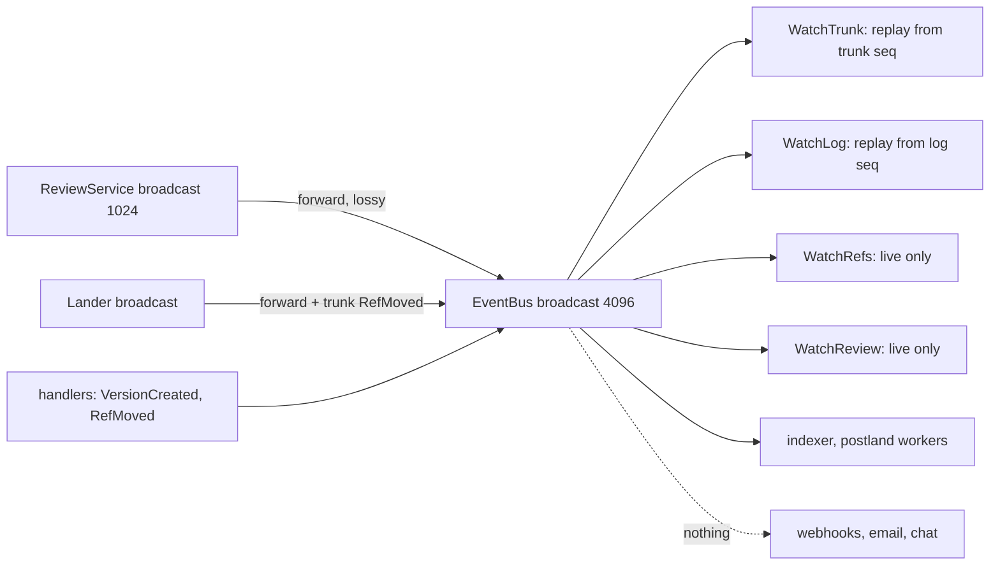

# Notifications and webhooks

Rill's events exist only inside the server process: a per-repository
`tokio::sync::broadcast` channel that review, landing and ref changes are
published to, consumed by the `Watch*` server-streaming RPCs and by in-process
workers. Nothing is delivered to anyone who is not connected at the moment the
event fires. The invariant a production system needs is that an event, once it
has happened, is eventually delivered at least once to every durable
subscriber, or recorded as undeliverable; the bus today gives at-most-once to
whoever is listening.

## Current state

| Piece | Source | Behavior |
| --- | --- | --- |
| Event bus | [state/events.rs](../../crates/rill-server/src/state/events.rs) | `EventBus` wraps `broadcast::Sender<RepoEvent>` with `EVENT_CAPACITY = 4096`. `publish` drops the event silently when no receiver exists; a slow receiver gets `RecvError::Lagged(n)` and loses `n` events. `RepoEvent` is `Review(ReviewEvent)`, `Land(LandEvent)`, `RefMoved {name, old, new, at}`, `VersionCreated {hash}`. |
| Sources | [workers/mod.rs](../../crates/rill-server/src/workers/mod.rs), [services/repo/write.rs](../../crates/rill-server/src/services/repo/write.rs), [services/repo/refs.rs](../../crates/rill-server/src/services/repo/refs.rs) | `ReviewService` and `Lander` each have their own broadcast channel (`DEFAULT_EVENT_CAPACITY = 1024` for review); `EventBus::forward` copies them onto the bus, itself a lossy receiver. `land_to_bus` adds a synthetic `RefMoved{trunk}` per landing with `old: None`. `VersionCreated` and user ref moves are published directly by the handlers. |
| Durable logs | [rill-store repo.rs](../../crates/rill-store/src/repo.rs) `log_after`, `log_head`, `trunk_range`; [meta.rs](../../crates/rill-store/src/meta.rs) `Mutation::AppendLog` | The metadata store has an append-only, gap-free write-ahead log of version hashes (`log/<repo>/<seq>`) and the trunk sequence. These are the only durable, replayable event sources. Review events, ref moves and verification results have no log. |
| Watches | [services/repo/watch.rs](../../crates/rill-server/src/services/repo/watch.rs), [services/review.rs](../../crates/rill-server/src/services/review.rs) `watch_review` | `WatchTrunk(after_seq)` and `WatchLog(after_seq)` subscribe to the bus first, then replay from the store and use bus events as wake-ups, so they are exact and resumable by cursor. `WatchRefs(prefix)` and `WatchReview(change_id)` are live-only: no cursor, no replay; a `Lagged` receiver silently skips. Every watch is a server task bound to one connection and ends at `shutdown` or disconnect. |
| Review-side intent | [rill-types review.rs](../../crates/rill-types/src/objects/review.rs) `Thread.to: Option<Principal>` | A thread can name a recipient; nothing acts on it. |
| Agents | [rill-sdk repo/watch.rs](../../crates/rill-sdk/src/repo/watch.rs), [review.rs](../../crates/rill-sdk/src/review.rs) `watch` | The SDK exposes all four streams. `rill-mcp` exposes none; an agent on MCP polls `GetReview`/`GetLandStatus`. |
| Outbound delivery | — | No webhook, email, Slack, or subscription record exists anywhere in the workspace. `ReviewerPool` ([rill-review agents/pool.rs](../../crates/rill-review/src/agents/pool.rs)) fans out to in-process `Reviewer` implementations; it is not a notification path. |



## Why it blocks production

1. **A reviewer who is not connected is never told.** `Thread.to` is set, the
   author waits, the recipient has no page, no email, no chat message. Review
   latency becomes "when did they happen to run `rill review list`".
2. **CI and deploy systems cannot react.** `LandEvent::Landed`,
   `Verification`, `Culprit` and `Reverted` are the events a deploy pipeline
   or an incident channel needs; without outbound delivery every integration
   must hold a gRPC stream open forever and handle reconnects and gaps itself.
3. **Live-only watches lose events on restart and lag.** A `WatchReview`
   client that reconnects after a server restart has no cursor; whatever
   happened in between is gone. `WatchRefs` under a burst of landings
   (`EVENT_CAPACITY` exceeded) skips `RefMoved` events and the client's view
   of refs is stale with no signal beyond a `tracing::warn!`.
4. **Agents poll.** MCP agents cannot subscribe; a fleet of agents polling
   `GetReview` is load on the metadata store proportional to agents × polling
   rate, and still delivers stale state.
5. **Forwarding compounds loss.** Review events pass through two lossy
   channels before a watcher sees them; the forwarder's own `Lagged` branch
   only logs.
6. **No audit trail of what was sent.** When a webhook later exists without a
   durable record, a disputed "we were never notified" cannot be answered.

## Requirements

* R1. Every `RepoEvent` is appended to a durable, per-repository, gap-free
  event log with a sequence number before (or atomically with) being published
  on the bus. Test: kill the server between a landing and any watcher
  receiving it; after restart `WatchEvents(after_seq)` delivers it.
* R2. All watch RPCs accept a cursor and replay from the log; `Lagged` on the
  in-memory bus is a wake-up, never a loss.
* R3. Subscriptions are records: `(repo, principal or endpoint, filter,
  delivery kind, cursor)`, created and listed through the API, persisted in
  the metadata store.
* R4. Webhook delivery is at-least-once with exponential backoff, a
  per-endpoint retry budget, HMAC signature over the body, a delivery log with
  status per attempt, and manual redelivery. Test: endpoint returns 500 five
  times then 200; one event, six attempts recorded, final success.
* R5. Delivery is ordered per subscription (no event N+1 delivered before N
  succeeds or is dead-lettered) and a dead-lettered subscription is visible in
  the API and resumable.
* R6. Email and chat (Slack, and a generic incoming-webhook format) are
  delivery kinds built on the same outbox with templates per event kind;
  delivery failures do not affect the API path.
* R7. Agents can subscribe through MCP: a `rill_watch` tool that returns
  events since a cursor, plus an SDK helper that resumes a watch stream across
  reconnects.
* R8. Event payloads are stable, versioned schemas (`rill.v1.RepoEvent` in
  proto and a documented JSON encoding for webhooks), carrying ids and hashes
  rather than denormalised state, with a `resource_url` to fetch current
  state.
* R9. Notification routing honours review intent: `Thread.to`, review
  ownership, label requirement and `DependentsReady` map to recipients without
  a user having to create subscriptions by hand.

## Design direction

### Recommended: durable event log in the metadata store, bus as wake-up only, transactional outbox with a delivery worker, and subscriptions as records

**Event log.** Add `evt/<repo>/<be64 seq>` → encoded `RepoEvent` using the
existing `Mutation::AppendLog` primitive (the same mechanism the write-ahead
log uses, so every backend already supports it). Publication becomes: append
in the same transaction as the state change where the change is a metadata
write (ref moves, review record updates, landing records), or immediately
after for events originating in library crates; then `bus.publish(RepoEvent)`.
`EventBus` gains `publish_durable(&RepoStore, event) -> Result<u64>` and the
forwarders write the review and lander events before re-publishing. Review and
lander keep their in-crate channels (the library crates have no store
dependency for events); only the server appends.

**Watches.** One new RPC, `RepoService.WatchEvents(after_seq, filter)`,
replays from `evt/` then tails, exactly as `WatchTrunk` does with
`drain_trunk`. `WatchRefs` and `WatchReview` are reimplemented on top of it
with filters, gaining cursors (`RefEvent.seq`, `ReviewEvent.seq`) for R2.

**Subscriptions.** Keyspace `sub/<repo>/<id>` → `Subscription { id, owner,
filter, delivery: Webhook{url, secret_ref} | Email{address} |
Slack{webhook_url_ref, channel} | Principal{name}, cursor, state: Active |
Paused | Dead{reason}, created_at }`. `AdminService` (or a new
`NotificationService`) gets `CreateSubscription`, `ListSubscriptions`,
`DeleteSubscription`, `Redeliver(subscription, seq)`. Filters are event kinds
plus optional `change_id`, `ref prefix`, `path prefix` (checked against the
version's `file_changes`) and principal predicates (`to == me`, `owner ==
me`).

**Outbox and delivery worker.** The delivery worker (one per repository, like
the indexer) reads `evt/` from each active subscription's cursor, builds the
payload, and attempts delivery. Per attempt it writes
`dlv/<repo>/<subscription>/<seq>/<attempt>` → `{at, status, response_code,
error}`. Success advances the cursor by a CAS on the subscription record;
failure schedules the next attempt with backoff (1 s, 2 s, ... capped at 1 h,
24 h total budget by default); exhaustion sets `state = Dead` and the
subscription stops advancing (R5). Webhook bodies are JSON
(`application/json`), headers `X-Rill-Event`, `X-Rill-Seq`, `X-Rill-Delivery`,
`X-Rill-Signature: sha256=<hmac>` over the raw body with the secret resolved
through the same `SecretSource` the sandbox brief proposes; GitHub-style, so
existing receivers port directly.

**Routing (R9).** A built-in `Router` derives implicit subscriptions from
review state: on `Commented { new_thread, thread.to = Some(p) }` → notify `p`;
on `Submitted` → notify principals holding a required label's `reviewer`
relation (from the ReBAC authorizer); on `DependentsReady` → owners of the
dependents; on `Verification { green: false }`, `Culprit`, `Reverted` → the
repository's `oncall` subscription. Implicit routes resolve to principals; a
principal's delivery preferences (`pref/<principal>` → email, Slack id, digest
window) are what turn a principal into an endpoint. Humans configure one
preference record; agents get events through `WatchEvents`.

**Agents (R7).** `rill-mcp` gains `rill_watch { after_seq, filter, wait_ms }`:
long-poll over `WatchEvents` returning up to N events and the new cursor,
which fits tool-call semantics better than a stream. The SDK adds
`EventStream::resume` that reconnects and continues from the last seen `seq`.

```mermaid
sequenceDiagram
  participant S as service handler
  participant M as MetaStore
  participant B as EventBus
  participant D as delivery worker
  participant E as endpoint
  S->>M: tx { state change, AppendLog evt/ }
  M-->>S: seq
  S->>B: publish(event, seq)
  D->>M: read evt/ after cursor(sub)
  D->>E: POST payload, X-Rill-Signature
  alt 2xx
    D->>M: dlv/ ok; CAS cursor = seq
  else failure
    D->>M: dlv/ failed; schedule retry (backoff)
  end
```

### Alternatives considered

| Option | Trade-off |
| --- | --- |
| External broker (NATS JetStream, Kafka, Redis Streams) as the durable log | Durable and scalable, but a second stateful system to deploy and the event log would live outside the metadata store's transactions, so "state change and event" atomicity is lost. The metadata store already has `AppendLog`; use it, and revisit when fan-out exceeds one process. |
| Make the broadcast channel larger | Postpones loss; does not survive restart or give cursors. |
| Deliver synchronously from the handler | Couples API latency to third-party endpoints; a slow Slack call delays `Vote`. The outbox decouples them. |
| Polling-only for integrations (`WatchEvents` without webhooks) | Sufficient for agents and first-party tools; third-party systems (chat, email, GitHub status) need push. Both are kept. |

### Trade-offs

* The event log grows forever; a retention policy (`events.retain_days`)
  deletes old `evt/` rows and marks subscriptions whose cursor is older than
  retention as `Dead{reason: "cursor expired"}`.
* Appending events in the same transaction as state changes is only possible
  for server-side writes; events from library crates (lander, review) are
  appended by the forwarder just after the fact, which leaves a crash window
  where a state change has no event. Closing it means the lander and review
  services take an `EventSink` trait in their constructors; that is a small
  change in both crates and the recommended end state.
* One delivery worker per repository matches the single-lander assumption; a
  multi-server deployment needs the same leadership mechanism the lander and
  the search compactor need.

## Work breakdown

1. **S** `evt/` keyspace in `rill-store` keys, `RepoStore::append_event` /
   `events_after`, `RepoEvent` serde encoding (postcard, no
   `skip_serializing_if`).
2. **M** `EventBus::publish_durable`; forwarders append before publishing;
   handlers append in-transaction for ref moves and version creation;
   `RepoEvent` proto message with `seq`.
3. **M** `WatchEvents(after_seq, filter)` RPC; `WatchRefs` and `WatchReview`
   reimplemented with cursors; SDK `resume`.
4. **M** `EventSink` trait in `rill-review` and `rill-lander` so events are
   written by the server at the moment of the state change (closes the crash
   window).
5. **M** Subscription records and `NotificationService` RPCs; CLI `rill notify
   subscribe|list|delete|redeliver`.
6. **L** Delivery worker: outbox read, webhook client (reqwest, timeouts,
   HMAC), backoff, delivery log, dead-lettering, redelivery, metrics.
7. **M** Email (SMTP via `lettre`) and Slack (incoming webhook and
   chat.postMessage) delivery kinds with templates per event.
8. **M** Router for implicit recipients (`Thread.to`, required reviewers,
   dependents, oncall) and principal preference records.
9. **S** `rill_watch` MCP tool (long-poll over `WatchEvents`).
10. **S** Retention worker for `evt/` and `dlv/`; admin visibility of dead
    subscriptions in `Health`.

## Risks and open questions

* Webhook secrets and SMTP credentials need the secret store from the sandbox
  brief; until it exists they live in `ServerConfig`, which is read by every
  operator.
* Path-prefix filters require loading the version to inspect `file_changes`
  per event per subscription; cache by version hash in the delivery worker, or
  restrict path filters to `Landed` events.
* Email digests (one message per review per hour rather than one per comment)
  change ordering semantics; digests should be a delivery-kind option that
  batches within a window, with the per-event delivery log still recording
  each event.
* Permission on outbound payloads: a subscription created by a principal must
  not deliver events about paths that principal cannot read. The filter
  evaluation runs with the owner's `read_filter`, and payloads carry ids only
  (R8), so the leak surface is "a change touching a secret path exists", which
  the subscription owner could also learn from `WatchLog`. Decide whether that
  is acceptable or whether path-restricted principals get only events whose
  every path they may read.
* Open: should the event log be the write-ahead log (`log/`) extended with
  typed records, instead of a second log? `log/` stores version hashes only
  and is read by `WatchLog`; merging would change its schema and every reader.
  A second log keyed by seq with a `version_seq` cross-reference is the safer
  path.
* Open: event schema stability for webhooks versus proto evolution; a JSON
  encoding derived from proto via `prost-wkt`/`pbjson` keeps one source of
  truth.

## References

Source:
[rill-server/src/state/events.rs](../../crates/rill-server/src/state/events.rs),
[rill-server/src/workers/mod.rs](../../crates/rill-server/src/workers/mod.rs),
[rill-server/src/services/repo/watch.rs](../../crates/rill-server/src/services/repo/watch.rs),
[rill-server/src/services/review.rs](../../crates/rill-server/src/services/review.rs),
[rill-server/src/services/repo/write.rs](../../crates/rill-server/src/services/repo/write.rs),
[rill-server/src/services/repo/refs.rs](../../crates/rill-server/src/services/repo/refs.rs),
[rill-review/src/service.rs](../../crates/rill-review/src/service.rs),
[rill-lander/src/events.rs](../../crates/rill-lander/src/events.rs),
[rill-store/src/meta.rs](../../crates/rill-store/src/meta.rs),
[rill-store/src/repo.rs](../../crates/rill-store/src/repo.rs),
[rill-store/src/keys.rs](../../crates/rill-store/src/keys.rs),
[rill-types/src/objects/review.rs](../../crates/rill-types/src/objects/review.rs),
[rill-sdk/src/repo/watch.rs](../../crates/rill-sdk/src/repo/watch.rs),
[rill-sdk/src/review.rs](../../crates/rill-sdk/src/review.rs).

Prior art: the transactional outbox pattern (Richardson, microservices.io) and
Debezium's outbox event router; GitHub webhooks (delivery ids,
`X-Hub-Signature-256`, redelivery UI, delivery log); Stripe webhooks (ordering
caveats, idempotency keys, retry schedule); Gerrit's stream-events and its
notification plugins; Phabricator Herald rules (routing by predicates); Slack
incoming webhooks and `chat.postMessage`; NATS JetStream and Kafka as
alternative durable logs; Standard Webhooks specification for signature and
header conventions; `lettre` and `reqwest` crates.
