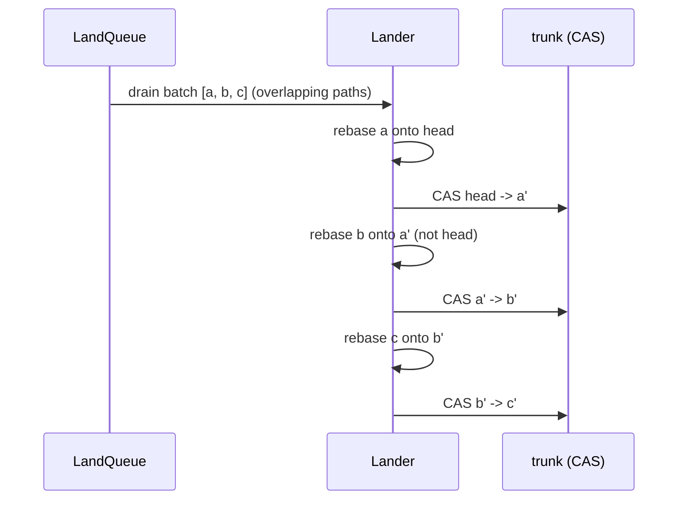

# Scale and performance

Rill's third principle is "cost scales with the change, not the repo". The
tree, diff and path-history code honours it; the search indexer, the
in-memory backend, several list RPCs and the landing queue do not, and
nothing measures any of it. There are no benchmarks, no load tests and no
profiling harness in the workspace, so every number below is a complexity
argument from source, not a measurement.

## Current state

### What exists

* `[workspace.dependencies]` lists `proptest` and `similar-asserts`; no
  `criterion`, `divan`, `iai` or `pprof`. No crate has a `benches/`
  directory ([Cargo.toml](../../Cargo.toml)).
* No test creates more than a few dozen files or a few hundred versions.
  The largest fixtures are
  [workflow.rs](../../crates/rill-core/tests/workflow.rs) (413 lines) and
  [landing.rs](../../crates/rill-lander/tests/landing.rs) (586 lines).
* `[profile.release]` sets `lto = "thin"`, `codegen-units = 4`,
  `debug = 1`, which is suitable for `perf` with symbols.
* The server exposes no metrics endpoint; `tracing` spans exist but no
  timing is exported ([serve.rs](../../crates/rill-server/src/serve.rs)).

### Hot-path complexity

Notation: *C* = entries in the change, *D* = directory depth, *N* = files
in the repository, *H* = versions in history, *W* = graph width, *B* =
bytes of a file.

| Path | Code | Complexity | O(change)? |
| --- | --- | --- | --- |
| Tree materialize | [tree/builder.rs](../../crates/rill-core/src/tree/builder.rs) `build_dir` | O(C·D) tree loads and writes; untouched subtrees are never loaded | yes |
| Tree diff | [diff/tree.rs](../../crates/rill-core/src/diff/tree.rs) `diff_trees` | O(changed dirs × fan-out); equal subtree hashes pruned without loading | yes, but one directory of 100k entries costs 100k name comparisons per changed sibling |
| Walk (checkout, index) | [tree/walk.rs](../../crates/rill-core/src/tree/walk.rs) | O(N) under prefix, collected into one `Vec<WalkEntry>` | no (inherent) |
| Path history derive | [derive/history.rs](../../crates/rill-core/src/derive/history.rs) | O(C·D) node rewrites, sharing the rest with the first parent | yes |
| Path history query | `DeriveManager::history` | O(D) node loads per hit; one `PathHistory` derive per visited version | yes |
| Blame | [derive/blame.rs](../../crates/rill-core/src/derive/blame.rs) | Walk back first-parent chain until stored blame or creation: O(H_path) `RootTree` + `file_state` lookups, then one Histogram diff per content change, O(B·lines) each; every intermediate stored | first request is O(file history); later requests incremental |
| Derive (generic) | [derive/manager.rs](../../crates/rill-core/src/derive/manager.rs) `compute` | Explicit post-order stack; derives every ancestor missing the value. A cold `Generation` on a 100k-version history is 100k store reads and writes | first call is O(H) |
| `log` | [graph/walk.rs](../../crates/rill-core/src/graph/walk.rs) `ancestors` | O(limit·log W) heap ops; `info()` is read twice per version (on push and on pop); `generation()` may trigger a derive | bounded by `limit` (max 10,000 in [history.rs](../../crates/rill-server/src/services/repo/history.rs)) |
| `is_ancestor`, `merge_base` | [graph/commit_graph.rs](../../crates/rill-core/src/graph/commit_graph.rs) | Generation-pruned walks. `merge_base` scans the whole heap (`heap.iter().any`) before every pop: O(W) per step, O(W²) worst case on wide graphs | bounded by graph width |
| Rebase | [rebase.rs](../../crates/rill-core/src/rebase.rs) → [merge/change.rs](../../crates/rill-core/src/merge/change.rs) | Per-path three-way merge of the changed paths only; each file merge is O(B) | yes |
| Land (one request) | [land/pipeline.rs](../../crates/rill-lander/src/land/pipeline.rs) | `trunk_head` scan + `get_change_version` + `is_ancestor` + rebase + `RootTree` derive + CAS `land_on_trunk`; on `Conflict` the whole attempt repeats up to `max_retries` | yes, times retries |
| Land queue sweep | [land/lander.rs](../../crates/rill-lander/src/land/lander.rs) `run_once` | `drain` all; `touched_paths` per request (one tree diff); `partition` builds a `HashMap` of every touched path **and every ancestor directory** per request: O(Σ C·D) | yes per request, but sequential per batch |
| Landing record | [land/record.rs](../../crates/rill-lander/src/land/record.rs) `record_landing` | Reads, decodes, appends and re-encodes a 1,000-entry ring under `record_lock` on **every** landing: O(1000) per land, serialised | no (constant, but large and serialised) |
| Search index per root | [index/search_index.rs](../../crates/rill-search/src/index/search_index.rs) `index_root` | Walks the **entire** root and writes a full `RootManifest` (one entry per file) as derived data for every landed root | **no: O(N) per landing** |
| Search query | [query/search.rs](../../crates/rill-search/src/query/search.rs) | Trigram intersection, then regex over candidate blobs of the root's manifest | bounded by `MAX_RESULTS = 5_000` |
| `ListReviews`, `ListWorkspaces`, `ListIntents`, `list_repos` | [repo.rs](../../crates/rill-store/src/repo.rs) | Unbounded prefix scans, every row decoded | **no: O(all records)** |
| `GetBlob` | [repo/trees.rs](../../crates/rill-server/src/services/repo/trees.rs) | Whole blob read into memory (`read_content`), then sliced into 256 KiB chunks; `offset`/`length` do not reduce the read | O(B) regardless of range |
| `PutBlob` | same | Buffered entirely in a `BytesMut` before hashing; no upper bound beyond the gRPC frame limit | O(B) memory |
| Object `PUT` | [objects/handlers.rs](../../crates/rill-server/src/objects/handlers.rs) | Body limit `MAX_PUT_BYTES = 256 MiB`, buffered, hashed, stored | O(B) memory |

### Memory behaviour of the memory backend

[memory.rs](../../crates/rill-store/src/memory.rs):

* `MemoryObjectStore` is `RwLock<HashMap<(ObjectKind, ObjectHash), Bytes>>`.
  Nothing is ever evicted; `put` verifies BLAKE3 over the whole value while
  **not** holding the lock, then takes the write lock for the insert.
  Memory is the sum of all object bytes plus 40 bytes of key per object.
* `MemoryMetaStore` is `RwLock<BTreeMap<Bytes, Bytes>>`. `scan` clones
  every `(key, value)` pair in range (cheap: `Bytes` is refcounted) into a
  `Vec` while holding the read lock. `transact` holds the write lock for
  condition checks, mutations and `AppendLog`'s `next_back` range scan.
  One write lock serialises every transaction in the process.
* `KeyRange::prefix` defaults to `limit: usize::MAX`
  ([meta.rs](../../crates/rill-store/src/meta.rs)), so every unbounded
  list above materialises the full result set.

Process-wide caches that grow without bound:

| Cache | Location | Bound |
| --- | --- | --- |
| `CommitGraph::parents`, `generations` | [commit_graph.rs](../../crates/rill-core/src/graph/commit_graph.rs) | none (`DashMap`) |
| `SearchIndex::manifests` | [search_index.rs](../../crates/rill-search/src/index/search_index.rs) | none; one `Arc<RootManifest>` of N entries per indexed root |
| `LandQueue::status` | [queue.rs](../../crates/rill-lander/src/queue.rs) | trimmed by `forget_terminal` each sweep; a ticket whose status never turns terminal stays forever |
| `DeriveManager::in_flight` | [manager.rs](../../crates/rill-core/src/derive/manager.rs) | removed after each derive |

Bounded caches: `TreeOps` decoded trees (`DEFAULT_TREE_CACHE = 4096`) and
the `DeriveManager` value cache, both on
[util/lru.rs](../../crates/rill-core/src/util/lru.rs). Eviction collects
and sorts every stamp when the map exceeds capacity: O(n log n) every
`capacity/8` inserts under a global `parking_lot::Mutex`, so a tree cache
of 4,096 sorts 4,097 entries every 513 misses, with every reader blocked.

## Why it blocks production

* **A landing on a 1M-file monorepo re-walks the monorepo.** The indexer
  follows `Landed` events and calls `index_root`, which walks every
  directory (≈ N/fan-out tree loads, most cache misses after the first
  land evicts them) and writes a manifest of 1M entries as one derived
  record. With a 10 s land cadence the indexer never catches up and the
  process holds one `RootManifest` per root in `manifests`.
* **100 concurrent lands serialise.** `run_once` drains the queue and
  partitions by touched paths; requests sharing any directory ancestor are
  one batch and run sequentially, each one doing `trunk_head`, rebase,
  `RootTree` derive and a CAS. Independent batches do run concurrently,
  but every winner moves trunk, so every other in-flight attempt fails
  CAS, re-reads `trunk_head`, re-rebases and retries, up to `max_retries`
  times. With 100 requests touching a shared `Cargo.lock` the last one
  rebases 99 times or gives up. `record_landing` adds a 1,000-entry
  decode/encode under a mutex per success.
* **`ListReviews` on a repository with 500k changes returns 500k decoded
  `ReviewState` records** in one gRPC message, exceeding tonic's 4 MiB
  default decode limit on the client and holding the meta read lock for
  the scan.
* **Cold derives stall the first request after restart.** `Generation`,
  `RootTree` and `PathHistory` are stored, but `CommitGraph` caches are
  empty on boot; the first `log` on a 100k-version repository walks
  `limit` versions with two `get_change_info` round trips each, and the
  first `is_ancestor` may derive `Generation` for the whole history if the
  store was imported without derives.
* **A 2 GiB blob on `GetBlob` is a 2 GiB allocation per request**, plus
  a copy of every chunk during `read_content`, and the same on `PutBlob`
  ingest before the hash is checked. Ten concurrent fetches of one large
  artifact exhaust a 16 GiB node.
* **The memory backend is the default** (`StorageConfig::Memory`) and the
  only backend `rill-server` runs in tests. A server started without a
  config file keeps every object forever and loses everything on exit;
  a demo that imports a real repository grows until the OOM killer runs.
* **No way to know any of this before an incident.** Without metrics or
  benchmarks a regression in `diff_trees` or `partition` ships silently.

## Requirements

Done means each of the following is true and checked by a benchmark or a
load test that runs in CI (nightly for the long ones):

1. `materialize`, `diff_trees`, `PathHistory::derive` and `rebase` on a
   1M-file, depth-8 tree with a 10-file change complete in under 20 ms on
   the local backend with a warm cache and under 200 ms cold.
2. Indexing a landed version costs O(changed files): a 10-file change on
   a 1M-file root indexes in under 500 ms and writes under 1 MiB.
3. `log --limit 100` on a 100k-version linear history completes in under
   50 ms warm; `merge_base` on a graph of width 1,000 completes in under
   100 ms; neither reads a version's info more than once.
4. 100 concurrent `Land` requests on disjoint paths land in under 5 s
   total on the local backend; 100 requests on one shared file land in
   under 60 s with zero `Failed { reason: "trunk moved ... giving up" }`.
5. Every list RPC is paginated with a server-enforced maximum page size
   and a continuation token; no RPC response exceeds 4 MiB.
6. `GetBlob` with `offset`/`length` reads only the chunks that cover the
   range; peak server memory during a 2 GiB `PutBlob` is under 512 MiB.
7. Every process-wide cache has a bound and a metric; a 24 h soak at 1
   land/s on the local backend shows flat RSS after warm-up.
8. The server exports request latency histograms per RPC, land queue
   depth, derive cache hit rate and store operation latency.

## Design direction

### Search: incremental manifests

Replace the per-root `RootManifest` (a flat `Vec<ManifestEntry>`) with a
manifest keyed by **tree hash** rather than root hash: one record per
directory listing its files' blob hashes, written only for directories
whose tree hash is new. `index_root` becomes `diff_trees(previous_root,
root)` plus per-changed-directory writes. Querying maps a candidate blob
back to paths by walking the root's directory manifests, which is the same
O(N) walk the query already does over `RootManifest` but now shared across
roots through the object store.

Alternative: keep the flat manifest but compute it from the previous
root's manifest plus the tree diff (O(N) copy, O(C) work). Simpler, still
O(N) memory per root. Reject: the copy is the cost.

### Landing: pipelining instead of retry storms

Within one batch the lander already processes sequentially; make it also
rebase each request onto the **predicted** head (the previous request's
result) so the CAS succeeds first time. Across batches, replace the
drain-and-spawn model with a single trunk-advancing task per repository
and a bounded worker pool for rebase and verification; a verified request
hands its rebased version to the sequencer, which performs the CAS in
arrival order. Retries then happen only when an external `UpdateRef`
moves trunk. The prior art is the Bors/Homu merge queue and Meta's
Sapling landing stack.

`record_landing`: write only the per-version `land@1` record on the hot
path; serve `ListLandings` from a reverse scan of `trunk/<repo>/` joined
with `land@1`, dropping the ring.

### Blobs: range reads and streaming ingest

`read_range(content, offset, len)` that loads only the manifest chunks
covering the range (chunk boundaries are in `BlobManifest`). `PutBlob`
hashes and chunks the stream incrementally (FastCDC over a rolling window)
instead of buffering; the expected hash check runs on the running BLAKE3
state. The HTTP `PUT` keeps its 256 MiB limit but streams to a temp file
in the local backend.

### Lists: cursors everywhere

Add `page_size` (max 1,000) and `page_token` (the last key) to every list
RPC; `RepoStore` list methods take a `KeyRange` with `limit` and return the
next key. This is a proto change, so do it before any external client
depends on the current shape.

### Caches and the memory backend

* `LruCache`: replace the sort-on-evict with a `VecDeque` clock or the
  `moka`/`quick_cache` crate; shard by key hash to cut lock contention.
* `CommitGraph`: bound `parents`/`generations` with the same cache.
* `MemoryObjectStore`: add a configurable byte budget with LRU eviction
  so it can serve as a cache tier, and refuse to be the default outside
  `dev_mode`.
* `merge_base`: track the count of non-stale heap entries instead of
  scanning the heap each iteration.
* `ancestors`: use the `parents` cache that `info()` already fills instead
  of a second `info()` on pop.

### Benchmark plan

Criterion benches in each library crate, run on a fixed generated corpus
(`rill-bench` crate with a deterministic generator seeded by `proptest`'s
`TestRng`):

| Bench | Corpus | Target |
| --- | --- | --- |
| `tree_materialize` | 1M files, depth 8, fan-out 32; change 10 files | < 20 ms warm |
| `tree_diff_adjacent` | same, consecutive roots | < 5 ms |
| `tree_diff_distant` | roots 10k versions apart, 50k files differ | < 2 s |
| `path_history_derive` | same change | < 10 ms |
| `blame_cold` / `blame_warm` | file with 1,000 revisions, 2,000 lines | < 2 s / < 5 ms |
| `log_100` | 100k linear + 1k merges | < 50 ms |
| `merge_base_wide` | 1,000 parallel branches merged pairwise | < 100 ms |
| `rebase_10` | 10-file change across 1,000 trunk versions | < 50 ms |
| `index_root_incremental` | 1M-file root, 10-file change | < 500 ms |
| `grep_hot` | 1M files, query matching 100 | < 200 ms |
| `lru_put_evict` | 4,096 capacity, 1M inserts | < 100 ns/insert amortised |
| `memory_meta_scan_1m` | 1M keys, prefix of 10k | < 10 ms |

Load tests (a `tests/load/` binary using `rill-sdk` against a local-backend
server, nightly):

| Test | Shape | Pass |
| --- | --- | --- |
| `land_100_disjoint` | 100 clients, 100 disjoint paths | all `Landed` in < 5 s |
| `land_100_contended` | 100 clients, one shared file | all `Landed` in < 60 s, zero give-ups |
| `land_soak_24h` | 1 land/s, 10 watchers, indexer and postland on | RSS flat after 1 h; p99 land < 1 s |
| `checkout_1m` | sparse and full checkout of 1M files | full < 5 min; sparse 1k files < 2 s |
| `import_linux` | `rill-git-import` of a 1M-commit repository | < 4 h; derives complete |
| `blob_2g` | 10 concurrent 2 GiB `GetBlob` | server RSS < 1 GiB |

### Profiling plan

* `cargo flamegraph` (perf-based) over each criterion bench with
  `debug = 1`; check in the SVGs for the baseline.
* `tokio-console` on the server during `land_100_contended` to find
  tasks blocked on `record_lock`, `pending` and the meta write lock.
* `heaptrack` or `dhat-rs` on `checkout_1m` and `blob_2g` for peak
  allocation; `valgrind --tool=massif` as a cross-check.
* `tracing` spans on `Lander::attempt`, `DeriveManager::compute`,
  `index_root` and every `MetaStore::transact`, exported through
  `tracing-opentelemetry`; a `metrics` endpoint (`/metrics` on the HTTP
  listener) with `metrics-exporter-prometheus`.
* `cargo llvm-lines` and `cargo bloat` once, to catch monomorphisation
  blow-up in `derive::get::<D>` and the proto conversions.

## Work breakdown

1. **S** Add `criterion` to `[workspace.dependencies]`; create
   `crates/rill-bench` with the deterministic corpus generator and the
   `tree_*`, `lru_*` and `memory_meta_*` benches. Record baseline numbers
   in the crate README.
2. **S** Fix `LruCache` eviction (clock or `quick_cache`); fix
   `merge_base`'s per-iteration heap scan; make `ancestors` use the
   `parents` cache. Add the `log_100` and `merge_base_wide` benches.
3. **M** Paginate every list RPC (proto + store + SDK + CLI); cap
   `list_reviews`, `list_workspaces`, `list_intents`, `list_repos`.
4. **M** `read_range` for chunked blobs; `GetBlob` honours `offset`/
   `length` at the chunk level; streaming `PutBlob` hash and chunking.
5. **L** Incremental search manifests keyed by tree hash; bound
   `SearchIndex::manifests`; `index_root_incremental` bench.
6. **L** Lander sequencer: predicted-head rebase within a batch, single
   trunk-advancing task, bounded verify pool; drop the landing ring.
   `land_100_*` load tests.
7. **M** Metrics endpoint and `tracing` spans on the hot paths;
   `tokio-console` feature flag.
8. **M** Memory backend byte budget and eviction; refuse `Memory`
   outside `dev_mode` unless `storage.allow_volatile = true`.
9. **L** Load-test binary and nightly CI job; 24 h soak on a dedicated
   runner; `import_linux` as a quarterly manual run.
10. **M** Bound `CommitGraph` caches; add cache hit-rate metrics;
    `derive` warm-up task after import.

## Risks and open questions

* The tree is a plain `BTreeMap<String, TreeEntry>` per directory; a
  directory with 100k entries (vendored `node_modules`, generated code)
  costs 100k decodes on every touch and dominates `diff_trees`. Sharded or
  prefix-split trees (as in Sapling's manifests) are a format change;
  decide before the format is frozen.
* `DeriveManager::compute` derives all missing ancestors synchronously
  inside the request. A background deriver that follows the write-ahead
  log (`log_after`) would keep requests O(1), but it must not race the
  in-flight lock.
* Landing throughput is ultimately bounded by one CAS per land on one
  key; FoundationDB's transaction latency (~5 ms) caps a single repository
  at ~200 lands/s. Is that enough, or does trunk need batching (one CAS
  advancing several sequence numbers)?
* `ancestors_excluding` and `merge_base` are bounded by graph width, which
  is unbounded for a repository with thousands of long-lived agent
  branches. Generation numbers v2 (corrected commit dates, as in git's
  commit-graph) would tighten the pruning.
* Whether the target numbers above are right depends on the intended
  deployment size; they assume "Linux-kernel-sized monorepo, one team of
  agents". Confirm with the owner before step 9.

## References

Source:
[tree/builder.rs](../../crates/rill-core/src/tree/builder.rs),
[tree/walk.rs](../../crates/rill-core/src/tree/walk.rs),
[diff/tree.rs](../../crates/rill-core/src/diff/tree.rs),
[graph/commit_graph.rs](../../crates/rill-core/src/graph/commit_graph.rs),
[graph/walk.rs](../../crates/rill-core/src/graph/walk.rs),
[derive/manager.rs](../../crates/rill-core/src/derive/manager.rs),
[derive/blame.rs](../../crates/rill-core/src/derive/blame.rs),
[derive/history.rs](../../crates/rill-core/src/derive/history.rs),
[util/lru.rs](../../crates/rill-core/src/util/lru.rs),
[blobs.rs](../../crates/rill-core/src/blobs.rs),
[rill-store/src/repo.rs](../../crates/rill-store/src/repo.rs),
[rill-store/src/keys.rs](../../crates/rill-store/src/keys.rs),
[rill-store/src/memory.rs](../../crates/rill-store/src/memory.rs),
[rill-store/src/meta.rs](../../crates/rill-store/src/meta.rs),
[rill-lander/src/queue.rs](../../crates/rill-lander/src/queue.rs),
[rill-lander/src/land/lander.rs](../../crates/rill-lander/src/land/lander.rs),
[rill-lander/src/land/pipeline.rs](../../crates/rill-lander/src/land/pipeline.rs),
[rill-lander/src/land/record.rs](../../crates/rill-lander/src/land/record.rs),
[rill-lander/src/conflict_graph.rs](../../crates/rill-lander/src/conflict_graph.rs),
[rill-search/src/index/search_index.rs](../../crates/rill-search/src/index/search_index.rs),
[rill-server/src/services/repo/trees.rs](../../crates/rill-server/src/services/repo/trees.rs),
[rill-server/src/services/repo/history.rs](../../crates/rill-server/src/services/repo/history.rs).

Prior art and tools: criterion.rs and divan (micro-benchmarks);
`cargo-flamegraph`, `tokio-console`, `heaptrack`, `dhat-rs`;
`metrics-exporter-prometheus`, `tracing-opentelemetry`; git's
`commit-graph` generation numbers v2 and `paint_down_to_common`; Sapling's
tree manifests and sharded directory trees; GitHub Blackbird (blob-keyed
search index); Bors-NG and Homu merge queues; FoundationDB's transaction
latency and 10 MB transaction size limits; the "Scalability! But at what
COST?" (McSherry et al., 2015) single-thread baseline discipline for
judging the load numbers.
