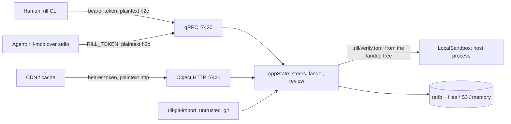
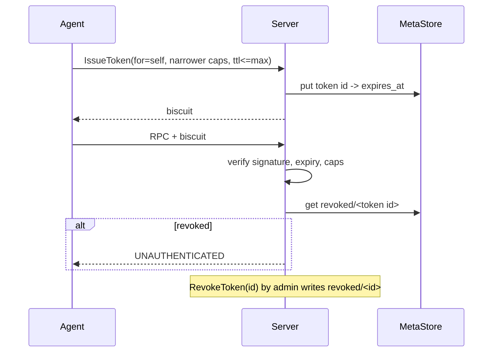

# Security hardening

Rill's server is the repository, so every security property reduces to
what the server accepts from whom and what it does with it. Today the
server speaks plaintext on both listeners, runs repository-supplied
verification commands as host processes, and decodes protobuf, JSON, TOML,
conflict markers and git objects from untrusted sources with no fuzzing.
The invariant to establish: every byte that crosses a trust boundary is
bounded, validated and attributed before it touches storage or a process.

## Current state

### Trust boundaries

| Boundary | Code | What is checked today |
| --- | --- | --- |
| Transport | [serve.rs](../../crates/rill-server/src/serve.rs), [client.rs](../../crates/rill-sdk/src/client.rs) | Nothing. `tonic` is built with `features = ["transport", "codegen"]` and no `tls` feature ([Cargo.toml](../../Cargo.toml)); `axum::serve` binds a plain `TcpListener`. The server never terminates TLS and the SDK cannot dial `https://`. The `rustls` entries in `Cargo.lock` come from `reqwest`/`object_store` (S3), not the API. |
| Authentication | [auth/authenticator.rs](../../crates/rill-server/src/auth/authenticator.rs), [identity.rs](../../crates/rill-policy/src/identity.rs) | Static tokens: `HashMap<String, _>` lookup, equality not constant-time. Biscuit tokens: Ed25519 signature, expiry via `is_expired_at`; no revocation, no audience, no max lifetime (`IssueToken` accepts any future `expires_at`). Without a header: `dev` principal when `dev_mode`, else `UNAUTHENTICATED`. |
| Authorization | [auth/permit.rs](../../crates/rill-server/src/auth/permit.rs) | Capability path/verb check, then ReBAC relation on the path's directory or ancestor. A repository with **no** relation tuples is open to every authenticated caller (bootstrap rule). `GetTree`, `GetBlob`, object `GET` and `batch` require only root read: a path-scoped reader can fetch any object by hash. |
| Token issuance | [services/admin.rs](../../crates/rill-server/src/services/admin.rs) `issue_token` | A caller holding a capability may mint a narrower token for **any** `for_principal` without an admin check; attribution of that principal's changes is then only as trustworthy as the delegator. `DEFAULT_TOKEN_TTL_MS` applies only when `expires_at` is absent. |
| Proto decode | [rill-proto/src/convert/*](../../crates/rill-proto/src/convert/mod.rs) | Hashes and ids checked for length; paths through `RepoPathBuf::new` (rejects `.`, `..`, `\`, NUL, empty components); ref names through `RefName::new`. No limits on `file_changes` count, `extra` map size, message length, `Merge` term count or `parents` count. tonic's default 4 MiB decode limit is the only bound. |
| Change versions | [services/repo/write.rs](../../crates/rill-server/src/services/repo/write.rs) `commit_version` | Parents and predecessor must exist; referenced blobs must exist; inline content ≤ `MAX_INLINE` (1 MiB). The root tree is materialised before the RPC returns, so a malformed change fails fast. `author` is taken from the request body in `CreateChangeVersion`, not from the caller. |
| Blobs | [services/repo/trees.rs](../../crates/rill-server/src/services/repo/trees.rs), [objects/handlers.rs](../../crates/rill-server/src/objects/handlers.rs) | Hash verified on every `put` (`rill_store::object::verify`). `PutBlob` buffers the whole stream before hashing; HTTP `PUT` body ≤ `MAX_PUT_BYTES` (256 MiB). No per-repository quota. |
| Blob read | [blobs.rs](../../crates/rill-core/src/blobs.rs) `read_content` | `BytesMut::with_capacity(*size as usize)` trusts the `size` in the `ContentRef` before any chunk is read: a `ContentRef::Chunked { size: u64::MAX }` in a stored change makes the first reader allocate until the allocator fails. `check_size` runs only after assembly. |
| Materialize to disk | [rill-sdk/src/local/fs.rs](../../crates/rill-sdk/src/local/fs.rs), [checkout.rs](../../crates/rill-sdk/src/local/checkout.rs), [rill-exec/src/materialize.rs](../../crates/rill-exec/src/materialize.rs) | Path components are validated, so `..` cannot appear. Symlinks are written with `std::os::unix::fs::symlink` to **any** target, and `write_entry` runs `create_dir_all(parent)` then `std::fs::write`, which follow symlinks. Files are written in path order, so a tree containing `a -> /etc` followed by `a/passwd` writes through the link (CVE-2014-9390 class). `rill-exec` materialises the same way before running verification. |
| `.rill` directory | [meta.rs](../../crates/rill-sdk/src/local/meta.rs), [walk.rs](../../crates/rill-sdk/src/local/walk.rs), [classify.rs](../../crates/rill-policy/src/risk/classify.rs) | The checkout metadata dir and the repository policy dir are both `.rill`. A repository file `.rill/checkout.toml` or `.rill/manifest.toml` overwrites the checkout's own state on materialize; the local walk excludes `.rill`, so `.rill/verify.toml` cannot be edited from a checkout. |
| Verification | [rill-exec/src/sandbox/local.rs](../../crates/rill-exec/src/sandbox/local.rs) | `LocalSandbox` is the only `SandboxKind`. It runs the commands in the landed tree's `.rill/verify.toml` as host processes with a cleared environment plus `PATH` and `HOME`, the server's user and network. Anyone who can land a change can run code on the server. Risk classification flags `.rill/` edits (`classify.rs`) but that only affects review labels. |
| Merge markers | [merge/parse.rs](../../crates/rill-core/src/merge/parse.rs) | `parse_materialized` returns `None` on malformed markers; marker length is inferred from the longest `<` run. Only exercised by one test; no fuzzing. Not called from the SDK or server today. |
| MCP stdio | [rill-mcp/src/protocol/framing.rs](../../crates/rill-mcp/src/protocol/framing.rs) | `read_line` into a `String` with no length cap; `serde_json` depth limit (128) applies. The MCP process holds `RILL_TOKEN` with the user's full authority; tool arguments are JSON converted to SDK calls. |
| CLI arguments | [rill-cli/src/commands/parse.rs](../../crates/rill-cli/src/commands/parse.rs), `clap` | Typed parsing; nothing is shelled out. `rill import` reads an arbitrary git repository through `gix`. |
| Regex from clients | [rill-search/src/query/request.rs](../../crates/rill-search/src/query/request.rs) | `RegexBuilder` with the crate defaults (10 MiB compiled size limit; linear-time matching). Trigram extraction runs over the pattern before compilation. |
| Config | [config.rs](../../crates/rill-server/src/config.rs) | Static tokens and `root_private_key_hex` live in the TOML file or in `RILL_STATIC_TOKENS` / `RILL_ROOT_PRIVATE_KEY` environment variables; `to_toml()` serialises them back out. No file-permission check, no secret-file indirection, no KMS. |
| Dependencies | [Cargo.lock](../../Cargo.lock) | 567 locked packages, 61 direct non-workspace dependencies. No `deny.toml`, no `cargo audit` run, no SBOM. `cargo report future-incompatibilities` names `proc-macro-error2@2.0.1` (via `biscuit-quote` ← `biscuit-auth`) for re-exporting the private `proc_macro` crate (rust-lang/rust#127909); it will stop compiling on a future toolchain. |
| Releases | — | No `.github/`, no CI, no signing, no reproducible build definition. |
| `unsafe` | [path.rs](../../crates/rill-types/src/path.rs) (`&str` → `&RepoPath` transmute, sound), [sandbox/local.rs](../../crates/rill-exec/src/sandbox/local.rs) (`libc::killpg`) | Two sites, both commented. |

### Threat model

Principals: humans with static or Biscuit tokens; agents with
attenuated Biscuit tokens minted by `IssueToken`; CDNs holding a read
token; the verification sandbox (effectively the repository's authors);
operators with the config file.

Assets: trunk and refs (integrity), blobs (confidentiality per path,
integrity by hash), review and landing records (non-repudiation: who
landed what), the root private key, static tokens, the host the server
runs on.

Attackers in scope: a network attacker on the path between client and
server; an authenticated low-privilege principal (path-scoped reader, or
agent with a narrow token); an author who can land a change; a malicious
git repository fed to `rill import`; a compromised dependency.

## Why it blocks production

* **Credential theft on the wire.** Every bearer token, including the
  root-issued agent tokens, crosses the network in cleartext HTTP/2. A
  reverse proxy can terminate TLS in front, but nothing in the repository
  documents or tests that deployment, and the SDK cannot verify a server
  identity at all.
* **Remote code execution by landing.** With `verify.enabled = true` any
  principal with write on `.rill/verify.toml` runs arbitrary commands as
  the server user with the server's network, which in the S3
  configuration includes its bucket credentials. With `verify.enabled =
  false` (the default) there is no verification at all.
* **Symlink write-through on checkout.** A change that adds `lib ->
  /home/user/.ssh` and `lib/authorized_keys` plants a key on every
  machine that checks it out, including the verification host. Nothing
  rejects it on the server (`FileKind::Symlink` content is arbitrary
  bytes) or on the client.
* **Checkout state overwritten by repository content.** A change adding
  `.rill/checkout.toml` with a different `endpoint` redirects the next
  `rill sync` to an attacker's server, which then receives the user's
  token.
* **Denial of service from one stored change.** `ContentRef::Chunked {
  size: u64::MAX }` allocates on read; a `ChangeVersion` with 10⁶ tiny
  `file_changes` fits under 4 MiB and costs 10⁶ `has()` calls plus a tree
  build per request; a `Merge` with 10⁵ terms does the same in
  `materialize`; an MCP line of 10 GiB is read into a `String`.
* **Reader scope is only path-deep on the API, not on objects.** Any
  object hash is readable with root read. A path-scoped token is
  meaningless once the caller learns a hash, and hashes leak through
  `Diff`, `ListDir` and `Log`.
* **Impersonation through delegation.** A token holder can issue a token
  for `Principal::human("ceo")` with a subset of its own capability; the
  changes that token creates are attributed to `ceo` in `author`,
  provenance and landing records. `CreateChangeVersion` additionally
  accepts an arbitrary `author` in the request body.
* **No revocation.** A leaked Biscuit token is valid until `expires_at`;
  a leaked static token is valid until the config file changes and the
  server restarts.
* **Supply chain is unaudited.** 567 packages with no advisory check; a
  future toolchain breaks the build through `proc-macro-error2`; releases
  have no provenance.

## Requirements

1. The gRPC and HTTP listeners can terminate TLS from configured
   certificate and key paths, and the SDK verifies the server against a
   configured CA or the platform store; a test proves a plaintext client
   is refused when TLS is on.
2. Every bearer-token comparison is constant-time; tokens never appear in
   logs, error messages or `to_toml()` output; secrets may be read from
   files (`*_file` config keys) or environment, and the config loader
   refuses a world-readable secret file.
3. Biscuit tokens carry a maximum lifetime enforced at issue time and a
   revocation check at verify time (block-list by token id, persisted in
   the meta store); `IssueToken` for a different principal requires
   `admin`, and `CreateChangeVersion` rejects an `author` that is not the
   caller unless the caller is a `service`.
4. Hard limits, enforced in `rill-proto` conversion and tested with
   boundary values: ≤ 10⁴ file changes per version, ≤ 16 parents, ≤ 64
   merge terms, ≤ 64 KiB of `extra`, ≤ 4 KiB per path, ≤ 1 MiB per MCP
   line, ≤ 4 KiB regex pattern. `read_content` allocates no more than the
   bytes actually read.
5. Materialize (SDK and `rill-exec`) never writes through a symlink: it
   uses `O_NOFOLLOW`/`openat`-style resolution or writes every symlink
   after every regular file and checks each ancestor with
   `symlink_metadata`; symlink targets that are absolute or escape the
   root are refused on the server at `commit_version`.
6. The checkout metadata directory is not a repository path (rename to
   `.rill-checkout` or move under `$XDG_STATE_HOME`), and `commit_version`
   rejects paths under the metadata name.
7. Object reads are authorised per object: a `GetBlob`/object `GET` by a
   path-scoped caller succeeds only when the hash is reachable from a
   path the caller may read (reverse index `blob → paths` per root, or a
   signed URL minted by `ListDir`/`Diff`).
8. Verification runs in a sandbox that denies network and host filesystem
   by default (`SandboxKind::Container` or `Firecracker`); `LocalSandbox`
   is refused unless `dev_mode` or an explicit `allow_host_exec = true`.
9. Fuzz targets for every decoder run continuously (cargo-fuzz, 24 h on
   first introduction, then in CI for 10 minutes per PR) with no crash or
   OOM.
10. `cargo deny check` (advisories, licences, bans, sources) and `cargo
    audit` pass in CI; a CycloneDX SBOM is attached to each release;
    release binaries are built in CI with `SOURCE_DATE_EPOCH`, signed
    with `cosign` keyless and published with SLSA provenance.
11. `proc-macro-error2` is removed from the tree (upstream `biscuit-quote`
    fix, patch, or vendored macro) before it becomes a hard error.

## Design direction

### Transport

Enable `tonic/tls-ring` and `axum-server` with `rustls`; add
`[tls] cert_file`, `key_file`, `client_ca_file` (optional mTLS for agent
fleets) to `ServerConfig`. The SDK gains `ca_file` and refuses `http://`
endpoints unless `allow_insecure = true` or the host is loopback. The
alternative, "always run behind a proxy", leaves the SDK unable to verify
anything and is rejected; document the proxy deployment too, for the CDN
in front of the object protocol.

### Tokens

Biscuit already carries a unique id per block; store `revoked/<repo>/<id>`
and check it in `BiscuitAuthenticator` with a small positive cache. Cap
`expires_at` at `auth.max_token_ttl` (default 30 days; agents 24 h).
Static tokens: compare with `subtle::ConstantTimeEq` against a hashed
table (store `blake3(token)`), and accept `token_file` entries.

### Input limits and fuzzing

Put the limits in one `rill_proto::limits` module and apply them in
`TryFrom<pb::ChangeVersion>`, `TryFrom<pb::Merge>`, path and ref
conversions, so the server and any future client share them. Fuzz
targets (`fuzz/` with `cargo-fuzz`, `libfuzzer-sys`, `arbitrary`):

| Target | Entry point | Oracle |
| --- | --- | --- |
| `proto_change_version` | `ChangeVersion::try_from(prost::decode(bytes))` | no panic; `to_proto(from_proto(x)) == x` when `Ok` |
| `postcard_records` | `decode_record::<ChangeInfo/ReviewState/Workspace/Intent>` | no panic |
| `tree_decode` | `Tree` / `BlobManifest` / `HistoryNode` from bytes | no panic; `hash(encode(decode(b))) == hash(b)` |
| `merge_markers` | `parse_materialized(materialize(terms)) == Some(terms)` and `parse_materialized(arbitrary)` | round trip; no panic |
| `unified_patch` | `apply_unified(old, patch)` | no panic; bounded output |
| `repo_path` | `RepoPathBuf::new` | never yields `.`/`..`/absolute |
| `trigram_regex` | `required_trigrams_for_regex` + `compile` | no panic; compile time < 100 ms |
| `mcp_frame` | `read_message` over `arbitrary` bytes | no panic; bounded allocation |
| `verify_toml` | `VerifyPlan::parse` | no panic |
| `git_import` | `gix` object parsing through `rill-git-import` reader | no panic (gix has its own fuzzers; this covers the mapping) |
| `diff_lines`, `merge_file` | `edit_script`, `merge_file` on arbitrary byte triples | no panic; merge of `(a, a, b)` is `b` |

### Materialize

Write regular files first, symlinks last, and before every write walk the
ancestors of the target with `symlink_metadata`, refusing if any is a
symlink (git's `verify_path` plus the `core.protectNTFS`/`core.symlinks`
checks). On Linux, prefer `openat2(RESOLVE_BENEATH | RESOLVE_NO_SYMLINKS)`
through the `cap-std` crate for both the SDK and `rill-exec`. Reject
absolute and `..`-containing symlink targets at `commit_version` with
`INVALID_ARGUMENT`; reject case-insensitive duplicates and Windows
reserved names there too.

### Verification sandbox

Add `SandboxKind::Container` backed by `bubblewrap` (`bwrap --unshare-all
--ro-bind / / --tmpfs /tmp --bind $dir /work`) as the minimum, and a
Firecracker or gVisor backend for multi-tenant deployments, both behind
the existing `Sandbox` trait. The `network` flag becomes enforced.
Alternative: run verification on separate worker hosts via a job queue;
more infrastructure, but it also fixes the scale problem of verification
blocking the lander. Do bubblewrap first.

### Object authorisation

Keep the hash-addressed object protocol (it is what CDNs need) but gate it
with capability tokens scoped to object hashes: `ListDir` and `Diff`
return, for a path-scoped caller, a short-lived Biscuit block listing the
hashes it just revealed; the object endpoints accept either repo-wide read
or such a block. Repo-wide readers see no change.

### Secrets and configuration

`token_file`, `root_private_key_file`, `tls.key_file`; refuse mode bits
wider than `0600`; `to_toml()` redacts; `WhoAmI` and logs never echo
tokens. Optional `age`/SOPS-encrypted config is out of scope.

### Supply chain

`deny.toml` with `advisories` (deny unmaintained, yanked), `licenses`
(allow Apache-2.0, MIT, BSD, ISC, Unicode, MPL-2.0 for `rustls-webpki`),
`bans` (multiple versions warn, `openssl` deny), `sources` (crates.io
only). `cargo audit` in CI, `cargo vet` or `cargo crev` for the
cryptographic and parsing crates (`biscuit-auth`, `ed25519-dalek`,
`cedar-policy`, `prost`, `postcard`, `gix`). Releases through
`cargo-dist` with `cosign` signing and `slsa-github-generator`
provenance; `cargo cyclonedx` for the SBOM.

## Work breakdown

1. **S** `subtle` constant-time token compare; hash static tokens;
   redact secrets in `to_toml()` and logs; `*_file` config keys with
   permission checks.
2. **S** Input limits in `rill-proto`; `read_content` capacity from
   manifest chunk sizes, not `size`; MCP line cap; regex length cap.
3. **M** Symlink-safe materialize in SDK and `rill-exec` (write order,
   ancestor checks, `cap-std` on Linux); server-side symlink target and
   reserved-name validation in `commit_version`; rename the checkout
   metadata dir.
4. **M** TLS on both listeners; SDK CA verification and `allow_insecure`;
   mTLS option; tests with self-signed certs.
5. **M** Token revocation list, max TTL, admin check for
   `for_principal`, `author == caller` rule in `CreateChangeVersion`.
6. **L** `SandboxKind::Container` with bubblewrap; refuse `Local` outside
   `dev_mode`; enforce `network`.
7. **M** `fuzz/` crate with the targets above; nightly 1 h job and 10
   min PR job; seed corpora from the existing test fixtures.
8. **S** `deny.toml`, `cargo audit`, SBOM generation in CI; track the
   `proc-macro-error2` fix upstream (`biscuit-quote`) and patch if no
   release lands within a quarter.
9. **L** Hash-scoped object authorisation for path-scoped readers.
10. **M** Release pipeline: `cargo-dist`, `cosign`, SLSA provenance,
    reproducible build check (two builders, identical digests).
11. **S** Threat-model document under `architecture/policy/` with the
    table above as the maintained source of truth.

## Risks and open questions

* Hash-scoped object access (step 9) conflicts with the CDN story: an
  edge cache cannot evaluate Biscuit blocks. Either CDNs serve only
  repo-wide-readable repositories, or the cache key includes the token
  and loses sharing. Decide before step 9.
* `biscuit-auth` is the only consumer of `proc-macro-error2`; if upstream
  stalls, vendoring `biscuit-quote` (a small macro crate) is the fallback,
  and it adds a crate to maintain.
* bubblewrap needs user namespaces; many container runtimes disable them.
  The Firecracker backend is the real answer for hosted deployments and is
  XL on its own.
* `rill import` trusts `gix`'s parsers; gix is fuzzed upstream but the
  importer maps symlinks and submodules into `FileKind` and tree entries
  with no validation beyond `RepoPathBuf`. Treat imported repositories as
  hostile in step 3.
* The open-repository bootstrap rule (no tuples ⇒ everyone) is convenient
  and dangerous when `CreateRepo` is bypassed by a direct store write or an
  import tool. Consider requiring an explicit `open = true` flag instead.
* Cedar policies set through `SetPolicy` are evaluated server-side with
  the caller's text; Cedar is designed for untrusted policy text, but a
  pathological policy's evaluation cost is unmeasured (fuzz target
  candidate).

## References

Source:
[serve.rs](../../crates/rill-server/src/serve.rs),
[config.rs](../../crates/rill-server/src/config.rs),
[auth/authenticator.rs](../../crates/rill-server/src/auth/authenticator.rs),
[auth/layer.rs](../../crates/rill-server/src/auth/layer.rs),
[auth/permit.rs](../../crates/rill-server/src/auth/permit.rs),
[services/admin.rs](../../crates/rill-server/src/services/admin.rs),
[services/repo/write.rs](../../crates/rill-server/src/services/repo/write.rs),
[services/repo/trees.rs](../../crates/rill-server/src/services/repo/trees.rs),
[objects/handlers.rs](../../crates/rill-server/src/objects/handlers.rs),
[objects/batch.rs](../../crates/rill-server/src/objects/batch.rs),
[rill-policy/src/identity.rs](../../crates/rill-policy/src/identity.rs),
[rill-policy/src/tokens/verifier.rs](../../crates/rill-policy/src/tokens/verifier.rs),
[rill-proto/src/convert/primitives.rs](../../crates/rill-proto/src/convert/primitives.rs),
[rill-types/src/path.rs](../../crates/rill-types/src/path.rs),
[rill-core/src/blobs.rs](../../crates/rill-core/src/blobs.rs),
[rill-core/src/merge/parse.rs](../../crates/rill-core/src/merge/parse.rs),
[rill-sdk/src/local/fs.rs](../../crates/rill-sdk/src/local/fs.rs),
[rill-sdk/src/local/meta.rs](../../crates/rill-sdk/src/local/meta.rs),
[rill-exec/src/sandbox/local.rs](../../crates/rill-exec/src/sandbox/local.rs),
[rill-exec/src/materialize.rs](../../crates/rill-exec/src/materialize.rs),
[rill-mcp/src/protocol/framing.rs](../../crates/rill-mcp/src/protocol/framing.rs),
[rill-search/src/query/request.rs](../../crates/rill-search/src/query/request.rs).

Prior art and tools: git CVE-2014-9390 and CVE-2021-21300 (symlink
write-through on checkout) and git's `verify_path`; `cap-std` and
`openat2`; bubblewrap, gVisor, Firecracker; Biscuit's revocation
identifiers; `subtle`; `rustls`, `tonic` TLS, `axum-server`; cargo-fuzz,
`libfuzzer-sys`, `arbitrary`, `cargo-deny`, `cargo-audit`, `cargo-vet`,
`cargo-cyclonedx`, `cargo-dist`, `cosign`, SLSA; OWASP ASVS for the
authentication requirements; the "Zip bomb" and decompression-bomb
guidance applied to `ContentRef` sizes.
