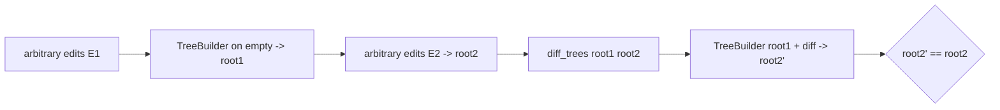

# Code health and testing

The workspace is 47,215 lines of Rust across 14 crates and 338 source
files, with 357 test functions and no continuous integration. The code
follows its own rules (small modules, `thiserror` errors, almost no
`unwrap` outside tests) closely enough that the remaining work is
mechanical: split seven files, add the test kinds that do not exist, and
define the CI that enforces all of it. The invariant to establish: no
change merges without `fmt`, `clippy`, the full test suite and the fuzz
smoke run passing on a hosted runner.

## Current state

### Size and shape

Measured with `wc -l` over `crates/*/src/**/*.rs` and `crates/*/tests`:

| Crate | Files | Lines | `#[test]` in `src` | `#[test]` in `tests/` |
| --- | --- | --- | --- | --- |
| rill-types | 17 | 2,435 | 22 | 0 |
| rill-store | 13 | 2,871 | 24 | 4 |
| rill-core | 37 | 4,130 | 42 | 2 |
| rill-policy | 26 | 3,907 | 57 | 0 |
| rill-proto | 13 | 2,322 | 27 | 0 |
| rill-review | 26 | 3,045 | 22 | 7 |
| rill-lander | 15 | 1,876 | 5 | 10 |
| rill-search | 22 | 2,310 | 27 | 5 |
| rill-exec | 10 | 1,389 | 12 | 0 |
| rill-server | 38 | 7,334 | 15 | 2 |
| rill-sdk | 41 | 6,182 | 7 | 17 |
| rill-cli | 29 | 5,044 | 14 | 10 |
| rill-mcp | 29 | 3,294 | 14 | 6 |
| rill-git-import | 12 | 1,076 | 5 | 1 |
| **Total** | **338** | **47,215** | **293** | **64** |

Integration tests total 5,548 lines in 15 files; the largest are
[grpc_smoke.rs](../../crates/rill-server/tests/grpc_smoke.rs) (697),
[sdk/tests/common/mod.rs](../../crates/rill-sdk/tests/common/mod.rs)
(684, the in-process server fixture) and
[landing.rs](../../crates/rill-lander/tests/landing.rs) (586).

Files over the 400-line limit that [CLAUDE.md](../../CLAUDE.md) sets:

| File | Lines | Contents |
| --- | --- | --- |
| [rill-store/src/repo.rs](../../crates/rill-store/src/repo.rs) | 673 | `Stores`, `RepoStore`: versions, refs/trunk, review, workspaces/operations, intents, derived, ReBAC, misc, plus `encode_record`/`decode_record` |
| [rill-server/src/services/review.rs](../../crates/rill-server/src/services/review.rs) | 551 | 15 RPC handlers and `review_event_proto` |
| [rill-server/src/services/workspace.rs](../../crates/rill-server/src/services/workspace.rs) | 523 | 12 RPC handlers plus `load`/`record`/`base_of` helpers and `workspace_diff` |
| [rill-server/src/services/admin.rs](../../crates/rill-server/src/services/admin.rs) | 469 | 8 handlers, scope/action/subject parsers, `health_components` |
| [rill-proto/src/convert/roundtrip_tests.rs](../../crates/rill-proto/src/convert/roundtrip_tests.rs) | 452 | 12 round-trip tests and fixtures |
| [rill-cli/src/commands/review.rs](../../crates/rill-cli/src/commands/review.rs) | 449 | 10 subcommands and `print_state` |
| [rill-server/src/config.rs](../../crates/rill-server/src/config.rs) | 416 | `ServerConfig` and sections, env override parsing, 3 tests |

[ARCHITECTURE.md](../../docs/ARCHITECTURE.md) already names
`rill-server/src/services/` and `rill-store/src/repo.rs` as the files to
split "when they next change".

### `unwrap`, `expect`, `todo!` inventory

Counted by a script that attributes each `.unwrap()` to the test module
when it appears after the file's `#[cfg(test)]` line or in a `tests.rs`
or `tests/` file:

* 506 `.unwrap()` in total; 434 in test code; 72 before a `#[cfg(test)]`
  marker. Of those 72, 66 are in files that are entirely test code
  ([tokens/tests.rs](../../crates/rill-policy/src/tokens/tests.rs) 29,
  [rebac/tests.rs](../../crates/rill-policy/src/rebac/tests.rs) 16,
  [submit/tests.rs](../../crates/rill-policy/src/submit/tests.rs) 6,
  [review/testing.rs](../../crates/rill-review/src/testing.rs) 8, and
  the `#[cfg(all(test, unix))]` module in
  [sandbox/local.rs](../../crates/rill-exec/src/sandbox/local.rs) 9).
  The production `unwrap` sites are:
  [heuristic.rs:50-59](../../crates/rill-review/src/agents/heuristic.rs)
  (three `LazyLock<Regex>` of static patterns, uncommented) and
  [merge.rs:106](../../crates/rill-types/src/merge.rs) (`into_resolved`,
  guarded by `is_resolved()` one line above, uncommented). Both comply
  with the rule's spirit but not its letter ("a comment proves it cannot
  fail").
* 22 `.expect()` outside test modules, every one with a proof string
  (static regexes, default addresses, "unchanged tree has a base",
  "postcard serialization of in-memory value cannot fail").
* 0 `todo!`, 0 `unimplemented!`, 0 `TODO`/`FIXME`/`XXX` comments (the only
  matches are the heuristic reviewer's own detection regex).
* 7 `panic!`/`unreachable!` outside test files; the one in
  [derive/blame.rs:106](../../crates/rill-core/src/derive/blame.rs) is
  `unreachable!()` with a comment.
* 4 `allow(...)`: `dead_code` on `util/mod.rs`, two
  `clippy::too_many_arguments`, and the generated-code allow in
  `rill-proto/src/lib.rs`.
* 2 `unsafe` blocks, both commented (see
  [16-security-hardening.md](16-security-hardening.md)).

### Dependencies

61 direct dependencies in `[workspace.dependencies]` (excluding the 13
workspace crates); 567 packages in `Cargo.lock`, 550 distinct names.
Heavy subtrees: `gix` (git import), `cedar-policy`, `tonic`/`axum`/
`hyper`, `object_store` with `reqwest`/`rustls` (S3), `redb`,
`biscuit-auth`, `fastcdc`, `imara-diff`, `regex`. `proptest` is a
dev-dependency of `rill-types` only and is not used by any test.
`cargo report future-incompatibilities` lists `proc-macro-error2@2.0.1`
(E0365, via `biscuit-quote`); it compiles with a warning today and will
not compile on a future stable.

### Test kinds present and absent

| Kind | Present | Absent |
| --- | --- | --- |
| Unit (`#[cfg(test)]`) | every crate | — |
| Cross-module (`tests/`) | 10 crates | rill-types, rill-policy, rill-proto, rill-exec |
| Store conformance | [conformance.rs](../../crates/rill-store/tests/conformance.rs) runs memory and local backends through one suite | S3 (needs a mock) and `fdb` (feature-gated, never built in tests) |
| End-to-end gRPC | `grpc_smoke.rs`, SDK `common/mod.rs` fixture | — |
| CLI | [parse.rs](../../crates/rill-cli/tests/parse.rs), [cli_e2e.rs](../../crates/rill-cli/tests/cli_e2e.rs) | snapshot tests of rendered output |
| MCP | [protocol.rs](../../crates/rill-mcp/tests/protocol.rs) | — |
| Property-based | none | merge algebra, diff, tree builder, path history, conflict partition |
| Fuzz | none | every decoder (see 16) |
| Concurrency (`loom`) | none | `LruCache`, `LandQueue`, `DeriveManager::in_flight`, `MemoryMetaStore::transact` |
| Fault injection | none | store errors mid-transaction, lander crash between CAS and `record_landing` |
| Benchmarks | none | see [15-scale-and-performance.md](15-scale-and-performance.md) |
| Doc tests | `cargo test --doc` runs; few examples | — |

### CI and release

There is no `.github/`, no `Makefile`, `justfile`, `deny.toml`,
`rust-toolchain.toml`, `.pre-commit-config.yaml` or release workflow.
`rust-version = "1.85"` is declared. The `fdb` feature is never compiled
anywhere. `cargo clippy --all-targets` and `cargo fmt --check` are rules
in CLAUDE.md that nothing enforces.

### Known defects

Found during review of `rill-core`; each needs a test alongside its fix.

1. `parse_materialized` ([merge/parse.rs](../../crates/rill-core/src/merge/parse.rs))
   has no caller outside `rill-core` (only
   [tests/workflow.rs](../../crates/rill-core/tests/workflow.rs)); SDK
   `Checkout::mark_resolved`
   ([local/checkout.rs:181](../../crates/rill-sdk/src/local/checkout.rs))
   only clears the manifest's `conflict` flag, so a conflict resolved by
   editing markers never round-trips into `Merge` terms.
2. `to_unified` ([diff/unified.rs:11](../../crates/rill-core/src/diff/unified.rs))
   accepts `context` and discards it (`let _ = context;`); its doc comment
   describes behaviour it does not have.
3. `to_unified` renders through `String::from_utf8_lossy`, so unified
   diffs of non-UTF-8 files are not byte-lossless and `apply_unified`
   cannot reproduce them.
4. `CommitGraph::ancestors` ([graph/walk.rs](../../crates/rill-core/src/graph/walk.rs))
   calls `info()` on push and again on pop; the `parents` `DashMap` is
   filled but never read by the log walks; both `DashMap`s are unbounded.
5. `merge_base` returns a single candidate; criss-cross merges get one of
   several best ancestors with no recursive virtual ancestor, so
   three-way merges after a criss-cross may report spurious conflicts.
6. `rebase` ([rebase.rs](../../crates/rill-core/src/rebase.rs)) copies
   `subtree_changes` verbatim without re-validating
   `SubtreeChange::Copy` sources against the new parent.
7. `merge_changes` ([merge/change.rs](../../crates/rill-core/src/merge/change.rs))
   always produces `intent: None` and empty `subtree_changes`.
8. `ChangeBuilder` ([builder.rs](../../crates/rill-core/src/builder.rs))
   validates nothing beyond path syntax; `extra` and `copy_from` have no
   setters, so neither can be populated through the builder.
9. `diff_trees` has no rename detection; `copy_from` is the only rename
   signal and only when a client supplies it. Line diffs use Histogram
   only (`imara-diff`), with no Myers or patience fallback for
   pathological inputs.

## Why it blocks production

* A regression in `fmt`, `clippy` or any test is invisible until someone
  runs it locally; the CLAUDE.md rules are aspirations without CI.
* The `fdb` backend has never been compiled in a test, so the production
  storage target is unverified by the suite that defines backend
  semantics.
* The merge algebra (`Merge::simplify`, add/remove lists) and the
  conflict partition are the correctness core and have only example-based
  tests. A wrong `simplify` silently resolves a conflict; a wrong
  `partition` lands overlapping changes concurrently.
* `LruCache`, `LandQueue` and `DeriveManager::in_flight` are hand-written
  concurrent structures with no model checking; a lost wake-up in
  `in_flight` deadlocks every request for that derive.
* The lander writes trunk by CAS, then `record_landing`, then review
  hooks, then events, with no test of a crash between steps; recovery
  behaviour after such a crash is unknown.
* Defect 1 means the documented "conflicts are data" workflow does not
  work from a checkout: users resolve markers, run `mark_resolved`, and
  the server still holds `FileChange::Conflict`.
* Seven files over the size limit concentrate the gRPC surface where most
  future change lands, so every split is more expensive the later it is
  done.
* The `proc-macro-error2` warning is a time bomb on a toolchain upgrade.

## Requirements

1. A CI workflow runs on every push and pull request: `cargo fmt
   --check`, `cargo clippy --workspace --all-targets --all-features -D
   warnings`, `cargo test --workspace` (including `--features fdb` with a
   FoundationDB service container), `cargo doc -D warnings`, `cargo deny
   check`, and a 10-minute fuzz smoke; all green before merge.
2. No file under `crates/*/src` exceeds 400 lines, enforced by a CI
   check (`tokei`/`wc` script) with an allow-list for generated code.
3. `cargo clippy` with `-D clippy::unwrap_used -D clippy::expect_used`
   on non-test code passes, with `#[allow]` plus a proof comment at each
   remaining site.
4. Property tests cover: `Merge` algebra (simplify idempotent, resolved
   round-trip, term order independence); `materialize`/`parse_materialized`
   round trip; `diff_trees` ⊕ `TreeBuilder` (apply diff to `before`
   yields `after`'s hash); `edit_script` (applying the script to `old`
   yields `new`); `partition` (any two requests in different groups have
   disjoint path closures); `PathHistory` (`history(path)` equals the
   brute-force scan of first-parent versions); `RepoPathBuf` invariants.
5. `loom` models for `LruCache`, `LandQueue::enqueue`/`drain`/`set_status`
   and `DeriveManager::get` (two concurrent callers compute once).
6. Fault-injection tests through a `FailingMetaStore`/`FailingObjectStore`
   wrapper: every `RepoStore` transaction either fully applies or leaves
   the store readable and consistent; a lander crash after
   `land_on_trunk` is recovered on restart (landing record rebuilt from
   `trunk/<repo>/`).
7. Snapshot tests (`insta`) for CLI output of `log`, `status`, `review
   show`, `diff` and for MCP tool schemas; `trycmd` for CLI usage and
   exit codes.
8. Test counts and coverage (`cargo llvm-cov`) are reported per crate;
   line coverage of `rill-types`, `rill-core`, `rill-store` and
   `rill-lander` is at least 85 %, workspace at least 75 %.
9. The nine known defects have regression tests and are fixed.
10. A release process document and workflow produce signed binaries for
    `rill`, `rill-server` and `rill-mcp` on Linux x86_64/aarch64 and macOS
    with a changelog generated from conventional commits.

## Design direction

### Split plan

Each split keeps a `mod.rs` that only declares and re-exports, per
CLAUDE.md.

| File | Split into |
| --- | --- |
| `rill-store/src/repo.rs` | `repo/mod.rs` (`Stores`, `RepoStore` struct, `encode_record`/`decode_record`, `RepoConfig`), `repo/versions.rs` (put/get change versions, log, signatures), `repo/refs.rs` (refs, `land_on_trunk`, trunk queries), `repo/review.rs`, `repo/workspaces.rs` (workspaces + operations), `repo/intents.rs`, `repo/derived.rs` (derived + misc + `get_bytes`), `repo/rebac.rs`. Each ~80-150 lines; the tests move with their methods. |
| `rill-server/src/services/review.rs` | `services/review/mod.rs` (`ReviewSvc`, trait impl delegating), `review/read.rs` (`get_review`, `list_reviews`, `watch_review`, `review_event_proto`), `review/submit.rs` (`submit_for_review`, `evaluate_submit`, `abandon`, `set_stack`), `review/threads.rs` (`comment`, `reply_thread`, `resolve_thread`, `vote`), `review/land.rs` (`request_land`, `get_land_status`). Same pattern as `services/repo/`. |
| `rill-server/src/services/workspace.rs` | `workspace/mod.rs`, `workspace/lifecycle.rs` (create/get/list/delete/set_sparse_profile), `workspace/snapshot.rs` (`snapshot`, `new_change`, `workspace_diff`, `base_of`/`base_root`), `workspace/ops.rs` (`update_base`, `handoff`, `undo`, `list_operations`, `load`/`record`). |
| `rill-server/src/services/admin.rs` | `admin/mod.rs`, `admin/parse.rs` (scope/action/subject/relation/policy-name parsers and their test), `admin/tokens.rs` (`who_am_i`, `issue_token`), `admin/relations.rs`, `admin/policy.rs`, `admin/health.rs` (`health`, `health_components`, used by `/readyz`). |
| `rill-proto/src/convert/roundtrip_tests.rs` | `convert/tests/change.rs`, `tests/review.rs`, `tests/workspace.rs`, `tests/tree.rs`, with shared `wire`/`sample_change_version` in `tests/mod.rs`. Test-only, so lowest priority. |
| `rill-cli/src/commands/review.rs` | `review/mod.rs` (clap enum, `run`), `review/show.rs` (`show`, `list`, `print_state`, `status_text`), `review/act.rs` (`submit`, `vote`, `comment`, `threads`, `resolve_thread`, `evaluate`, `abandon`). |
| `rill-server/src/config.rs` | `config/mod.rs` (`ServerConfig`, sections), `config/env.rs` (`apply_env`, parsers, `parse_static_tokens`), tests split accordingly. |

### Property tests

`proptest` is already a workspace dependency. Strategies live in a
`rill-types::testing` module (behind a `testing` feature) so every crate
shares generators for `RepoPathBuf`, `ContentRef`, `FileChange`,
`ChangeVersion` and `Merge<T>`. The tree property is the valuable one:

Alternatives considered: `quickcheck` (fewer shrinking guarantees) and
hand-written generators (no shrinking). `proptest` with `proptest-state-
machine` for the workspace operation log (apply/undo sequences) is the
recommendation.

### Concurrency and fault injection

`loom` tests behind `#[cfg(loom)]` for the three structures above; they
need `loom::sync::Mutex` behind a type alias in `util/lru.rs` and
`queue.rs`. For the async paths use `tokio::test(start_paused = true)`
with `FailingMetaStore` that fails the *n*th `transact`, parameterised
over *n*, and assert `RepoStore` invariants after each failure point.
Jepsen-style testing of the lander (multiple server processes on one
FoundationDB with injected partitions) belongs after the sequencer
redesign in 15; the single-process assumption makes it premature now.

### Snapshot and CLI tests

`insta` with `assert_snapshot!` on `rill log`, `rill status`, `rill review
show` and `rill diff` outputs against the in-process fixture in
`rill-sdk/tests/common`; `trycmd` for `--help`, usage errors and exit
codes from [exit.rs](../../crates/rill-cli/src/exit.rs). Snapshots are
reviewed in PRs like code.

### CI definition

`.github/workflows/ci.yml`, matrix on `ubuntu-latest` and `macos-latest`,
toolchain pinned by `rust-toolchain.toml` (stable, MSRV job on 1.85):

| Job | Runs |
| --- | --- |
| `check` | `cargo fmt --check`, `cargo clippy --workspace --all-targets --all-features -D warnings`, `cargo doc --no-deps -D warnings`, file-size check |
| `test` | `cargo nextest run --workspace`; `--features fdb` with a `foundationdb/fdb-server` service on Linux |
| `coverage` | `cargo llvm-cov --workspace --lcov`, uploaded; threshold gate |
| `deny` | `cargo deny check`, `cargo audit` |
| `fuzz-smoke` | each fuzz target for 60 s on its seed corpus |
| `bench-smoke` | `cargo bench --no-run` (compiles only); nightly job runs them and posts deltas |
| `future-incompat` | `cargo report future-incompatibilities` must be empty |

`cargo nextest` for per-test process isolation (the local backend tests
create temp dirs and bind ports); `sccache` or `Swatinem/rust-cache` for
build time.

### Release process

`cargo-dist` generates `release.yml`: tag `v*` builds the three binaries
on the matrix, signs with `cosign` keyless, attaches SBOM and SLSA
provenance, publishes a GitHub release with a `git-cliff` changelog.
Versioning: one workspace version (already `0.1.0` in
`[workspace.package]`); the proto package `rill.v1` is the compatibility
contract, with `buf breaking` run in CI against the previous tag once the
API is published.

## Work breakdown

1. **S** `.github/workflows/ci.yml` with `check` and `test` jobs;
   `rust-toolchain.toml`; `Swatinem/rust-cache`. Fix whatever clippy
   finds under `--all-features`.
2. **S** `deny.toml`, `cargo audit`, `future-incompat` job; file-size
   check script; `#[allow]` + proof comments on the five production
   `unwrap`s, then `-D clippy::unwrap_used` for non-test code.
3. **M** Split `repo.rs`, `review.rs`, `workspace.rs`, `admin.rs`,
   `config.rs`, CLI `review.rs`, `roundtrip_tests.rs` (one PR each, no
   behaviour change, tests moved not rewritten).
4. **M** `rill-types::testing` strategies; property tests for `Merge`,
   `RepoPathBuf`, `edit_script`, `materialize`/`parse_materialized`.
5. **M** Tree and history property tests (builder ⊕ diff, `PathHistory`
   vs brute force, `partition` disjointness).
6. **M** Fix and test defects 1-9; wire `parse_materialized` into
   `Checkout::mark_resolved` so resolved markers become `Resolve` RPCs.
7. **M** `FailingMetaStore`/`FailingObjectStore`; transaction atomicity
   and lander crash-recovery tests; FoundationDB service in CI with the
   conformance suite.
8. **M** `loom` models for `LruCache`, `LandQueue`, `DeriveManager`.
9. **S** `insta` snapshots for CLI and MCP schemas; `trycmd` for usage.
10. **S** `cargo llvm-cov` job and thresholds.
11. **M** `cargo-dist` release workflow, `cosign`, SBOM, changelog.
12. **S** Remove `proc-macro-error2` (track `biscuit-quote` upstream;
    `[patch]` if needed) so the `future-incompat` job stays green.

## Risks and open questions

* The FoundationDB CI job needs the `fdb` client library on the runner;
  the official Docker image provides a server but the Rust crate links
  `libfdb_c`. Budget time for the runner image.
* `loom` requires the structures to use `loom` primitives under
  `cfg(loom)`; `DashMap` has no loom variant, so `in_flight` must be
  modelled with a `Mutex<HashMap>` first, which is also arguably the
  simpler implementation.
* Coverage thresholds on async-heavy crates (`rill-server`) undercount
  generated code paths; exclude `rill-proto`'s generated module from the
  gate.
* The split of `services/review.rs` changes nothing observable but
  touches the file the review workflow lives in; schedule it when no
  review feature work is in flight.
* Property tests on `merge_base` will expose defect 5 as failures; decide
  whether to implement recursive merge bases (as in git's `merge-recursive`
  virtual ancestor) or to document the limitation before enabling that
  test in CI.
* `rill-git-import` tests depend on a real git repository fixture
  ([real_git.rs](../../crates/rill-git-import/tests/real_git.rs)); it
  must be vendored or generated in CI, not fetched.

## References

Source:
[CLAUDE.md](../../CLAUDE.md),
[docs/ARCHITECTURE.md](../../docs/ARCHITECTURE.md),
[Cargo.toml](../../Cargo.toml),
[rill-store/src/repo.rs](../../crates/rill-store/src/repo.rs),
[rill-store/tests/conformance.rs](../../crates/rill-store/tests/conformance.rs),
[rill-server/src/services/review.rs](../../crates/rill-server/src/services/review.rs),
[rill-server/src/services/workspace.rs](../../crates/rill-server/src/services/workspace.rs),
[rill-server/src/services/admin.rs](../../crates/rill-server/src/services/admin.rs),
[rill-server/src/config.rs](../../crates/rill-server/src/config.rs),
[rill-cli/src/commands/review.rs](../../crates/rill-cli/src/commands/review.rs),
[rill-proto/src/convert/roundtrip_tests.rs](../../crates/rill-proto/src/convert/roundtrip_tests.rs),
[rill-core/src/merge/parse.rs](../../crates/rill-core/src/merge/parse.rs),
[rill-core/src/diff/unified.rs](../../crates/rill-core/src/diff/unified.rs),
[rill-core/src/graph/walk.rs](../../crates/rill-core/src/graph/walk.rs),
[rill-core/src/graph/commit_graph.rs](../../crates/rill-core/src/graph/commit_graph.rs),
[rill-core/src/rebase.rs](../../crates/rill-core/src/rebase.rs),
[rill-core/src/merge/change.rs](../../crates/rill-core/src/merge/change.rs),
[rill-core/src/builder.rs](../../crates/rill-core/src/builder.rs),
[rill-core/src/util/lru.rs](../../crates/rill-core/src/util/lru.rs),
[rill-core/src/derive/manager.rs](../../crates/rill-core/src/derive/manager.rs),
[rill-lander/src/queue.rs](../../crates/rill-lander/src/queue.rs),
[rill-lander/src/land/pipeline.rs](../../crates/rill-lander/src/land/pipeline.rs),
[rill-sdk/src/local/checkout.rs](../../crates/rill-sdk/src/local/checkout.rs),
[rill-review/src/agents/heuristic.rs](../../crates/rill-review/src/agents/heuristic.rs),
[rill-types/src/merge.rs](../../crates/rill-types/src/merge.rs).

Prior art and tools: `proptest` and `proptest-state-machine`; `loom`;
`insta`, `trycmd`, `assert_cmd`; `cargo-nextest`; `cargo-llvm-cov`;
`cargo-deny`, `cargo-audit`, `cargo-vet`; `cargo-fuzz`; `cargo-dist`,
`git-cliff`, `cosign`, SLSA; `buf breaking`; Jepsen and the FoundationDB
simulation testing approach as the model for later multi-process lander
tests; git's `merge-recursive` virtual ancestor for defect 5; the
Hypothesis/QuickCheck literature on stateful property testing for the
workspace operation log.
